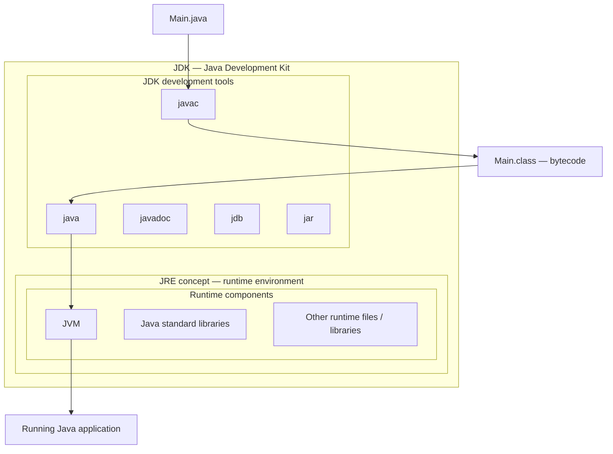
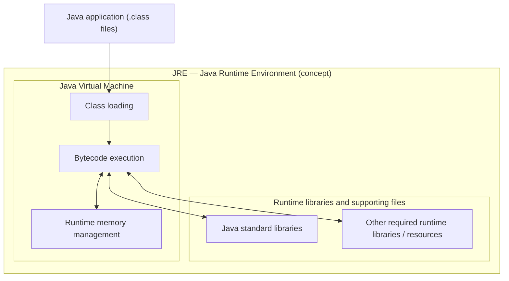
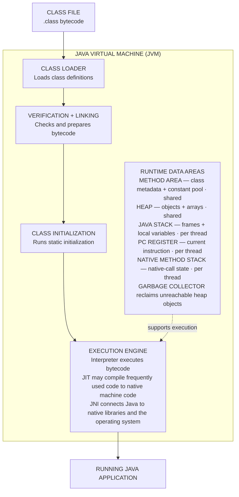

# Chapter 1: Introduction to Java

## 1. What is Java?
Java is a high-level, general-purpose, class-based programming language and platform. Java source code is compiled into bytecode, which a compatible Java Virtual Machine (JVM) executes.

**Example:** A file named `Main.java` can be compiled into `Main.class`; a compatible JVM can then execute that bytecode on Windows, Linux, or macOS.

~~~text
Main.java --javac--> Main.class (bytecode) --JVM--> program runs
~~~

## 2. History of Java
Java began at Sun Microsystems in the early 1990s as part of the Green Project, which explored software for consumer electronic devices. James Gosling was a key designer; Mike Sheridan and Patrick Naughton were also important early contributors. Oak is the best-documented early name; the name was later changed to Java. Sun announced Java publicly in 1995, and Java 1.0 was released on 23 January 1996. Some secondary sources mention GreenTalk and `.gt` in early naming accounts, but accounts of that stage are not consistent, so treat that detail as an uncertain historical report rather than an established fact.

**Naming evolution example:** In a simplified timeline: Green Project → Oak → Java. The name Java is commonly associated with coffee from the Indonesian island of Java; the familiar coffee-cup logo reflects that association.

## 3. Why Java was created
The project sought portability across different devices, reliability, security, and a productive programming environment. C and C++ already existed and remain useful; Java offered a different balance with bytecode, a managed runtime, garbage collection, and a broad standard library. Java avoids explicit pointer arithmetic and direct memory-address manipulation in ordinary application code, reducing some memory-corruption risks without eliminating every security or memory-management problem.

**Example:** In Java, a developer normally works with object references such as `Dog pet = new Dog();` rather than manually moving a pointer through memory as in C.

## 4. Features
- Object-oriented programming with classes, objects, encapsulation, inheritance, and polymorphism.
- Platform portability through bytecode and compatible JVMs.
- Automatic garbage collection for managed objects.
- Strong compile-time type checking and runtime checks.
- Built-in support for threads and concurrency APIs.
- Networking and extensive standard libraries.
- Runtime class loading and JIT optimization.
These features reduce some risks but do not make programs automatically bug-free, secure, or faster in every situation.

**Example:** A Java server can handle requests with threads, use JDBC to access a database, and rely on garbage collection to reclaim unreachable objects.

## 5. Applications
Java is used for backend services, enterprise systems, APIs, Android codebases, desktop applications, data processing, cloud services, developer tools, and some embedded environments. Java itself is not a database; Java programs can connect to databases using drivers and APIs.

**Example:** A banking application may use Java for business rules, an HTTP API to communicate with a browser, and a relational database to store accounts and transactions.

## 6. Java editions
- Java SE: core language and standard libraries for general-purpose development.
- Jakarta EE: specifications and APIs for enterprise and server applications. It was formerly Java EE; many migrated APIs use the jakarta.* namespace.
- Java ME: technologies for certain constrained or embedded devices.
They serve different needs and are not interchangeable labels.

**Example:** A command-line calculator typically needs Java SE; an enterprise server may use Jakarta EE APIs; a constrained embedded device may use Java ME where supported.

## 7. Java versions, release history, and what changed

Java version numbers tell you which language, library, JVM, and tooling features became available. Java 8, 11, 17, 21, and 25 are widely used LTS releases; LTS means a vendor offers a longer support window, not that every vendor has identical dates or terms. Since Java 9, feature releases have generally arrived every six months. A newer Java can run older bytecode in many cases, but compatibility is not automatic in every situation: removed APIs, changed defaults, dependencies, and build settings can matter.

### Major milestones

| Release | Date | Important additions or changes (highlights, not every change) |
|---|---|---|
| Java 1.0 | Jan 1996 | First public production release; core language/runtime and standard APIs. |
| Java 1.1 | Feb 1997 | Inner classes, JavaBeans-related support, JDBC and RMI APIs. |
| Java 2 / Java 1.2 | Dec 1998 | Collections framework, Swing, major standard-library and JVM improvements. |
| Java 5 (1.5) | Sep 2004 | Generics, annotations, enums, enhanced for-loop, autoboxing/unboxing, varargs, concurrency utilities. |
| Java 6 | Dec 2006 | Library/tooling improvements, scripting support, compiler APIs; no major new syntax headline. |
| Java 7 | Jul 2011 | try-with-resources, diamond operator `<>`, multi-catch, strings in `switch`, binary literals and numeric underscores, NIO.2. |
| Java 8 (LTS for many vendors) | Mar 2014 | Lambda expressions, method references, streams, functional interfaces, default methods, and the `java.time` date/time API. |
| Java 9 | Sep 2017 | Java Platform Module System (JPMS), JShell, collection factory methods, and improved process/API support. |
| Java 10 | Mar 2018 | Local-variable type inference with `var` (for eligible local variables; not a dynamic type). |
| Java 11 (LTS for many vendors) | Sep 2018 | Standardized HTTP Client API, single-file source launch, new String/file methods, and removal of some older Java EE/CORBA modules from the JDK. |
| Java 12–13 | 2019 | Switch expressions and text blocks appeared as preview features; previews were not yet final features. |
| Java 14 | Mar 2020 | Switch expressions became final; helpful NullPointerException messages; records appeared as preview. |
| Java 15 | Sep 2020 | Text blocks became final; sealed classes and records continued through preview stages. |
| Java 16 | Mar 2021 | Records became final; pattern matching for `instanceof` became final; `jpackage` became a standard tool. |
| Java 17 (LTS) | Sep 2021 | Sealed classes became final; strong encapsulation of JDK internals; pattern matching for switch remained preview. |
| Java 18 | Mar 2022 | UTF-8 became the default charset; simple web server tool; `@snippet` support for documentation. |
| Java 19–20 | 2022–2023 | Virtual threads, structured concurrency, and some pattern-matching work were preview/incubator features—not all final yet. |
| Java 21 (LTS) | Sep 2023 | Virtual threads, record patterns, pattern matching for switch, and sequenced collections became final; string templates were preview at this release. |
| Java 22–24 | 2024–2025 | Foreign Function & Memory API became final in Java 22; continued work on language previews, performance, garbage collection, and developer tools. Check each JEP/release notes for the exact status of a feature in a specific release. |
| Java 25 (LTS) | Sep 2025 | Current LTS generation as of this note; includes compact source files and instance main methods as final features, plus other language, library, runtime, and performance changes. Exact support periods depend on the vendor. |

**Important:** this is a learning timeline of selected headline changes, not a complete list of every API or bug fix. A feature marked *preview* or *incubator* was experimental and could require special flags; it should not be treated as a normal finalized language feature for that release.

### LTS versus non-LTS

- **LTS:** a vendor-supported long-term baseline that organizations often choose for production, such as Java 8, 11, 17, 21, or 25.
- **Non-LTS / interim feature release:** delivers newer features sooner, but typically has a shorter support window.
- Oracle's support policy and the policies of OpenJDK distributors such as Eclipse Temurin can differ. Always check the exact vendor, build, and support policy rather than assuming a universal end-of-support date.
- For a new learning project, use a currently supported JDK such as 25 LTS if your IDE and course setup support it. If a course or project specifically targets Java 17 or 21, use that version for consistency.

### Check the Java version installed on your computer

~~~bash
java -version
javac -version
~~~

- `java -version` reports the runtime/launcher version selected by your PATH.
- `javac -version` reports the compiler version selected by your PATH.
- They should normally come from the JDK you intend to use. On Windows, `where java` and `where javac` help identify which executable is being used.
- In Eclipse, also check **Window > Preferences > Java > Installed JREs** (the exact menu can vary by version) and the project's **Java Compiler** settings. The command-line JDK and Eclipse project compliance level can differ.

### Why version matters in practice

For example, records became a final feature in Java 16, and virtual threads became final in Java 21. Code using either feature will not compile on older language levels that do not support it. In Eclipse, a project set to Java 17 can reject newer syntax even if a newer JDK is installed. Set the project's JRE/JDK and compiler compliance level intentionally, and check library/deployment compatibility before upgrading.

**Example:** Code using local-variable type inference with `var` needs Java 10 or later as its source level; a project configured for Java 8 will reject that syntax.

## 8. Install and verify the JDK
For development, install a JDK, which includes the compiler and runtime components. Common distributions include Eclipse Temurin, Oracle JDK, and Amazon Corretto. On Windows, if a command is not found, locate the actual JDK installation and check whether its bin directory is on PATH, then open a new terminal. You have already installed Eclipse Temurin and verified both commands, so you can continue to the examples.

Useful Windows checks:

~~~bat
where java
where javac
~~~

On macOS or Linux, use `which java` and `which javac`.

**Example:** `javac -version` should print a compiler version. If the command is not found, verify the JDK installation and PATH rather than installing only a runtime.

## 9. IDE and command line
An IDE such as Eclipse combines a code editor, project/build tools, run controls, debugger, and console. The editor is where you write code; the compiler translates source; the launcher starts the program; the console displays output and diagnostics. Eclipse may compile automatically when you save, depending on settings.

In Eclipse: open the Java project, open or create a class under the source folder, write code, save, choose Run As > Java Application, and read the Console.

**Example:** Create `Main.java`, add a `main` method that prints `Hello`, save, then select **Run As → Java Application**. The Console should display `Hello`.

## 10. Structure of a Java program
Create a file named Main.java:

~~~java
public class Main {
    public static void main(String[] args) {
        System.out.println("Hello, Java!");
    }
}
~~~

- public class Main declares a class named Main.
- The public top-level class name should match the filename, including capitalization.
- main is the entry-point method for this basic application.
- public controls access; static means the method can be called without creating a Main object; void means it returns no value.
- String[] args holds command-line arguments as strings.
- System.out.println prints text and moves to a new line.
- Java is case-sensitive, braces delimit blocks, and statements commonly end with semicolons.
- // starts a single-line comment; /* ... */ is a block comment.

## 11. First program: editor → compiler → output

<!-- INLINE_JAVA_EDITOR -->

This section deliberately shows the complete path from the editor where you type code, to the compiler that translates it, to the console where you see the result. The code block below represents what you type in Eclipse's Java editor; the command and console blocks show the build and output.

### A. Editor: write and save `Main.java`

In Eclipse, open your Java project, create a class named `Main` in the source folder, and type this code into the editor:

~~~java
public class Main {
    public static void main(String[] args) {
        System.out.println("Hello, Java!");
    }
}
~~~

Save the file. The filename must be `Main.java` because the public class is named `Main`.

### B. Compiler: translate the source code

**Command-line compiler:** open a terminal in the folder containing `Main.java` and run:

~~~bash
javac Main.java
~~~

If compilation succeeds, `javac` normally prints no success message. It creates `Main.class`, containing bytecode. If there is a syntax error, the compiler prints a diagnostic and you must fix the source before running it.

**In Eclipse:** save the file. Eclipse usually compiles automatically when *Project > Build Automatically* is enabled. Click **Run As > Java Application** to run the class; you generally do not need to type `javac` manually inside Eclipse.

### C. Output: run the compiled class

From the same terminal, run:

~~~bash
java Main
~~~

The console should show:

~~~text
Hello, Java!
~~~

The flow is:

~~~text
Eclipse editor: Main.java
        |
        | save / compile
        v
Compiler: javac Main.java
        |
        v
Compiled bytecode: Main.class
        |
        | run with java Main
        v
Console output: Hello, Java!
~~~

### D. Change the code and compare the output

Return to the editor and change only the text inside `println`:

~~~java
public class Main {
    public static void main(String[] args) {
        System.out.println("I am learning Java!");
    }
}
~~~

Save the changed source file. In a terminal, compile and run again:

~~~bash
javac Main.java
java Main
~~~

**New console output:**

~~~text
I am learning Java!
~~~

**Before:** `Hello, Java!`  
**After:** `I am learning Java!`

The output changes because the source code changed and the updated source was compiled and executed. If you change `Main.java` but run without rebuilding, the `.class` file can still contain the previous compiled program.

### E. What each part does

- **Editor (Eclipse):** where you write and edit `Main.java`; syntax highlighting and error markers help you spot mistakes.
- **Compiler (`javac`):** checks source code and translates valid code into bytecode in `.class` files.
- **Launcher (`java`):** starts the Java Virtual Machine to execute the class.
- **Console / output panel:** displays text printed by your program and any runtime messages.
- **Eclipse Console:** shows the program output after you use **Run As > Java Application**. The exact panels and menu wording may vary slightly by Eclipse version.
<!-- INLINE_JAVA_EDITOR -->

## 12. Compilation and execution
Compilation and execution are separate steps. javac Main.java compiles source code. java Main launches the compiled class; omit the .class extension. An IDE can automate these steps, but understanding them helps you diagnose problems.

Example with a deliberate error (missing semicolon):

~~~java
System.out.println("Hello, Java!")
~~~

The compiler reports a syntax error. Correct it to:

~~~java
System.out.println("Hello, Java!");
~~~

Save and compile again. Exact diagnostic wording depends on the JDK.

## 13. Bytecode
Bytecode is the intermediate instruction format normally stored in .class files. The JVM loads and verifies classes, then interprets bytecode and may JIT-compile frequently executed code into native machine instructions. Bytecode supports portability, but platform-specific paths, native libraries, and external dependencies can still affect portability.

## 14. JDK, JRE, JVM
- JVM: loads, verifies, and executes bytecode.
- JRE: conceptual runtime environment containing a JVM and runtime libraries; modern distributions do not always ship a separate general-purpose JRE download.
- JDK: development kit containing tools such as javac plus runtime components.
Memory aid: JDK for development, JRE as the runtime concept, JVM for executing bytecode.

### Blueprint 1 — JDK (Java Development Kit): overall structure

This is the outer-container view from your notebook: the JDK provides development tools as well as the runtime components needed to run Java programs.



- **JDK:** the complete development kit, including tools and runtime components.
- **JRE concept:** the runtime environment needed by a Java application.
- **Important modern note:** this nested drawing is conceptual. Current JDK distributions usually include a runtime image; they do not necessarily contain a separately installable JRE folder or every tool shown in the diagram.

### Blueprint 2 — JRE (Java Runtime Environment): runtime structure

This is the separate runtime-only view. It focuses on the components used when running an already-compiled Java application.



The JRE does **not** include the Java source compiler `javac` as part of its runtime role. It provides what an application needs to run. A separate JRE download is not offered by every modern Java distribution, so this is a conceptual blueprint.

### Blueprint 3 — JVM (Java Virtual Machine): internal architecture

This single JVM flowchart shows the class-file path, runtime data areas, and execution engine together. Runtime data areas support execution; they are not compile-time stages.



#### What the JVM does

1. **Load class files:** the class loader loads class definitions when needed.
2. **Verify and link:** bytecode verification checks structural and type-safety rules; linking also includes preparation and resolution.
3. **Initialize classes:** static initialization runs when required.
4. **Allocate and manage runtime memory:** the JVM uses runtime data areas for class information, objects, method calls, and thread state.
5. **Execute bytecode:** the interpreter executes bytecode; a **Just-In-Time (JIT) compiler** may compile frequently executed (“hot”) code into native machine code.
6. **Collect unreachable objects:** the garbage collector can reclaim heap memory used by objects that are no longer reachable.
7. **Call native code when needed:** JNI connects Java code with native libraries.

#### Runtime memory areas — what each area means

| Area | Purpose | Sharing |
|---|---|---|
| **Method area** | Class-level structures, method metadata, and runtime constant pool. It is a specification concept; implementations can organize it differently. | Shared |
| **Heap** | Stores objects and arrays; this is the main area managed by garbage collection. | Shared |
| **Java stack** | Holds stack frames for method calls, including local variables and intermediate computations. | One per thread |
| **PC register** | Tracks the current JVM instruction for a thread; its value is undefined while that thread executes a native method. | One per thread |
| **Native method stack** | Supports native-method execution; details depend on the JVM implementation. | Typically per thread / implementation-dependent |

**Memory allocation correction:** primitive local variables and references may be stored in a stack frame, while objects and arrays are typically allocated on the heap. This is a useful learning model; JVM optimizations can change physical allocation details.

#### Execution engine

- **Interpreter:** starts executing bytecode without first compiling all of it to native code.
- **JIT compiler:** compiles frequently executed code to native machine code for better performance.
- **Garbage collector:** reclaims heap memory from unreachable objects; it does not simply clear every memory area.
- **JNI and native libraries:** provide access to platform-specific code, which can affect portability.

The precise implementation varies across JVMs. The flowchart explains the main concepts rather than promising an identical internal layout in every Java implementation.

### How the three relate

```text
JDK = development tools + runtime components
JRE = runtime libraries + JVM + supporting files (conceptual)
JVM = loads, verifies, and executes bytecode
```

### Example workflow

```bash
javac Main.java
java Main
```

1. `javac Main.java` uses the JDK compiler to produce `Main.class` if compilation succeeds.
2. `java Main` launches the program using a JVM and the required runtime libraries.
3. The program's output appears in the console.

The JVM does not normally compile `.java` source directly in this workflow; `javac` compiles source code into bytecode first.

## 15. .java and .class files
- Main.java contains human-readable source code.
- Main.class contains compiled bytecode.
After compiling, list files with dir on Windows or ls on macOS/Linux. Do not edit the .class file as if it were source; edit the .java file and recompile.

## 16. Compiler and launcher
~~~bash
javac Main.java
java Main
~~~

javac compiles the source file; java launches the class named Main. If javac is not found, check that a JDK is installed and its bin directory is discoverable. If the main class cannot be found, confirm you are in the correct directory and that Main.class exists.

## 17. Write Once, Run Anywhere
The same compiled bytecode can run on different platforms when each has a compatible JVM and the required libraries. This is the goal behind Java's WORA phrase, not a guarantee that every program is free of operating-system-specific assumptions.

**Example:** `Main.class` can generally run on Windows and Linux if both systems have a compatible Java runtime and the application does not depend on OS-specific files or native libraries.

## 18. Workflow
1. Understand the task.
2. Create a project or source file.
3. Write and save code.
4. Compile or build.
5. Read and fix errors.
6. Run the program.
7. Compare output with expectations.
8. Change code and repeat.
9. Test normal, boundary, and invalid inputs.

~~~text
Plan -> Edit -> Save -> Compile -> Fix errors
                           |
                           v
                    Run -> Check output
                           |
                           v
                    Modify and repeat
~~~

## 19. Common errors
- javac is not recognized: verify JDK installation and PATH; open a new terminal after changes.
- Public class/file mismatch: rename the file or class so names match.
- ';' expected: inspect the indicated line and nearby lines for a missing semicolon or syntax issue.
- Could not find or load main class: check current directory, classpath, compilation result, and class name.
- Main method not found: use public static void main(String[] args) for this example.
- Old output appears: save and rebuild, and ensure the correct class/project is running.
- Eclipse errors: inspect capitalization, braces, semicolons, selected JDK, and the Problems/Console views.

## 20. Quick revision
- Java started at Sun Microsystems; the Green Project explored consumer-device software.
- Oak is the best-documented early name; Java was announced in 1995 and Java 1.0 released in 1996.
- Source file: .java. Compiled bytecode file: .class.
- javac compiles; java launches; JVM executes bytecode.
- JDK supplies development tools; JRE is the runtime concept.
- Java's portability depends on compatible runtimes and dependencies.

## Interview questions and answers

### 1. Why does Java eliminate explicit pointers?

Java does not expose C-style pointers or pointer arithmetic to ordinary application code. Instead, reference variables hold managed references to objects. This reduces risks such as arbitrary memory access, pointer arithmetic errors, and many memory-corruption bugs. Java still uses references, and problems such as \`NullPointerException\`, resource leaks, and unsafe native-code issues remain possible.

**Example:**
\`\`\`java
String language = "Java";
System.out.println(language.length());
\`\`\`

### 2. What is the difference between a \`.class\` file and an \`.exe\` file?

A Java \`.class\` file normally contains JVM bytecode and requires a compatible Java runtime. A Windows \`.exe\` file is a native executable or launcher format understood by Windows; it may contain machine code, packaged runtime components, or launch another program. The formats are not directly interchangeable.

**Example:** Compile \`Main.java\` with \`javac Main.java\` to create \`Main.class\`, then run it with \`java Main\`. You do not run it as \`Main.exe\`.

### 3. Why does Java not support standalone functions?

In Java, executable methods are declared inside a class, interface, enum, or record; Java does not provide free-standing functions at the top level. A method can be an instance method or a static method. This design associates behavior with a type, while static methods can still be called without creating an object.

**Example:**
\`\`\`java
class Calculator {
    static int add(int a, int b) {
        return a + b;
    }
}
// Call: Calculator.add(2, 3)
\`\`\`

### 4. What is the difference between a function and a method?

A **function** is a general term for a callable unit of code. A **method** is a callable unit declared as a member of a type. Languages such as C allow functions outside classes; Java expresses ordinary declared behavior through methods.

**Example:** \`Calculator.add(2, 3)\` calls the static method \`add\` declared inside \`Calculator\`.

### 5. Who allocates memory in Java?

The JVM manages memory for a Java program. When code evaluates \`new\`, the runtime allocates storage for the object, typically on the heap, and runs its constructor. Method-call frames and local variables are commonly associated with each thread's JVM stack, although implementation details can vary. The garbage collector may reclaim heap memory when objects are no longer reachable; it does not replace closing files or sockets.

**Example:**
\`\`\`java
Dog pet = new Dog(); // the JVM allocates and initializes a Dog object
\`\`\`

### 6. Does Java have global variables? If not, why?

Java has no variables declared at the top level outside a type. A class can declare a \`static\` field, which belongs to the class and is accessible according to its access rules. Use mutable static state carefully because it can make testing and concurrency harder.

**Example:**
\`\`\`java
class AppConfig {
    static final int MAX_RETRIES = 3;
}
\`\`\`

### 7. Why is the \`main\` method static?

In the traditional Java application entry point, the launcher needs to invoke \`main\` before an application object exists. Making it \`static\` allows it to be called on the class without first constructing an instance.

**Example:**
\`\`\`java
public class Main {
    public static void main(String[] args) {
        System.out.println("Program started");
    }
}
\`\`\`

The standard entry-point form used in this course is \`public static void main(String[] args)\`. Newer Java releases also provide other launch forms, but this classic form remains widely used and important for interviews.

## Practical exercises

Try these without copying a finished solution first:

1. Write a \`Main\` class that prints your name, target job role, and three reasons you are learning Java.
2. Compile a class with \`javac\`, list the generated files, and explain what the \`.java\` and \`.class\` files contain.
3. Run the same \`.class\` file on another machine or operating system with a compatible runtime, if available. Record the environment assumptions.
4. Create a \`Calculator\` class with static \`add\`, \`subtract\`, and \`multiply\` methods, then call them from \`main\`.
5. Create a \`Student\` class and instantiate two objects. Add one instance field and one static field; observe which values are shared.
6. Deliberately remove a semicolon and change the public class name without changing the filename. Read the compiler errors, then fix both problems.
7. Explain the path from source code to bytecode to execution in your own words, and draw the steps in a diagram.

## 21. Practice questions
1. Define Java.
2. What was the Green Project?
3. What early name is best documented in Java's history?
4. When was Java announced and when was Java 1.0 released?
5. Why was Java created when C and C++ already existed?
6. Explain five Java features.
7. Compare Java SE, Jakarta EE, and Java ME.
8. What does LTS mean?
9. Explain JDK, JRE, and JVM.
10. What is bytecode?
11. Differentiate .java and .class files.
12. What do javac and java do?
13. Why might output not change after editing source?
14. Create a program that prints your name.
15. Remove a semicolon, observe the compiler error, fix it, and compile again.
16. Run `java -version` and `javac -version` and record the versions.
17. Explain why Java references are not the same as directly manipulable C-style pointers.
18. Compare a Java `.class` file with a Windows `.exe` file.
19. Explain why the classic `main` method is static.

## Further reading
- Oracle, A Brief History of Java: https://education.oracle.com/file/general/4955_BriefHistoryOfJava_7.pdf
- JVM Specification: https://docs.oracle.com/en/java/javase/26/docs/specs/jvms/jvms-1.html
- Oracle Java: https://www.oracle.com/java/
- Eclipse IDE: https://eclipseide.org/
- Eclipse Temurin: https://adoptium.net/

---
End of Chapter 1. All chapter notes and the guided code workflow are collected in this single Markdown file.
