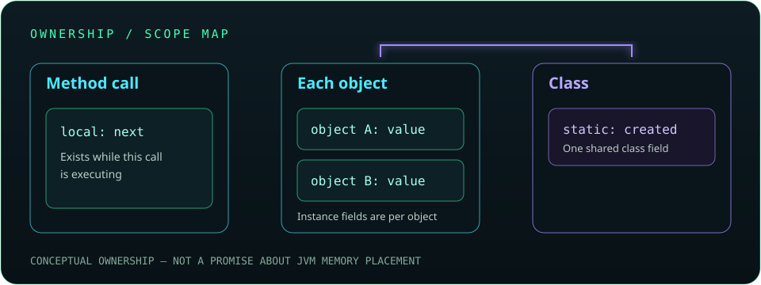
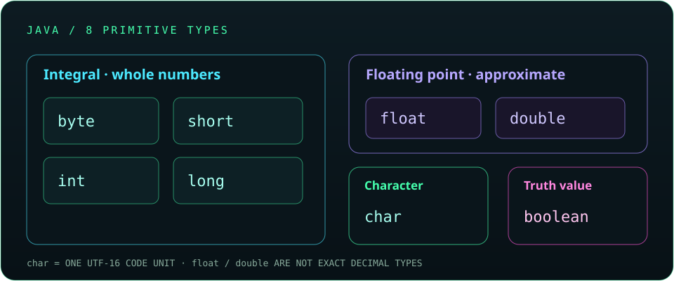
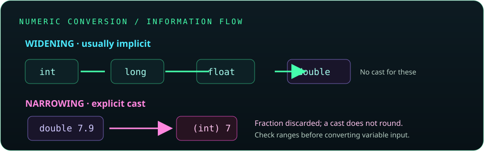
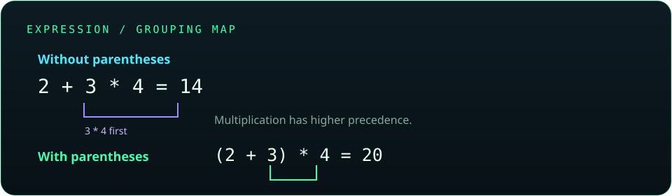

# Chapter 2: Variables, Data Types, and Operators

Variables give names to values, data types describe which values a variable can hold, and operators let a program work with those values. Together, these ideas are the building blocks for calculations, decisions, and input in Java.

## 17. Variables

A variable is a named place in a program that refers to a value. Every Java variable has a declared type, a name, and a scope that determines where its name can be used. A variable's value may change when the variable is not `final`.

```java
int score = 85;
score = 92;
System.out.println(score); // 92
```

`score` is an `int` variable. Reassigning it changes the value used by later statements; it does not change the variable's type.

**Key takeaway:** A variable has a type and a name; assignment updates its value.

## 18. Variable declaration and initialization

Declaration introduces a variable and its type. Initialization gives it its first value. These can happen on the same line or separately. A local variable must be definitely assigned before Java lets the program read it.

```java
int quantity;          // declaration
quantity = 3;           // initialization
int price = 12;         // declaration and initialization together
int total = quantity * price;
```

Fields are different: Java supplies default values to fields (`0`, `false`, or `null`, depending on type). Do not rely on defaults for local variables; assign them explicitly.

**Key takeaway:** Initialize local variables before reading them.

## 19. Dynamic initialization

An initializer does not have to be a literal. It can be an expression calculated from other values when the statement runs. This is often called dynamic initialization in introductory Java courses.

```java
int width = 8;
int height = 5;
int area = width * height;
int nextArea = area + width;
System.out.println(nextArea); // 48
```

The expressions use values available at that point in the program. If an input or an earlier variable changes, a later calculation can produce a different result.

**Key takeaway:** An initializer can be a calculation, a method result, or another expression—not just a fixed literal.

## 20. Scope and lifetime of variables

**Scope** is the region of source code in which a variable name is accessible. **Lifetime** is how long that variable's value exists during program execution. These ideas are related but not identical: a name can go out of scope while an object it referred to remains reachable elsewhere.

```java
int outer = 10;
if (outer > 0) {
    int inner = 4;
    System.out.println(outer + inner); // both names are in scope
}
// inner is out of scope here
```

The braces define a block. `outer` is declared in the surrounding block, so the inner block can use it. `inner` is declared inside the `if` block, so code after that block cannot use its name.

**Key takeaway:** A variable is usable only within its scope; its lifetime describes runtime existence.

## 21. Local, instance, and static variables

Java variables are commonly described by where they are declared:

- **Local variables** are declared inside a method, constructor, or block. Their scope is limited to that region, and they must be initialized before use.
- **Instance fields** are declared in a class outside its methods, without `static`. Each object has its own field values. Fields receive default values if no initializer is supplied.
- **Static fields** are declared with `static`. They belong to the class and are shared by its instances.

```java
class Counter {
    static int created; // shared by the class
    int value;          // separate for each object

    Counter(int start) {
        value = start;
        created++;
    }

    void printNext() {
        int next = value + 1; // local variable
        System.out.println(next);
    }
}
```

`value` belongs to one `Counter` object; `created` is shared. `next` exists only while `printNext` executes. Static fields are often used for class-wide constants or genuinely shared state; mutable shared state needs careful coordination in concurrent programs.

**Key takeaway:** Choose a variable's location based on who should own and access its value.



## 22. Constants and the `final` keyword

The `final` modifier prevents a variable from being assigned again after it has been initialized. A `static final` field is commonly used for a constant shared by a class. By convention, constant names use uppercase words separated by underscores.

```java
class Circle {
    static final double PI = 3.141592653589793;

    double area(double radius) {
        final double squaredRadius = radius * radius;
        return PI * squaredRadius;
    }
}
```

A `final` reference cannot be made to refer to a different object, but the referenced object's contents may still change if that object is mutable.

```java
final StringBuilder name = new StringBuilder("Java");
name.append(" SE"); // allowed: the object changes
// name = new StringBuilder("Other"); // not allowed: reassignment
```

**Key takeaway:** `final` prevents reassignment; it does not automatically make a referenced object immutable.

## 23. Primitive data types

Java has eight primitive types. They store simple values directly rather than references to objects.

| Type | Typical use | Example |
|---|---|---|
| `byte` | Small signed whole numbers | `byte level = 7;` |
| `short` | Short-range signed whole numbers | `short year = 2026;` |
| `int` | General-purpose whole numbers | `int population = 120_000;` |
| `long` | Larger whole numbers | `long distance = 5_000_000_000L;` |
| `float` | Single-precision decimal approximation | `float ratio = 0.75F;` |
| `double` | Double-precision decimal approximation | `double average = 82.5;` |
| `char` | One UTF-16 code unit | `char initial = 'J';` |
| `boolean` | `true` or `false` | `boolean ready = true;` |

Integer types are signed. `int` is the usual choice for whole-number calculations; use `long` when the possible range exceeds `int`. `float` and `double` represent approximate binary floating-point values, so they are not suitable for every exact-decimal use. `char` is not a general-purpose Unicode grapheme type: some visible characters require more than one UTF-16 code unit.

```java
int count = 4;
long largeCount = 4_000_000_000L;
double temperature = 21.5;
boolean passed = count > 0;
```

**Key takeaway:** Choose a primitive type for its range and meaning, and remember that floating-point values are approximate.



## 24. Reference data types

A reference variable holds a reference to an object or the special value `null`; it does not contain the object's entire data. Classes, arrays, interfaces, and enums are reference types. Multiple variables can refer to the same object.

```java
String first = new String("Java");
String second = first;
second = second.toUpperCase();

System.out.println(first);  // Java
System.out.println(second); // JAVA
```

Strings are immutable, so `toUpperCase()` creates a result rather than changing the original string. With a mutable object, changes through one reference can be observed through another reference to that same object. Dereferencing `null` causes a `NullPointerException`.

```java
String name = null;
// System.out.println(name.length()); // throws NullPointerException
```

**Key takeaway:** Primitive variables hold primitive values; reference variables refer to objects and may also be `null`.

## 25. Literals

A literal is a value written directly in source code. Java supports integer, floating-point, character, string, boolean, and null literals.

```java
int million = 1_000_000;       // integer literal with digit separators
long population = 8_000_000_000L;
double fraction = 0.125;
float scale = 1.5F;
char newline = '\n';
String message = "Hello, Java";
boolean enabled = true;
String missing = null;
```

Digit separators (`_`) improve readability and do not change a number's value. Integer literals are `int` by default unless written with `L`; decimal literals are `double` by default unless written with `F`. A `char` literal uses single quotes and represents one UTF-16 code unit, while a `String` uses double quotes.

**Key takeaway:** Literal spelling affects its type; add `L` or `F` when the intended numeric type requires it.

## 26. Type conversion

Type conversion changes a value from one type to another. A conversion may be automatic when Java defines a safe widening conversion, or explicit when information could be lost. Converting a reference type uses different rules from converting primitives; this chapter focuses on primitive numeric conversions.

```java
int whole = 7;
double approximate = whole;       // int widens to double
double measurement = 7.9;
int truncated = (int) measurement; // explicit narrowing: 7
```

The cast truncates the fractional part; it does not round to the nearest integer. Narrowing an out-of-range value can also produce a surprising result. Conversion to `boolean` is not allowed in Java.



**Key takeaway:** Before converting, ask whether the target type can represent the source value without losing information.

## 27. Implicit type casting

An implicit conversion happens automatically when a value is assigned or passed to a compatible wider type. For example, an `int` can be widened to a `long` or `double` without a cast. Widening from an integer to a floating-point type can still lose precision for sufficiently large values.

```java
int items = 12;
long totalItems = items; // widening: no cast needed

float approximate = items; // int can widen to float
double precise = approximate; // float can widen to double
```

Java does not implicitly narrow a value in an assignment:

```java
double reading = 4.8;
// int count = reading; // compile-time error: narrowing requires an explicit cast
```

**Key takeaway:** Widening conversions usually need no cast, but a wider destination does not guarantee perfect precision for every numeric type.

## 28. Explicit type casting

An explicit cast tells Java to convert a value even when the conversion may discard information. The programmer is responsible for checking whether the result is meaningful.

```java
double price = 19.99;
int wholeDollars = (int) price; // 19; fractional part is discarded

int codePoint = 65;
char letter = (char) codePoint;
System.out.println(letter); // A
```

Casting does not round `19.99` to `20`. For an out-of-range integer conversion, high-order bits can be discarded; for a floating-point value outside the integer range, the result is limited by Java's conversion rules. Check or validate ranges before narrowing when the input may vary.

```java
long count = 2_000_000_000L;
if (count <= Integer.MAX_VALUE && count >= Integer.MIN_VALUE) {
    int safeCount = (int) count;
    System.out.println(safeCount);
}
```

**Key takeaway:** A cast permits a conversion; it does not make a lossy conversion safe.

## 29. Type promotion

Java promotes small integral operands such as `byte`, `short`, and `char` to `int` for most arithmetic operations. If an expression combines different numeric types, the operands are generally promoted to a common wider type before the operation. The expression's result type can therefore differ from the variables used to calculate it.

```java
byte left = 10;
byte right = 20;
int sum = left + right; // operands are promoted to int
// byte smallSum = left + right; // compile-time error without a cast
byte smallSum = (byte) (left + right);
```

Integer arithmetic can overflow before assignment to a wider destination:

```java
int a = 1_500_000_000;
int b = 1_500_000_000;
long wrong = a + b;          // addition overflows as int first
long correct = (long) a + b; // promote before addition
```

**Key takeaway:** Check the type of the whole expression, not only the type of the destination variable.

## 30. Operators

An operator performs an operation on one or more operands. Java groups operators by purpose: arithmetic, comparison, logical, assignment, unary, bitwise, and shift operators. Some operators require numeric operands, while logical operators require boolean values.

```java
int remaining = 10 - 3;        // arithmetic
boolean enough = remaining >= 5; // comparison
boolean canContinue = enough && true; // logical
```

An expression combines values, variables, method calls, and operators. Parentheses make the intended grouping clearer; use them when they improve readability even if precedence already determines the same result.

**Key takeaway:** Know each operator's operand types and result type before combining operators in an expression.

## 31. Arithmetic operators

The arithmetic operators are `+`, `-`, `*`, `/`, and `%`. Integer division discards the fractional part toward zero. The remainder operator `%` gives the remainder after division and can be useful for divisibility checks.

```java
int quotient = 17 / 5;  // 3
int remainder = 17 % 5; // 2
double precise = 17.0 / 5; // 3.4

boolean isEven = 18 % 2 == 0;
```

Integer division by zero throws `ArithmeticException`. Floating-point division by zero follows floating-point rules and may produce infinity or `NaN` instead. Integer arithmetic can overflow without throwing an exception.

**Key takeaway:** Use a floating-point operand when fractional division is intended, and check integer divisors before dividing.

## 32. Relational operators

Relational operators compare numeric values: `<`, `<=`, `>`, and `>=`. Equality operators `==` and `!=` also compare primitive values. A comparison expression evaluates to a boolean.

```java
int age = 20;
boolean adult = age >= 18;
boolean sameNumber = 5 == 5; // true
```

For reference variables, `==` checks whether both references identify the same object, not whether two objects have equal contents. Use `.equals()` for logical equality when the class defines it appropriately.

```java
String first = new String("Java");
String second = new String("Java");
System.out.println(first == second);      // false: different objects
System.out.println(first.equals(second)); // true: equal text
```

**Key takeaway:** Use `==` for primitive values and reference identity; use `.equals()` when comparing object contents.

## 33. Logical operators

Logical operators combine or invert boolean expressions. `&&` means AND, `||` means OR, and `!` means NOT. The conditional operators `&&` and `||` short-circuit: Java skips the right operand when the left operand already determines the result.

```java
int[] values = {4, 8, 12};
int index = 1;
boolean validAndPositive =
        index >= 0 && index < values.length && values[index] > 0;
```

The bounds checks run before `values[index]` because `&&` evaluates left to right and stops when a condition is false. This prevents an invalid array access in this expression. The non-short-circuit boolean operators `&` and `|` evaluate both operands; use them with booleans only when that behavior is intentional.

**Key takeaway:** Short-circuit logic is useful for safe guards and clear compound conditions.

## 34. Assignment operators

The basic assignment operator `=` stores the right-hand value in the variable on the left. Compound assignments such as `+=`, `-=`, `*=`, and `/=` combine an operation with assignment.

```java
int points = 10;
points += 5; // same effect as points = points + 5
points *= 2; // same effect as points = points * 2
System.out.println(points); // 30
```

Compound assignment includes an implicit conversion back to the left-hand type, unlike the expanded expression:

```java
short value = 10;
value += 2; // allowed; compound assignment converts the result back to short
// value = value + 2; // compile-time error: the expression is int
```

**Key takeaway:** Assignment changes a variable; it is not the same as equality comparison (`==`).

## 35. Unary operators

Unary operators act on one operand. Common examples are unary plus (`+`), negation (`-`), logical complement (`!`), increment (`++`), decrement (`--`), and bitwise complement (`~`).

```java
int count = 4;
int before = count++; // use 4, then increment count to 5
int now = ++count;    // increment count to 6, then use 6
boolean active = true;
boolean inactive = !active;
```

Prefix and postfix increment both change the variable; they differ in which value the expression produces. Avoid embedding `++` inside long expressions, where evaluation order is difficult to see.

**Key takeaway:** Prefer a separate increment statement when it makes the order of updates easier to understand.

## 36. Bitwise operators

Bitwise operators work on individual bits of integral values. `&` ANDs corresponding bits, `|` ORs them, `^` XORs them, and `~` flips the bits of one operand. They are useful for masks, flags, and low-level data work.

```java
int READ = 1;   // binary ...0001
int WRITE = 2;  // binary ...0010
int permissions = READ | WRITE;

boolean canWrite = (permissions & WRITE) != 0;
permissions = permissions & ~WRITE; // clear the WRITE bit
```

Unlike `&&` and `||`, bitwise `&` and `|` evaluate both operands. For boolean operands that can matter; for integer operands they operate on bits.

**Key takeaway:** Use bitwise operators for explicit bit manipulation; use logical operators for ordinary boolean conditions.

## 37. Shift operators

Shift operators move the bits of an integral value. `<<` shifts left, `>>` shifts right while preserving the sign bit, and `>>>` shifts right while filling with zero bits. Java masks the shift distance to the width of the promoted left operand.

```java
int flags = 1;
int secondBit = flags << 1; // 2
int half = 16 >> 1;         // 8
int lowBits = -1 >>> 1;     // shifts in zeros on the left
```

For non-negative numbers within range, left shift by one often has the same effect as multiplying by two. Shifting does not prevent integer overflow, and a shift is not always a clearer or safer replacement for multiplication or division.

**Key takeaway:** Use shifts when the operation is genuinely about bits; choose `>>` or `>>>` based on the desired sign behavior.

## 38. Ternary operator

The conditional (ternary) operator `condition ? valueIfTrue : valueIfFalse` chooses one of two expressions and produces a value. Its condition must be boolean.

```java
int temperature = 28;
String message = temperature >= 30 ? "Hot" : "Comfortable";
System.out.println(message);
```

Use it for a short, straightforward choice. For multiple branches or expressions with side effects, an `if`/`else` statement is usually easier to read. Both result expressions must be compatible with the type Java determines for the whole conditional expression.

**Key takeaway:** A ternary expression is a compact value-producing choice, not a replacement for every `if`/`else`.

## 39. Operator precedence and associativity

Precedence determines which operators are grouped first; associativity determines grouping when operators share the same precedence. For example, multiplication has higher precedence than addition, and arithmetic operators of the same level generally group from left to right.

```java
int result = 2 + 3 * 4;     // 14
int grouped = (2 + 3) * 4;  // 20
int subtraction = 20 - 5 - 3; // (20 - 5) - 3 = 12
```

Parentheses make intent explicit and prevent mistakes when boolean, arithmetic, and comparison operators are combined. Do not rely on memorizing the entire precedence table when a pair of parentheses makes the code clearer.

**Key takeaway:** Use parentheses to communicate the grouping you intend, especially in complex expressions.



## 40. Command-line arguments

Java passes command-line arguments to `main` in the `String[] args` array. Each argument is text, even when it looks like a number; convert it before doing numeric operations. The first argument is at index `0`.

```java
public class AddArguments {
    public static void main(String[] args) {
        if (args.length != 2) {
            System.out.println("Usage: java AddArguments <first> <second>");
            return;
        }

        int first = Integer.parseInt(args[0]);
        int second = Integer.parseInt(args[1]);
        System.out.println(first + second);
    }
}
```

Run it with `java AddArguments 12 30` after compiling; the output is `42`. `Integer.parseInt` throws `NumberFormatException` if an argument is not a valid integer, so robust command-line programs should handle invalid input and explain the expected format.

**Key takeaway:** Check `args.length` before indexing and parse text into the type your calculation needs.

## 41. User input using `Scanner`

`Scanner` can read tokens and lines from an input source such as `System.in`. It provides methods such as `nextInt()`, `nextDouble()`, and `nextLine()`.

```java
import java.util.Scanner;

class ReadAge {
    public static void main(String[] args) {
        try (Scanner input = new Scanner(System.in)) {
            System.out.print("Age: ");
            int age = input.nextInt();
            System.out.println("Next year: " + (age + 1));
        }
    }
}
```

Token-reading methods stop at a delimiter (whitespace by default). A common surprise occurs when `nextInt()` is followed by `nextLine()`: the line method may consume the rest of the current line, including its pending newline. Consume that remainder first if you then need a full line. `Scanner` can also throw `InputMismatchException` when input does not match the requested type.

**Key takeaway:** Choose token or line input deliberately, validate user input, and close a `Scanner` for `System.in` only when the program is finished reading from standard input.

## 42. User input using `BufferedReader`

`BufferedReader` reads text efficiently, usually one line at a time. `readLine()` returns a `String` or `null` at end-of-input; parsing is a separate step. It is useful when line-based input is desired or many lines need to be read.

```java
import java.io.BufferedReader;
import java.io.IOException;
import java.io.InputStreamReader;

class ReadQuantity {
    public static void main(String[] args) throws IOException {
        BufferedReader input =
                new BufferedReader(new InputStreamReader(System.in));
        System.out.print("Quantity: ");
        String line = input.readLine();
        int quantity = Integer.parseInt(line);
        System.out.println("Double: " + (quantity * 2));
    }
}
```

`Integer.parseInt` throws `NumberFormatException` when the line is not an integer. `readLine()` can throw `IOException`, which the example declares with `throws IOException`; another design is to catch and report the error. For more involved applications, specify a character encoding explicitly when constructing a reader.

**Key takeaway:** `BufferedReader` gives you text; parse and validate that text before using it as a number.

## Chapter 2 coverage check

All 26 topics listed for Chapter 2 in the master roadmap are covered above. Several related details are included alongside their parent topics so the chapter stays aligned with the approved outline: integer overflow during promotion, floating-point approximation, `String` equality, `null`, input validation, and the `Scanner.nextInt()`/`nextLine()` boundary.

The roadmap does not currently list a dedicated section for enums, local-variable type inference (`var`), or exact decimal arithmetic with `BigDecimal`. These are useful follow-up topics, but are left out of this chapter until they are added to the syllabus.
