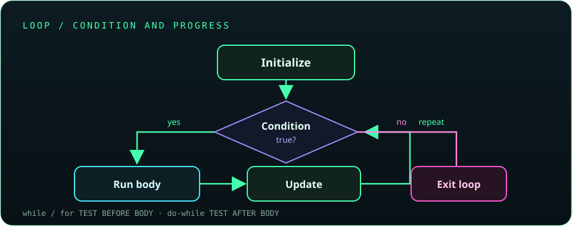
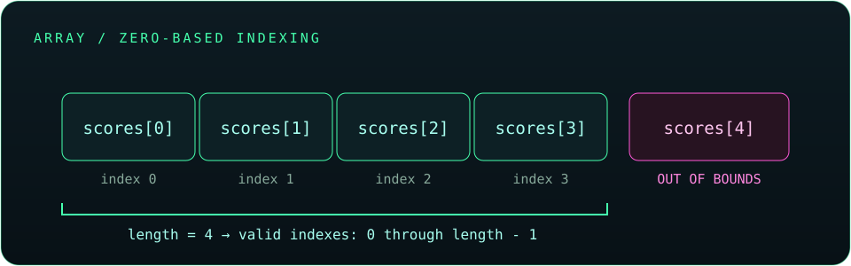
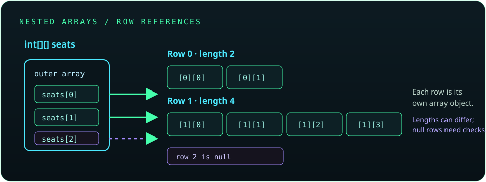

# Chapter 3: Control Flow and Arrays

Control flow determines which statements run and how many times they run. Arrays store a fixed-size sequence of values so a program can work with related data using indexes. This chapter combines decisions, loops, and array operations—the core tools for processing input and building predictable algorithms.

## 43. Control statements

Control statements change the normal top-to-bottom path through a method. Java's main control structures select between alternatives (`if`, `switch`), repeat work (`for`, `while`, `do-while`), or alter a loop/method path (`break`, `continue`, `return`).

```java
int score = 76;
if (score >= 60) {
    System.out.println("Pass");
} else {
    System.out.println("Try again");
}
```

Use a control structure that makes the rule easy to read. Braces are recommended even when a block contains only one statement; they make later edits safer.

**Key takeaway:** Decisions choose a path, loops repeat a path, and jump statements leave or skip part of a path.

## 44. Branching statements

Branching statements select which block executes based on a condition or a value. `if` handles arbitrary boolean conditions; `switch` is useful when one value is compared with several discrete alternatives. The branch order matters: in an `if`/`else if` chain, Java takes the first true condition.

```java
int temperature = 18;
if (temperature >= 30) {
    System.out.println("Hot");
} else if (temperature >= 20) {
    System.out.println("Warm");
} else {
    System.out.println("Cool");
}
```

The order above checks the highest threshold first. Reordering conditions could change which branch handles a value.

**Key takeaway:** Arrange mutually competing conditions so the first matching branch is the intended one.

## 45. `if`, `if-else`, and nested `if`

An `if` statement runs a block when its boolean condition is `true`. `if-else` provides an alternative when it is `false`. An `else if` chain checks several conditions; a nested `if` puts one decision inside another and is useful when the inner decision only applies after the outer condition succeeds.

```java
int age = 20;
boolean hasTicket = true;

if (age >= 18) {
    if (hasTicket) {
        System.out.println("Entry allowed");
    } else {
        System.out.println("Ticket required");
    }
} else {
    System.out.println("Age requirement not met");
}
```

Nested conditions can become difficult to scan. Combine simple conditions with `&&` when that preserves clarity, or extract a well-named boolean/method.

**Key takeaway:** Conditions must evaluate to `boolean`; use braces and keep nesting shallow where possible.

## 46. `switch` statements and expressions

A `switch` chooses a case based on a selector such as an integer-compatible value, enum, or `String`. In a traditional switch statement, `case` labels can fall through into later cases unless terminated with `break`, `return`, or another control transfer. Arrow-style cases do not fall through. A switch expression produces a value.

```java
String dayType = switch (day) {
    case "Saturday", "Sunday" -> "weekend";
    case "Monday", "Tuesday", "Wednesday", "Thursday", "Friday" -> "weekday";
    default -> "unknown";
};
```

The selector `day` must be declared as a `String`; the expression also needs a `default` here so every possible value produces a result. In a block-style arrow arm, use `yield value;` to return a value from that arm.

Traditional switch statements remain useful when supporting older Java source levels:

```java
switch (command) {
    case "start":
        startService();
        break;
    case "stop":
        stopService();
        break;
    default:
        System.out.println("Unknown command");
}
```

**Key takeaway:** Prefer arrow-style switch cases when available; remember that traditional cases may fall through.

## 47. Looping statements

Loops repeat a block while a condition or iteration rule permits. Use `for` when the iteration structure is clear (often with a counter), `while` when the stopping condition is central, and `do-while` when the body must run at least once.

```java
int attempts = 0;
while (attempts < 3) {
    System.out.println("Attempt " + (attempts + 1));
    attempts++;
}
```

Every loop needs progress toward its stopping condition, or a deliberate exit such as `break`; otherwise it may run forever.



**Key takeaway:** Identify the loop's starting state, continuation condition, and progress/update step.

## 48. `for` loop

A basic `for` loop has an initialization, a continuation condition, and an update expression. Initialization runs once; the condition is checked before each iteration; the update runs after each completed iteration.

```java
for (int number = 1; number <= 5; number++) {
    System.out.println(number);
}
```

The loop variable declared in the initializer is scoped to the loop. If the condition is initially false, the body runs zero times. Verify the boundary and update direction to avoid skipped values or an infinite loop.

**Key takeaway:** A `for` loop is a good fit when initialization, condition, and update belong together.

## 49. Enhanced `for` loop

The enhanced `for` loop visits each element in an array or iterable collection without exposing an index. It is clear and concise for read-only traversal.

```java
int[] scores = {82, 91, 77};
int total = 0;

for (int score : scores) {
    total += score;
}
System.out.println(total); // 250
```

The loop variable receives the current element value. Assigning to `score` does not replace the array element; use an indexed loop when you need to update positions, compare neighbors, or access an element number.

**Key takeaway:** Use enhanced `for` for simple element-by-element reading; use an indexed loop when position matters.

## 50. `while` loop

A `while` loop checks its condition before executing the body, so it may execute zero times. It is useful when the number of iterations is not known in advance and repetition depends on a changing condition.

```java
int remaining = 3;
while (remaining > 0) {
    System.out.println(remaining);
    remaining--;
}
```

The loop must change state so that the condition can eventually become false, unless it has another intentional exit. Be careful not to update the wrong variable or use a condition that can never change.

**Key takeaway:** A `while` loop is condition-controlled and can run zero or more times.

## 51. `do-while` loop

A `do-while` loop checks its condition after executing the body, so it always runs at least once. It is useful for menus or prompts that should be shown before deciding whether to repeat.

```java
int value = 1;
do {
    System.out.println(value);
    value++;
} while (value <= 3);
```

The semicolon after the `while` condition is part of the syntax. Ensure that the body can make the condition false when repetition should stop.

**Key takeaway:** Choose `do-while` when one execution is required before the first condition check.

## 52. Nested loops

A nested loop is a loop inside another loop. For each iteration of the outer loop, the inner loop runs according to its own initialization and condition. Nested loops are useful for grids, tables, and pairwise comparisons.

```java
for (int row = 1; row <= 3; row++) {
    for (int column = 1; column <= 4; column++) {
        System.out.print("(" + row + "," + column + ") ");
    }
    System.out.println();
}
```

With three rows and four columns, the inner body executes twelve times. If each loop processes `n` values, a fully nested pair often performs work proportional to `n × n`; consider this cost for large inputs.

**Key takeaway:** Trace one outer iteration at a time to understand nested-loop order and total work.

## 53. Jumping statements: `break`, `continue`, and `return`

`break` exits the nearest enclosing loop or switch. `continue` skips the rest of the current loop iteration and starts the next one. `return` exits the current method, optionally returning a value to the caller.

```java
for (int value = 1; value <= 10; value++) {
    if (value % 2 == 0) {
        continue; // skip even values
    }
    if (value > 7) {
        break; // stop when the next odd value is 9
    }
    System.out.println(value); // 1, 3, 5, 7
}
```

Use these statements to express a clear exit or skip condition. Too many jumps can make a method harder to follow; simple loop conditions are often clearer.

**Key takeaway:** `break` leaves a loop, `continue` skips one iteration, and `return` leaves a method.

## 54. Labeled `break` and `continue`

Labels identify an enclosing loop. A labeled `break` exits that labeled loop, and a labeled `continue` starts its next iteration. These are useful when a nested search must stop or continue at the outer-loop level; they should be used sparingly because they can make control flow harder to trace.

```java
int[][] values = new int[][] { {2, 4}, {6, 8} };
int target = 6;

search:
for (int row = 0; row < values.length; row++) {
    for (int column = 0; column < values[row].length; column++) {
        if (values[row][column] == target) {
            System.out.println("Found at " + row + ", " + column);
            break search;
        }
    }
}
```

The label `search` belongs immediately before the outer loop, so `break search` exits both loops. A helper method can sometimes communicate the same intent more clearly.

**Key takeaway:** A labeled jump targets a named enclosing loop; avoid labels when a simpler structure is clear.

## 55. Arrays

An array stores a fixed number of elements of one declared component type. It is an object, has a `length` field, and uses zero-based indexes. Once created, its length cannot change, though the values in its elements may be updated.

```java
int[] scores = new int[3];
scores[0] = 80;
scores[1] = 90;
scores[2] = 75;
System.out.println(scores.length); // 3
```

Reading or writing an index outside `0` through `length - 1` throws `ArrayIndexOutOfBoundsException`. Numeric array elements start with zero values, `boolean` elements with `false`, and reference elements with `null`.



**Key takeaway:** For an array of length `n`, valid indexes are `0` through `n - 1`.

## 56. One-dimensional arrays

A one-dimensional array is a linear sequence accessed with one index. Declare an array variable with a component type and create the array with a fixed length or an initializer.

```java
String[] names = new String[2];
names[0] = "Ada";
names[1] = "Grace";

for (int i = 0; i < names.length; i++) {
    System.out.println(i + ": " + names[i]);
}
```

The loop condition uses `< names.length`; using `<=` would access one index past the end. Array elements of reference type begin as `null` until assigned.

**Key takeaway:** Use `array.length` as the bound rather than hard-coding the number of elements.

## 57. Multidimensional arrays

Java multidimensional arrays are arrays whose elements are themselves arrays. A two-dimensional array can be viewed as rows and columns, and each element needs two indexes.

```java
int[][] grid = new int[2][3];
grid[0][1] = 7;

for (int row = 0; row < grid.length; row++) {
    for (int column = 0; column < grid[row].length; column++) {
        System.out.print(grid[row][column] + " ");
    }
    System.out.println();
}
```

`grid.length` is the number of rows; `grid[row].length` is that row's number of columns. Java does not require every row to have the same length.



**Key takeaway:** For nested arrays, use each row's own `length` when traversing its columns.

## 58. Jagged arrays

A jagged array is a multidimensional array whose rows can have different lengths. This works because each row is a separate array reference and can be created or replaced independently.

```java
int[][] seats = new int[3][];
seats[0] = new int[2];
seats[1] = new int[4];
seats[2] = new int[1];

for (int row = 0; row < seats.length; row++) {
    System.out.println("Row " + row + " has " + seats[row].length + " seats");
}
```

An uninitialized row remains `null`; accessing `seats[row].length` before assigning that row causes a `NullPointerException`.

**Key takeaway:** Initialize each row before using it, and do not assume all rows have equal length.

## 59. Array initialization

Arrays can be initialized with an explicit size or with an array initializer. The initializer form determines the size from the number of values provided.

```java
int[] ages = new int[3]; // three elements, initially 0
int[] marks = {80, 92, 87};
String[] cities = new String[] {"Delhi", "Pune"};
```

The shorthand `{...}` is permitted at a declaration with an array variable, as in `marks`. When assigning later, use `new int[] { ... }` because a bare initializer block is not allowed there.

```java
int[] values;
values = new int[] {1, 2, 3};
```

**Key takeaway:** Array size is fixed at creation; an initializer is a convenient way to create and fill it together.

## 60. Array traversal and manipulation

Traversal visits array elements, usually with an indexed or enhanced `for` loop. Manipulation updates values, swaps elements, or builds a result in another array.

```java
int[] values = {4, 1, 3};
for (int i = 0; i < values.length; i++) {
    values[i] *= 2;
}
System.out.println(java.util.Arrays.toString(values)); // [8, 2, 6]
```

For an in-place reversal, swap the outer pairs and stop at the midpoint:

```java
for (int left = 0, right = values.length - 1; left < right; left++, right--) {
    int temporary = values[left];
    values[left] = values[right];
    values[right] = temporary;
}
```

**Key takeaway:** Use indexes when updating positions; use a temporary variable to swap two elements safely.

## 61. Copying and comparing arrays

Assigning an array variable copies its reference, not the array contents. To create a separate shallow copy, use `Arrays.copyOf`, `clone()`, or `System.arraycopy`. For nested arrays, these methods copy only the row references, so use a row-by-row copy if independent nested arrays are required.

```java
import java.util.Arrays;

int[] original = {3, 5, 7};
int[] alias = original;
int[] copy = Arrays.copyOf(original, original.length);

alias[0] = 99;
System.out.println(original[0]); // 99: same array
System.out.println(copy[0]);     // 3: separate array
System.out.println(Arrays.equals(original, copy)); // false
```

For array contents, use `Arrays.equals`, not `==` (which compares array identity). For nested arrays, use `Arrays.deepEquals` and `Arrays.deepToString` when deep content behavior is intended.

**Key takeaway:** Distinguish aliasing from copying, and use `Arrays` equality methods to compare contents.

## 62. Sorting and searching arrays

`Arrays.sort` sorts primitive arrays in ascending order and sorts object arrays according to their natural order or a supplied comparator. `Arrays.binarySearch` searches a sorted array; if the value is absent, it returns a negative insertion-point encoding.

```java
import java.util.Arrays;

int[] scores = {42, 18, 35, 27};
Arrays.sort(scores);
System.out.println(Arrays.toString(scores)); // [18, 27, 35, 42]

int index = Arrays.binarySearch(scores, 35); // 2
```

Binary search assumes the array is already sorted according to the same ordering. Searching an unsorted array may return a result that is not meaningful.

**Key takeaway:** Sort before binary search, and check the search result for a negative value before treating it as an index.

## 63. The `Arrays` utility class

`java.util.Arrays` provides static methods for common array operations, including printing, sorting, searching, filling, copying, and equality checks. It saves you from implementing routine operations manually.

```java
import java.util.Arrays;

int[] values = new int[4];
Arrays.fill(values, 5);
int[] larger = Arrays.copyOf(values, 6);
System.out.println(Arrays.toString(larger)); // [5, 5, 5, 5, 0, 0]
```

For nested arrays, use `deepToString` to display nested contents. Many `Arrays` methods have overloads for primitive arrays and object arrays; check the method signature for the type being used.

**Key takeaway:** Reach for `Arrays` for standard operations, and use the deep variants for nested-array display/comparison.

## 64. Varargs

Varargs let a method accept zero or more arguments of one type using an ellipsis (`...`). Inside the method, the parameter behaves as an array. A method may declare only one varargs parameter, and it must be the final parameter in its list.

```java
static int sum(int... values) {
    int total = 0;
    for (int value : values) {
        total += value;
    }
    return total;
}

System.out.println(sum());        // 0
System.out.println(sum(2, 3, 4)); // 9
```

The method can also receive an existing `int[]`. Avoid overloads that make a call ambiguous between an array and varargs form.

**Key takeaway:** Varargs are convenient for optional repeated arguments, but the method receives a single array parameter.

## Chapter 3 coverage check

All 22 Chapter 3 roadmap topics (43–64) are covered above. The explanations also call out common pitfalls: switch fall-through, loop termination, nested-array row lengths, out-of-range indexes, reference aliasing, binary-search sorting requirements, and varargs placement.

This roadmap chapter does not yet include enhanced array utilities introduced by later Java versions, generic collections as alternatives to fixed-size arrays, or algorithmic complexity in depth. Those can be covered in their dedicated chapters or added to the syllabus later.
