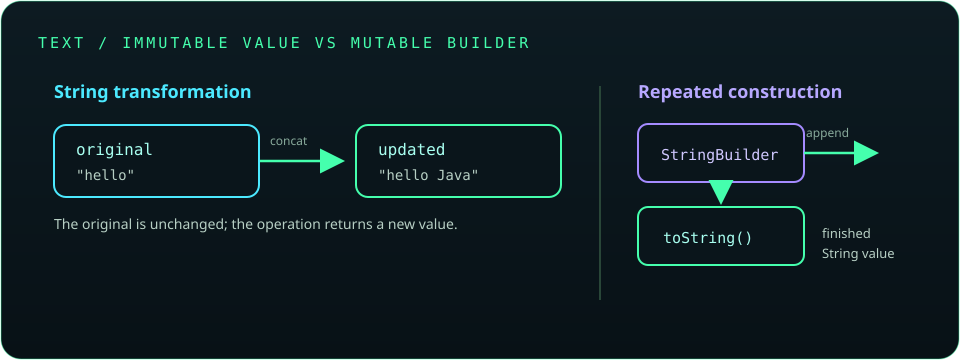

# Chapter 4: Strings and Text Processing

Text is represented in Java primarily by `String`, an immutable sequence of UTF-16 code units. This chapter covers safe comparison, common transformations, mutable text tools, formatting, regular expressions, and the difference between characters and encoded bytes.

## 65. The `String` class

`String` represents text and provides operations for inspecting, comparing, searching, and transforming it. String values are objects, even when written with a literal.

```java
String language = "Java";
System.out.println(language.length());
System.out.println(language.toUpperCase());
```

Methods such as `toUpperCase()` return a result; they do not modify the original string.

**Key takeaway:** Use `String` for text that should be treated as a value.

## 66. String creation and immutability

Strings can be created with literals or constructors. A `String` is immutable: once created, its character sequence cannot be changed. Operations that appear to modify text create and return another string.

```java
String original = "hello";
String updated = original.concat(" Java");
System.out.println(original); // hello
System.out.println(updated);  // hello Java
```

Prefer literals for ordinary text; constructors such as `new String("hello")` usually add no value.

**Key takeaway:** Store the returned string when applying a transformation.



## 67. String pool and interning

The JVM can reuse string literals from a pool. Equal literals commonly refer to the same pooled object, while `new String(...)` explicitly creates a distinct object. `intern()` returns the canonical pooled representation, but application code rarely needs to call it.

```java
String first = "ready";
String second = "ready";
System.out.println(first == second); // commonly true for these literals
```

Do not use pool identity as a text comparison rule; use `equals()`.

**Key takeaway:** Pooling is an implementation optimization, not a substitute for value equality.

## 68. String comparison: `==` versus `equals()`

`==` compares whether two references point to the same object. `equals()` compares string contents. Use `equalsIgnoreCase()` when case-insensitive equality is specifically intended.

```java
String input = new String("yes");
System.out.println(input == "yes");       // false: distinct references
System.out.println(input.equals("yes"));  // true: same text
```

If a value may be `null`, use a known non-null value first, such as `"yes".equals(input)`.

**Key takeaway:** Compare text by content, not by reference identity.

## 69. Common String methods

Useful methods include `length()`, `charAt()`, `substring()`, `contains()`, `startsWith()`, `endsWith()`, `indexOf()`, `replace()`, `strip()`, and `isEmpty()`. Most return a value and leave the receiver unchanged.

```java
String text = "  learn Java  ";
String clean = text.strip();
System.out.println(clean.substring(0, 5)); // learn
System.out.println(clean.contains("Java")); // true
```

Indexes are zero-based, and substring end indexes are exclusive. `isBlank()` tests for empty or whitespace-only text; `isEmpty()` tests only for length zero.

**Key takeaway:** Check boundaries before indexing and distinguish blank text from empty text.

## 70. String concatenation

The `+` operator joins strings and converts non-string operands to text. It is readable for a small number of values, but repeatedly concatenating inside a large loop can create many intermediate strings.

```java
String name = "Ada";
int score = 95;
String message = name + " scored " + score;
System.out.println(message);
```

Use `StringBuilder` when incrementally assembling a larger result.

**Key takeaway:** Use concatenation for simple expressions and a builder for repeated appends.

## 71. `StringBuilder`

`StringBuilder` holds mutable character data and is efficient for repeated appends in a single thread. Call `toString()` when the finished immutable string is needed.

```java
StringBuilder result = new StringBuilder();
for (int number = 1; number <= 3; number++) {
    result.append(number).append(' ');
}
System.out.println(result.toString().stripTrailing());
```

Builders support operations such as `append()`, `insert()`, `delete()`, and `reverse()`.

**Key takeaway:** Use one builder for iterative string construction.

## 72. `StringBuffer`

`StringBuffer` offers mutable string operations similar to `StringBuilder`, with synchronized methods for thread-safe access to the buffer itself. Synchronization adds overhead and does not automatically make a larger sequence of application operations atomic.

```java
StringBuffer buffer = new StringBuffer("Java");
buffer.append(" strings");
System.out.println(buffer);
```

For typical method-local construction, prefer `StringBuilder`.

**Key takeaway:** Choose `StringBuffer` only when its synchronized operations are actually needed.

## 73. Mutable versus immutable objects

An immutable object's observable state does not change after construction; a mutable object's state can. `String` is immutable, while `StringBuilder` is mutable. Immutability makes values easier to share and reason about, but mutable objects can be useful for efficient updates.

```java
String value = "start";
value = value + "-end"; // a new String is assigned
```

When designing a class, avoid exposing mutable internal state directly; use defensive copies where appropriate.

**Key takeaway:** Select mutability deliberately and protect state at object boundaries.

## 74. Tokenizing strings with `StringTokenizer`

`StringTokenizer` splits text using delimiter characters and is retained mainly for legacy code. It does not support regular-expression delimiters and is less expressive than `String.split()`.

```java
java.util.StringTokenizer tokens =
        new java.util.StringTokenizer("red,green,blue", ",");
while (tokens.hasMoreTokens()) {
    System.out.println(tokens.nextToken());
}
```

For new code, use `split()` or a dedicated parser when the input format has quoting or escaping rules.

**Key takeaway:** Know `StringTokenizer` for older code, but prefer modern alternatives.

## 75. The `split()` method

`split(regex)` divides a string around matches of a regular expression and returns an array. Characters such as `.` and `|` have special meaning in regex, so escape literal delimiters.

```java
String csv = "red,green,blue";
String[] colors = csv.split(",");
System.out.println(colors[1]); // green
```

The one-argument form discards trailing empty fields. Use `split(regex, -1)` when trailing empty fields must be preserved.

**Key takeaway:** `split()` accepts a regex, not a plain-text delimiter.

## 76. Regular expressions

Regular expressions describe patterns for matching, replacing, or splitting text. Java's `Pattern` and `Matcher` APIs support reusable compiled patterns and detailed match operations.

```java
java.util.regex.Pattern pattern =
        java.util.regex.Pattern.compile("[A-Z]{2}\\d{4}");
boolean valid = pattern.matcher("AB1234").matches();
System.out.println(valid);
```

Use `matches()` for a full-input match and `find()` to search for a matching region. Escape backslashes for both Java string syntax and regex syntax.

**Key takeaway:** Keep patterns readable and validate the whole input when the entire value must conform.

## 77. Formatting strings

`String.format()` and `formatted()` create strings from a format pattern and values. Common specifiers include `%s` for text, `%d` for integers, and `%.2f` for two decimal places.

```java
String report = "Name: %s, score: %.1f".formatted("Mina", 92.5);
System.out.println(report);
```

Formatting is useful for reports and aligned output; use locale-aware formatting when number or date conventions matter.

**Key takeaway:** Match each format specifier to the type and intended presentation.

## 78. Text blocks

Text blocks provide readable multiline string literals using triple quotes. They preserve line breaks while applying incidental indentation rules, and can be used for templates, SQL snippets, or structured text.

```java
String json = """
        {
          "language": "Java",
          "active": true
        }
        """;
System.out.println(json);
```

Text blocks do not automatically escape or validate content inserted into a query or markup language.

**Key takeaway:** Use text blocks for readable multiline constants, not as a security mechanism.

## 79. Unicode and character encoding basics

Java `String` stores UTF-16 code units. A visible Unicode character may use one code unit or a surrogate pair, so `length()` is not always the count of user-perceived characters. Encoding converts characters to bytes; specify a charset such as UTF-8 when reading or writing bytes.

```java
String greeting = "こんにちは";
byte[] utf8 = greeting.getBytes(java.nio.charset.StandardCharsets.UTF_8);
String restored = new String(utf8, java.nio.charset.StandardCharsets.UTF_8);
System.out.println(restored);
```

For user-facing cursor movement or character counts, use code-point-aware or grapheme-aware APIs rather than assuming one `char` equals one displayed character.

**Key takeaway:** Keep character data and encoded bytes distinct, and choose the charset explicitly.
