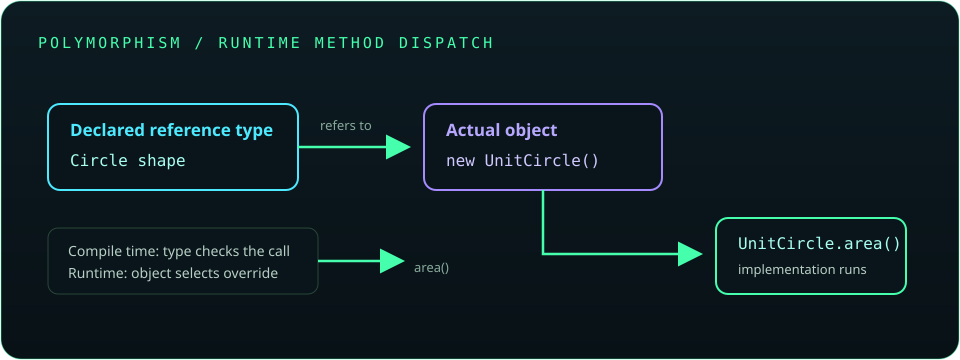

# Chapter 5: Methods and Object-Oriented Programming

Methods organize behavior; classes combine state and behavior into reusable types. This chapter builds from method calls and parameter passing through object design, inheritance, interfaces, relationships, and object lifecycle.

## 80. Methods in Java

A method is a named block of behavior declared in a class or interface. Methods help divide a problem into understandable operations, reduce duplication, and provide a clear contract for callers.

```java
static int doubleValue(int value) {
    return value * 2;
}
```

Give methods names that describe their purpose and keep each method focused.

**Key takeaway:** A method should expose a clear operation through a well-defined signature.

## 81. Method declaration and definition

A method declaration includes modifiers, a return type, a name, parameters, and a body. In Java, a concrete method's declaration and implementation appear together; an abstract method or interface method may declare a contract without a body.

```java
public static String greet(String name) {
    return "Hello, " + name;
}
```

The return type and parameter types are part of the method signature used for overload resolution.

**Key takeaway:** Choose parameter and return types that accurately express the method's contract.

## 82. Method calling

A method call supplies arguments to a method's parameters. Static methods are invoked through a class name; instance methods are invoked on an object.

```java
String greeting = Greeter.greet("Asha");
System.out.println(greeting);
```

The receiver must be available and non-null for an instance call. A method call can return a value, change object state, or perform an action.

**Key takeaway:** Make the receiver and the effect of a call clear.

## 83. Parameters and arguments

Parameters are variables declared in a method definition; arguments are the values supplied by a caller. Parameter types determine which values can be passed, and overload resolution selects an applicable method.

```java
static void printGreeting(String name) {
    System.out.println("Hello, " + name);
}

printGreeting("Asha");
```

Validate or reject invalid arguments at the boundary when the method requires a specific range or non-null value.

**Key takeaway:** Document and enforce meaningful preconditions for parameters.

## 84. Return types

A method's return type describes the value it gives back. A non-`void` method must return a compatible value on every reachable path; a `void` method communicates through effects rather than a result.

```java
static int maximum(int first, int second) {
    return first >= second ? first : second;
}
```

Return the most useful abstraction for callers, and avoid using `null` as an undocumented signal.

**Key takeaway:** A return type is part of a method's public contract.

## 85. Pass-by-value in Java

Java always passes arguments by value. For an object argument, the copied value is a reference to the same object; a method can mutate that object but cannot replace the caller's reference variable.

```java
static void rename(StringBuilder text) {
    text.append("!");
}
```

Primitive argument values are copied too, so assigning a parameter does not change the caller's primitive variable.

**Key takeaway:** Reference values are passed by value; Java is not pass-by-reference.

## 86. Method overloading

Overloading declares methods with the same name but different parameter lists. The compiler chooses an overload from the compile-time argument types; return type alone cannot distinguish overloads.

```java
static int area(int side) {
    return side * side;
}

static int area(int width, int height) {
    return width * height;
}
```

Avoid overload sets whose behavior is ambiguous for common calls such as `null`.

**Key takeaway:** Overloads should represent closely related operations with clear parameter distinctions.

## 87. Recursion

Recursion occurs when a method solves a problem by calling itself on a smaller input. A correct recursive method needs a base case and progress toward it; otherwise it can recurse indefinitely and exhaust the call stack.

```java
static int factorial(int number) {
    if (number <= 1) {
        return 1;
    }
    return number * factorial(number - 1);
}
```

For deep or unbounded input, an iterative solution may use memory more predictably.

**Key takeaway:** Prove that every recursive path reaches a base case.

## 88. Classes and objects

A class defines a type's state and behavior; an object is a runtime instance of that class. Fields store per-object or class-level state, while methods define operations.

```java
class Lamp {
    private boolean on;

    void switchOn() {
        on = true;
    }
}
```

Create objects with `new` and expose behavior rather than allowing arbitrary access to internal fields.

**Key takeaway:** Classes model responsibilities; objects hold the state for individual instances.

## 89. Instance and static members

Instance members belong to each object. Static fields and methods belong to the class and are shared; a static method has no `this` reference and cannot directly access instance state.

```java
class Counter {
    private static int created;
    private final int id = ++created;

    static int createdCount() {
        return created;
    }
}
```

Access static members through the class name to show their ownership.

**Key takeaway:** Use static state only when the value truly belongs to the type as a whole.

## 90. Constructors

A constructor initializes a new object and has the class name with no return type. If no constructor is declared, Java may provide a default no-argument constructor; declaring any constructor removes that implicit default.

```java
class User {
    private final String name;

    User(String name) {
        this.name = name;
    }
}
```

Constructors should establish valid object invariants.

**Key takeaway:** Treat construction as the point where an object becomes valid to use.

## 91. Default and parameterized constructors

A no-argument constructor accepts no parameters. A parameterized constructor receives the information needed to initialize state. The compiler supplies a default no-argument constructor only when the class declares no constructors.

```java
class Point {
    private final int x;
    private final int y;

    Point() {
        this(0, 0);
    }

    Point(int x, int y) {
        this.x = x;
        this.y = y;
    }
}
```

Provide a no-argument constructor only when a meaningful default state exists or a framework requires it.

**Key takeaway:** Be explicit about which constructor forms callers should use.

## 92. Constructor overloading

Constructor overloading provides multiple ways to create an object with different input sets. Each overload should delegate to a canonical constructor when that prevents duplicated initialization logic.

```java
class Range {
    private final int start;
    private final int end;

    Range(int end) {
        this(0, end);
    }

    Range(int start, int end) {
        if (end < start) {
            throw new IllegalArgumentException("end must not precede start");
        }
        this.start = start;
        this.end = end;
    }
}
```

**Key takeaway:** Keep all constructor paths consistent with the same invariants.

## 93. Constructor chaining

`this(...)` calls another constructor in the same class; `super(...)` calls a superclass constructor. A constructor invocation must be the first statement in its constructor body, and one constructor cannot use both forms directly.

```java
class ColoredPoint extends Point {
    private final String color;

    ColoredPoint(int x, int y, String color) {
        super(x, y);
        this.color = color;
    }
}
```

Chaining centralizes initialization and ensures base-class state is initialized.

**Key takeaway:** Delegate construction instead of repeating setup code.

## 94. The `this` keyword

`this` refers to the current object. It distinguishes a field from a parameter with the same name, invokes another constructor with `this(...)`, and can be passed to another method.

```java
class Account {
    private final String owner;

    Account(String owner) {
        this.owner = owner;
    }
}
```

Static methods cannot use `this` because they are not invoked on a particular instance.

**Key takeaway:** Use `this` when the current receiver needs to be explicit.

## 95. The `static` keyword

`static` marks members that belong to a class rather than one object. Static methods are suitable for operations that do not depend on instance state; static fields are shared across instances.

```java
class Temperature {
    static double toCelsius(double fahrenheit) {
        return (fahrenheit - 32) * 5 / 9;
    }
}
```

Mutable static fields create shared global state and can complicate testing and concurrency.

**Key takeaway:** Prefer instance members for object behavior and keep shared mutable state rare.

## 96. The `final` keyword

`final` prevents reassignment of a variable, overriding of a method, or subclassing of a class. A final reference cannot point to another object, but the referenced mutable object may still change.

```java
final java.util.List<String> names = new java.util.ArrayList<>();
names.add("Ada"); // allowed: the reference is unchanged
```

Final fields are useful for expressing stable object state.

**Key takeaway:** `final` restricts reassignment or extension; it does not automatically make an object immutable.

## 97. The `super` keyword

`super` refers to the superclass portion of the current object. It can call a superclass constructor or select a superclass implementation when a method is overridden.

```java
class Animal {
    String sound() {
        return "unknown";
    }
}

class Dog extends Animal {
    @Override
    String sound() {
        return super.sound() + " / bark";
    }
}
```

**Key takeaway:** Use `super` when subclass behavior intentionally builds on the base implementation.

## 98. Inheritance

Inheritance lets a class extend another class and specialize or reuse its behavior. Java classes have one direct superclass, and every class ultimately derives from `Object` unless it extends another class.

```java
class SavingsAccount extends Account {
    private double interestRate;
}
```

Use inheritance for a genuine “is-a” relationship; prefer composition when a type merely uses another object's service.

**Key takeaway:** Inheritance creates a substitutable subtype relationship, not just code reuse.

## 99. Types of inheritance supported in Java

Java supports single, multilevel, and hierarchical class inheritance. A class cannot extend two classes, avoiding multiple inheritance of class state and implementation. A class can implement multiple interfaces.

```java
interface Printable { void print(); }
interface Storable { void save(); }

class Report implements Printable, Storable {
    public void print() { }
    public void save() { }
}
```

Interfaces provide multiple type contracts without multiple class inheritance.

**Key takeaway:** Use interfaces for multiple capabilities and a single superclass for the class hierarchy.

## 100. Method overriding

Overriding provides a subclass implementation of an inherited instance method with a compatible signature and return type. `@Override` asks the compiler to verify that the method actually overrides a parent method.

```java
class Circle {
    double area() {
        return 0;
    }
}

class UnitCircle extends Circle {
    @Override
    double area() {
        return Math.PI;
    }
}
```

Static methods are hidden rather than overridden; private methods are not inherited for overriding.

**Key takeaway:** Use `@Override` and preserve the behavioral contract of the parent method.

## 101. Runtime and compile-time polymorphism

Compile-time polymorphism commonly refers to overload selection based on declared types and arguments. Runtime polymorphism refers to overridden instance-method dispatch based on the object's actual class.

```java
Circle shape = new UnitCircle();
System.out.println(shape.area()); // UnitCircle implementation at runtime
```

Fields and static methods do not use dynamic overriding dispatch.

**Key takeaway:** The compiler selects overloads; the runtime selects overridden instance implementations.



## 102. Dynamic method dispatch

When an overridable instance method is called through a superclass or interface reference, Java chooses the implementation belonging to the actual object at runtime.

```java
static void describe(Circle circle) {
    System.out.println(circle.area());
}
```

This enables code to work with abstractions while each concrete class supplies its own behavior.

**Key takeaway:** Program against an abstraction and let runtime dispatch select the concrete behavior.

## 103. Upcasting and downcasting

Upcasting treats a subtype object as a superclass or interface type and is generally implicit. Downcasting converts a reference to a more specific type and can fail at runtime if the object is not that subtype.

```java
Circle shape = new UnitCircle(); // upcast
if (shape instanceof UnitCircle unit) {
    System.out.println(unit.area()); // checked pattern match
}
```

Prefer polymorphic methods over repeated downcasts.

**Key takeaway:** Check before narrowing a reference, and avoid casts when the abstraction already provides the needed behavior.

## 104. Abstract classes

An abstract class cannot be instantiated directly. It can hold fields, constructors, concrete methods, and abstract methods that subclasses must implement.

```java
abstract class Shape {
    abstract double area();
}
```

Use an abstract class when related subclasses share state or implementation as well as a common contract.

**Key takeaway:** Abstract classes provide a partially implemented base type.

## 105. Abstraction

Abstraction exposes essential operations while hiding implementation details. Interfaces and abstract classes provide contracts that let callers depend on behavior rather than concrete implementation.

```java
interface PaymentMethod {
    void pay(int cents);
}
```

Keep public APIs small and name operations in terms of what they do, not how they do it.

**Key takeaway:** Abstraction reduces coupling between callers and implementation choices.

## 106. Interfaces

An interface defines a reference type and a contract. It may declare abstract methods, constants, default methods, static methods, and private helper methods (subject to the Java version).

```java
interface Identifiable {
    String id();
}
```

A class implements an interface and supplies implementations for its required methods.

**Key takeaway:** Use interfaces to describe capabilities that unrelated classes can share.

## 107. Multiple inheritance through interfaces

A class may implement multiple interfaces, acquiring multiple type contracts. If unrelated interfaces contribute conflicting default methods, the implementing class must resolve the conflict explicitly.

```java
interface Readable { default String mode() { return "read"; } }
interface Writable { default String mode() { return "write"; } }

class Document implements Readable, Writable {
    @Override
    public String mode() {
        return Readable.super.mode() + "/" + Writable.super.mode();
    }
}
```

**Key takeaway:** Multiple interfaces compose capabilities, while conflict resolution stays explicit.

## 108. Encapsulation

Encapsulation keeps state and implementation details behind a public boundary. Private fields and methods prevent callers from putting an object into an invalid state; public methods expose controlled operations.

```java
class Score {
    private int value;

    void set(int value) {
        if (value < 0) {
            throw new IllegalArgumentException("score must be non-negative");
        }
        this.value = value;
    }
}
```

Avoid public mutable fields for state with invariants.

**Key takeaway:** Protect invariants by controlling how state can change.

## 109. Access modifiers

`public` permits broad access; `protected` permits package access and subclass access; package-private (no modifier) permits access within the package; `private` restricts access to the declaring top-level class and its nested types.

```java
public class Profile {
    private String email;
    public String displayName() {
        return "Profile";
    }
}
```

Choose the narrowest access level that supports the intended API.

**Key takeaway:** Visibility is part of API design; expose only what clients need.

## 110. Packages and accessibility

Packages group related types and affect package-private and protected access. A package declaration appears at the top of a source file; the directory structure conventionally mirrors the package name.

```java
package com.example.billing;

public class Invoice {
}
```

Package names are normally lowercase and globally distinctive, often based on a reversed domain name.

**Key takeaway:** Organize types into coherent packages and treat package boundaries as design boundaries.

## 111. Association, aggregation, and composition

Association describes a relationship between objects. Aggregation is a whole-part relationship where the parts can exist independently; composition is a stronger ownership relationship where a whole controls the lifecycle of its parts.

```java
class Team {
    private final java.util.List<String> memberNames =
            new java.util.ArrayList<>();
}
```

These terms describe design relationships; Java does not enforce them with special keywords.

**Key takeaway:** Model ownership and lifecycle explicitly instead of relying only on class references.

## 112. Object relationships

Objects collaborate through references and method calls. A relationship can be one-to-one, one-to-many, or many-to-many, and may be navigable in one or both directions.

```java
class Order {
    private final java.util.List<String> itemNames =
            new java.util.ArrayList<>();
}
```

Avoid unnecessary bidirectional links; they can make state consistency and serialization harder.

**Key takeaway:** Choose object relationships that reflect real ownership and access needs.

## 113. The `Object` class

`Object` is the root superclass of Java classes. It defines methods including `equals()`, `hashCode()`, `toString()`, and synchronization-related methods.

```java
Object value = "Java";
System.out.println(value.toString());
```

Override its value-oriented methods when instances need meaningful equality or display behavior.

**Key takeaway:** Every ordinary class participates in the `Object` contract.

## 114. `toString()`

`toString()` returns a string representation of an object. The default implementation is generally not useful for users, so value types often override it for clear diagnostic output.

```java
class Point {
    private final int x;
    private final int y;

    @Override
    public String toString() {
        return "Point[x=" + x + ", y=" + y + "]";
    }
}
```

Do not expose secrets such as passwords or access tokens in diagnostic representations.

**Key takeaway:** Provide a useful, safe representation for debugging and logs.

## 115. `equals()` and `hashCode()`

`equals()` defines logical equality; `hashCode()` must return the same value for objects that are equal. Hash-based collections rely on both methods, so override them together when defining value equality.

```java
record Coordinate(int x, int y) { }
```

Records generate these methods from their components. For ordinary classes, follow the equality contract and base both methods on the same state.

**Key takeaway:** Equal objects must have equal hash codes.

## 116. The `instanceof` operator

`instanceof` tests whether a reference refers to an object compatible with a specified type. Modern Java supports pattern matching that tests and declares a narrowed variable together.

```java
if (value instanceof String text) {
    System.out.println(text.strip());
}
```

`null instanceof SomeType` evaluates to `false`.

**Key takeaway:** Use pattern matching to safely test and use a more specific type.

## 117. Shallow copy and deep copy

A shallow copy duplicates the outer object but keeps references to the same nested objects. A deep copy also duplicates the mutable objects that should no longer be shared.

```java
java.util.List<String> original = new java.util.ArrayList<>();
original.add("Java");
java.util.List<String> copy = new java.util.ArrayList<>(original);
```

This list copy is sufficient for immutable `String` elements; mutable elements may need their own copy policy.

**Key takeaway:** Define which nested state a copy is intended to share.

## 118. Immutable classes

An immutable class prevents its observable state from changing after construction. Common practices include private final fields, no mutators, validation in constructors, and defensive copies of mutable inputs and outputs.

```java
final class Label {
    private final String text;

    Label(String text) {
        this.text = java.util.Objects.requireNonNull(text);
    }
}
```

Immutability improves safe sharing and simplifies reasoning about state.

**Key takeaway:** Immutability requires protecting the full object graph, not merely marking references `final`.

## 119. Nested classes

A nested class is declared inside another class. It may be static or an inner class; nested types help keep closely related implementation details near their owner.

```java
class Computer {
    static class Specification {
        final int memoryGb;
        Specification(int memoryGb) {
            this.memoryGb = memoryGb;
        }
    }
}
```

Use nesting when the type's relationship to its enclosing class is meaningful.

**Key takeaway:** Nesting communicates scope and ownership; it is not just a way to shorten names.

## 120. Inner classes

A non-static nested class is an inner class and is associated with an instance of its enclosing class. It can access that enclosing object's members, including private members.

```java
class Workshop {
    private String name = "Java lab";

    class Badge {
        String label() {
            return name;
        }
    }
}
```

An inner class instance retains access to its enclosing instance, which can affect object lifetime.

**Key takeaway:** Use an inner class when behavior depends on a specific enclosing object.

## 121. Static nested classes

A static nested class is nested for organization but does not carry an implicit enclosing-instance reference. It can directly access only static members of the outer class.

```java
class Cache {
    static class Entry {
        final String key;
        Entry(String key) {
            this.key = key;
        }
    }
}
```

Static nested classes are often preferable when no outer object is needed.

**Key takeaway:** Choose a static nested class unless the nested type needs an enclosing instance.

## 122. Local and anonymous inner classes

A local class is declared inside a block; an anonymous class is an unnamed class expression, commonly used to provide a one-off implementation. Local variables captured by these classes must be final or effectively final.

```java
Runnable task = new Runnable() {
    @Override
    public void run() {
        System.out.println("Running");
    }
};
```

For a single abstract method, a lambda is usually shorter.

**Key takeaway:** Keep local and anonymous classes small and use them only when their added structure helps.

## 123. Anonymous classes versus lambda expressions

A lambda provides an implementation of a functional interface and captures `this` from its enclosing context. An anonymous class creates a distinct class instance and has its own `this`.

```java
Runnable lambda = () -> System.out.println("Lambda");
Runnable object = new Runnable() {
    @Override
    public void run() {
        System.out.println("Anonymous class");
    }
};
```

Use lambdas for concise behavior; use an anonymous class when multiple methods or a distinct instance context are needed.

**Key takeaway:** A lambda is not simply shorter syntax for every anonymous class.

## 124. Enums

An enum defines a fixed set of named instances. Enums can include fields, constructors, and methods, making them safer than string constants for a finite domain.

```java
enum Priority {
    LOW, NORMAL, HIGH
}
```

Compare enum values directly with `==`; each enum constant is a singleton instance.

**Key takeaway:** Represent a closed set of choices with an enum.

## 125. Annotations

Annotations attach metadata to declarations. The compiler and tools can use annotations for checks or processing; common examples include `@Override`, `@Deprecated`, and `@SuppressWarnings`.

```java
@Deprecated
static void oldApi() {
}
```

An annotation does not by itself change runtime behavior unless a tool or framework processes it.

**Key takeaway:** Treat annotations as metadata interpreted by defined tooling or runtime conventions.

## 126. Object creation and initialization order

Object creation initializes fields to default values, runs superclass construction, then initializes subclass fields and instance initializer blocks before the remainder of the constructor body. Static initialization occurs when the class is initialized.

```java
class Parent {
    Parent() {
        System.out.println("Parent constructor");
    }
}
```

Avoid calling overridable methods from constructors because subclass state may not yet be initialized.

**Key takeaway:** Understand initialization order before depending on state during construction.

## 127. Garbage collection

The garbage collector reclaims memory for objects that are no longer reachable from live program roots. Collection timing is not deterministic, and calling `System.gc()` is only a request.

```java
Object temporary = new Object();
temporary = null; // may become eligible if no other reference exists
```

Garbage collection does not close files, sockets, or other external resources; use try-with-resources for those.

**Key takeaway:** Manage resource lifetimes explicitly; let the JVM manage ordinary heap memory.

## 128. Why Java has no traditional destructor

Java does not provide deterministic C++-style destructors. Finalization is deprecated and unreliable for resource cleanup because the runtime does not guarantee when or whether it runs.

```java
try (java.io.BufferedReader reader =
             java.nio.file.Files.newBufferedReader(java.nio.file.Path.of("notes.txt"))) {
    System.out.println(reader.readLine());
}
```

Use `AutoCloseable` and try-with-resources to release resources promptly.

**Key takeaway:** Deterministic cleanup belongs in explicit resource-management constructs, not garbage collection.
