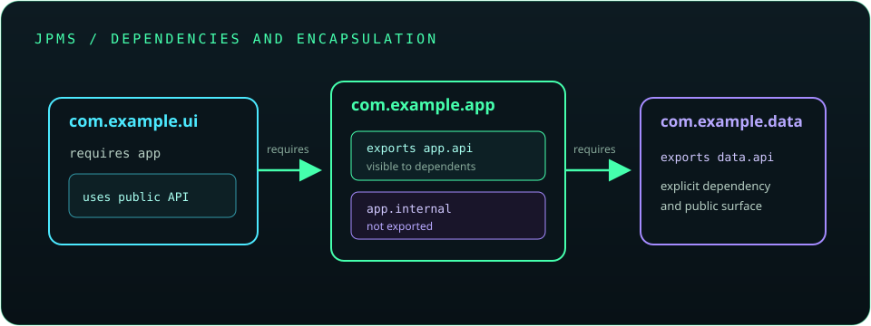

# Chapter 6: Packages, Imports, and Java Language Features

Packages organize Java types, while imports make type names convenient to use. This chapter also introduces JARs, class and module paths, JPMS, and modern language features that help model data and behavior clearly.

## 129. Built-in packages

The Java platform groups APIs into packages such as `java.lang`, `java.util`, `java.io`, and `java.time`. Types in `java.lang` are implicitly available by simple name in every source file.

```java
java.time.LocalDate today = java.time.LocalDate.now();
System.out.println(today);
```

Use the standard library when it provides a well-tested solution to a common problem.

**Key takeaway:** Learn the purpose of major platform packages and choose the right API.

## 130. User-defined packages

A user-defined package groups application types under a namespace. Package names are conventionally lowercase and commonly begin with a reversed organization domain.

```java
package com.example.inventory;

public class Item {
}
```

Place source files in a directory structure that matches the package name.

**Key takeaway:** Packages provide organization, namespace separation, and access boundaries.

## 131. The `package` declaration

The package declaration identifies the package to which a top-level type belongs and appears before imports and type declarations.

```java
package com.example.inventory;

import java.util.List;

public class Catalog {
    private List<String> names;
}
```

A source file without a package declaration belongs to the unnamed package, which is unsuitable for most reusable application code.

**Key takeaway:** Put application classes in a named package from the beginning.

## 132. The `import` keyword

An import lets source code refer to a type by its simple name rather than its fully qualified name. Imports do not copy or load the type; they affect how names are resolved at compile time.

```java
import java.util.ArrayList;

ArrayList<String> names = new ArrayList<>();
```

The compiler still requires the imported type to be available on the relevant class or module path.

**Key takeaway:** Imports are source-level name conveniences, not dependency declarations.

## 133. Implicit and explicit imports

Types in the current package and `java.lang` can be used without imports. Other types normally need a single-type import or a fully qualified name. A wildcard import makes types in one package available by simple name, but does not import subpackages.

```java
import java.util.List;
import java.util.Map;
```

Explicit imports make dependencies visible and help resolve same-name types.

**Key takeaway:** Know which names are automatic and which must be imported or qualified.

## 134. Static imports

A static import allows static members to be referred to without qualifying them by their declaring type.

```java
import static java.lang.Math.max;

int larger = max(8, 12);
```

Overusing static imports can hide where a method or constant comes from; use them when the origin remains clear.

**Key takeaway:** Static imports are a readability choice, not a requirement.

## 135. Fully qualified class names

A fully qualified class name includes the package and type name, such as `java.time.LocalDate`. It avoids ambiguity when multiple packages contain types with the same simple name.

```java
java.util.Date legacyDate = new java.util.Date();
java.sql.Date sqlDate = new java.sql.Date(System.currentTimeMillis());
```

Use qualification selectively; excessive qualification makes source code harder to scan.

**Key takeaway:** Fully qualify colliding names and import the rest when useful.

## 136. Access control across packages

Package-private members are available only within their package. `protected` members are accessible in the package and to subclasses under Java's protected-access rules. Public types and members form the broadly accessible API; private members remain encapsulated.

```java
package com.example.api;

public class Service {
    protected void validate() {
    }
}
```

Package organization therefore affects what other code can access.

**Key takeaway:** Design package and visibility boundaries together.

## 137. Creating and using JAR files

A JAR is a ZIP-format archive for classes, resources, and metadata. The JDK's `jar` tool can package compiled classes, and a manifest can identify an application's entry point.

```text
jar --create --file app.jar --main-class com.example.Main -C out .
java -jar app.jar
```

The classes and dependencies still need to be present in the packaging or runtime configuration.

**Key takeaway:** A JAR packages artifacts; it does not automatically bundle every dependency.

## 138. Classpath

The classpath tells the compiler or JVM where to find classes and class-path JARs. It can be set with `-cp` or `--class-path`.

```text
javac -cp "lib/*" -d out src/com/example/Main.java
java -cp "out;lib/*" com.example.Main
```

The path separator is platform-specific: semicolon on Windows and colon on Unix-like systems.

**Key takeaway:** Keep compile-time and runtime classpaths consistent.

## 139. Module path

The module path locates named modules for the Java Platform Module System. Unlike the classpath's broad visibility model, modules can declare which packages they export and which modules they require.

```text
java --module-path mods -m com.example.app/com.example.Main
```

Applications may combine named modules and class-path code, but the two models have different encapsulation rules.

**Key takeaway:** Use the module path when compiling or running named modules.

## 140. Java Platform Module System (JPMS)

JPMS, introduced in Java 9, organizes code into named modules with explicit dependencies and exported packages. It supports stronger encapsulation and more reliable dependency graphs.

```java
module com.example.app {
    requires java.logging;
    exports com.example.app.api;
}
```

Modules are useful for large applications and platform composition, but small projects do not always need them.

**Key takeaway:** A module describes dependencies and the packages it makes accessible.



## 141. Creating modules using `module-info.java`

A module descriptor named `module-info.java` declares a module's name, dependencies, and exports. The descriptor is compiled with the module's source code.

```java
module com.example.greeter {
    exports com.example.greeter.api;
}
```

Use `requires` for dependencies, `exports` for public packages, and `opens` when reflective access is needed by frameworks.

**Key takeaway:** Export only the packages that consumers should use.

## 142. Sealed classes and interfaces

Sealed types restrict which classes may directly extend or implement them. Permitted subtypes must declare whether they are `final`, `sealed`, or `non-sealed`.

```java
sealed interface Result permits Success, Failure { }
final class Success implements Result { }
final class Failure implements Result { }
```

Sealing is useful when a domain has a deliberately bounded set of variants.

**Key takeaway:** Use sealed hierarchies to make permitted subtype sets explicit.

## 143. Records

A record is a concise class form for a transparent data carrier. The compiler supplies a canonical constructor, accessors, and value-oriented `equals()`, `hashCode()`, and `toString()`.

```java
record User(String name, int age) { }

User user = new User("Asha", 28);
System.out.println(user.name());
```

Record components are final references, but a mutable object stored in a component is not automatically made immutable.

**Key takeaway:** Use records for data-focused types whose components define their value.

## 144. Pattern matching

Pattern matching combines a type test with binding a variable of the matched type. It reduces explicit casts and keeps the narrowed value in a scope where the test guarantees its type.

```java
if (value instanceof String text && !text.isBlank()) {
    System.out.println(text.strip());
}
```

Pattern features have evolved across Java releases; compile with a source level that supports the syntax used.

**Key takeaway:** Pattern matching makes type checks and safe use work together.

## 145. Switch expressions

A switch expression evaluates to a value. Arrow labels avoid accidental fall-through, and a block arm can use `yield` to return its value.

```java
int days = switch (month) {
    case 4, 6, 9, 11 -> 30;
    case 2 -> 28;
    default -> 31;
};
```

Use an exhaustive set of cases or a deliberate `default` for the input domain.

**Key takeaway:** Switch expressions make value selection explicit and reduce temporary variables.

## 146. Modern `instanceof` patterns

Pattern matching for `instanceof` declares a local variable as part of a successful type test. The variable is available only where the compiler can prove the test succeeded.

```java
if (value instanceof Integer number) {
    System.out.println(number + 1);
}
```

This feature is standard in modern Java; older source levels require a separate cast after the test.

**Key takeaway:** Use pattern variables instead of repeating a cast after a type check.

## 147. Text blocks

Text blocks express multiline strings without requiring a quote escape on every line. They use triple-quote delimiters and follow defined indentation and newline rules.

```java
String query = """
        SELECT name
        FROM users
        WHERE active = true
        """;
```

Use parameterized APIs for user-supplied values rather than concatenating them into SQL.

**Key takeaway:** Text blocks improve readability but do not make embedded languages safe automatically.

## 148. Local variable type inference with `var`

`var` asks the compiler to infer the type of a local variable from its initializer. It is not dynamic typing: the variable has a fixed compile-time type.

```java
var names = java.util.List.of("Ada", "Lin");
```

Local-variable inference requires an initializer and is not available for fields, method parameters, or return types.

**Key takeaway:** Use `var` when the initializer makes the type obvious without hiding useful information.

## 149. Functional programming concepts in Java

Functional-style Java emphasizes passing behavior, composing operations, and limiting side effects. Functional interfaces, lambdas, and streams support this style while remaining part of an object-oriented language.

```java
java.util.List<String> names = java.util.List.of("Ada", "Lin");
long count = names.stream()
        .filter(name -> name.length() == 3)
        .count();
```

Prefer clear, side-effect-conscious transformations; a loop may be clearer than a complex stream pipeline.

**Key takeaway:** Use functional tools where they improve clarity, not merely to avoid imperative syntax.
