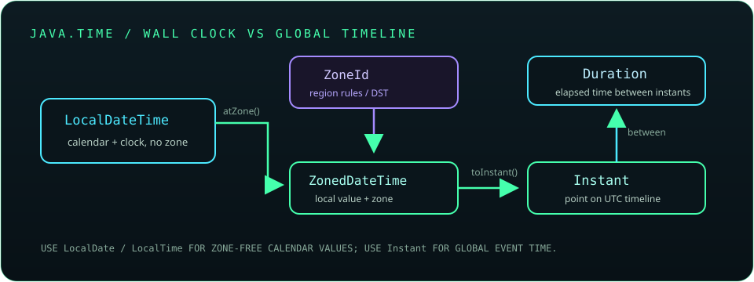

# Chapter 8: Wrapper Classes and Core APIs

Java's core APIs provide reusable building blocks for values, numbers, dates, comparison, randomness, and system interaction. This chapter focuses on choosing the right API and understanding its contracts, precision, and time-zone behavior.

## 169. Wrapper classes

Wrapper classes represent primitive values as objects: `Integer` for `int`, `Double` for `double`, `Boolean` for `boolean`, and corresponding types for the other primitives. They are needed in generic collections and offer parsing and conversion utilities.

```java
Integer count = Integer.valueOf(12);
int primitive = count.intValue();
```

Prefer primitive types for simple numeric state unless an object representation or `null` is meaningful.

**Key takeaway:** Wrapper objects bridge primitive values and APIs that require references.

## 170. Autoboxing and unboxing

Autoboxing converts a primitive to its wrapper; unboxing converts a wrapper back to a primitive. The compiler inserts these conversions, but unboxing a `null` wrapper throws `NullPointerException`.

```java
Integer boxed = 7; // boxing
int total = boxed + 3; // unboxing, then arithmetic
```

Use wrappers deliberately in large loops or performance-sensitive code, where repeated boxing can add allocations or work.

**Key takeaway:** Autoboxing is convenient syntax, not a change to primitive-versus-reference semantics.

## 171. Parsing strings into numbers

Methods such as `Integer.parseInt()` and `Double.parseDouble()` convert text to primitive numbers; `valueOf()` returns wrapper objects. Invalid text causes `NumberFormatException`, so validate or handle untrusted input.

```java
int quantity = Integer.parseInt("42");
long id = Long.parseLong("9001");
```

Specify the radix when parsing non-decimal integer text.

**Key takeaway:** Parsing can fail; treat user-provided numeric text as untrusted.

## 172. The `java.lang` package

`java.lang` contains fundamental types and APIs, including `Object`, `String`, `Class`, `Math`, `System`, `Runtime`, and the wrapper classes. It is implicitly imported into every Java source file.

```java
String message = "Core API";
Class<?> type = message.getClass();
System.out.println(type.getName());
```

**Key takeaway:** `java.lang` provides foundational types that most programs use directly.

## 173. The `Math` class

`Math` provides static mathematical operations and constants such as `PI`, `sqrt()`, `pow()`, `min()`, and `round()`. Its methods use primitive numeric types and follow their precision rules.

```java
double distance = Math.sqrt(3 * 3 + 4 * 4);
System.out.println(distance); // 5.0
```

For decimal money calculations, use `BigDecimal` rather than binary floating-point arithmetic.

**Key takeaway:** Use `Math` for common numeric operations, but choose numeric representations according to the problem.

## 174. The `System` class

`System` exposes standard input/output/error streams, environment properties, the system clock, array copying, and process-related operations. Its members are static and the class is not instantiated.

```java
long started = System.nanoTime();
// perform operation
long elapsed = System.nanoTime() - started;
System.out.println("Elapsed ns: " + elapsed);
```

Use `nanoTime()` for elapsed-time measurement and `currentTimeMillis()` for a wall-clock timestamp.

**Key takeaway:** Use system APIs according to their documented purpose; a monotonic timer is not a calendar clock.

## 175. The `Runtime` class

`Runtime.getRuntime()` returns the JVM runtime associated with the current process. It exposes information such as available processors and memory, and can start external processes with care.

```java
int processors = Runtime.getRuntime().availableProcessors();
System.out.println("Available processors: " + processors);
```

Memory readings are approximate snapshots, not promises about when garbage collection will occur. Prefer `ProcessBuilder` for configuring a subprocess.

**Key takeaway:** Runtime information is observational; do not treat it as a substitute for explicit resource or process management.

## 176. The `BigInteger` class

`BigInteger` represents arbitrary-precision integers, limited by available memory rather than a fixed primitive width. Arithmetic methods return new values because `BigInteger` is immutable.

```java
java.math.BigInteger large = new java.math.BigInteger("12345678901234567890");
java.math.BigInteger next = large.multiply(java.math.BigInteger.TEN);
```

Use methods such as `add()` and `multiply()` instead of primitive operators.

**Key takeaway:** Choose `BigInteger` when the required integer range exceeds primitive types.

## 177. The `BigDecimal` class

`BigDecimal` represents decimal values with arbitrary precision and an explicit scale. Construct decimal values from strings or integer units; constructing from a `double` can preserve the binary floating-point approximation.

```java
java.math.BigDecimal price = new java.math.BigDecimal("19.95");
java.math.BigDecimal tax = price.multiply(new java.math.BigDecimal("0.08"));
```

Division may require a scale and rounding mode; equality with `equals()` also considers scale, unlike `compareTo()`.

**Key takeaway:** Use decimal strings and explicit rounding policies for decimal arithmetic.

## 178. `Optional`

`Optional<T>` represents a value that may be present or absent, especially as a return type. Use `of()` for a known non-null value, `ofNullable()` for a possibly null value, and `empty()` for no value.

```java
java.util.Optional<String> nickname = java.util.Optional.ofNullable(input);
String display = nickname.orElse("Guest");
```

Avoid calling `get()` without first proving presence; do not use `Optional` automatically for every field or parameter.

**Key takeaway:** `Optional` makes possible absence explicit at selected API boundaries.

## 179. The `Objects` utility class

`Objects` provides null-handling and object utilities such as `requireNonNull()`, `equals()`, `hash()`, and `toString()`. It is useful for concise validation and null-safe comparisons.

```java
this.name = java.util.Objects.requireNonNull(name, "name");
```

Fail early when a required value is missing, with a message that identifies the violated contract.

**Key takeaway:** Centralize common object checks with the standard utility methods.

## 180. `Comparable`

`Comparable<T>` defines a type's natural ordering through `compareTo()`. A comparison should be consistent and transitive; when possible, natural ordering should be consistent with `equals()`.

```java
record Version(int major, int minor) implements Comparable<Version> {
    public int compareTo(Version other) {
        int result = Integer.compare(major, other.major);
        return result != 0 ? result : Integer.compare(minor, other.minor);
    }
}
```

Return a negative value, zero, or a positive value; do not rely on subtracting potentially extreme integers.

**Key takeaway:** Implement `Comparable` when one obvious default ordering exists.

## 181. `Comparator`

`Comparator<T>` defines an external ordering and supports multiple views of the same type. Factory methods such as `comparing()`, `thenComparing()`, and `reversed()` compose comparison rules.

```java
java.util.Comparator<String> byLengthThenName =
        java.util.Comparator.comparingInt(String::length)
                .thenComparing(java.util.Comparator.naturalOrder());
```

Use a comparator when ordering is contextual or the class has no single natural order.

**Key takeaway:** Comparators make ordering policy explicit and composable.

## 182. Sorting custom objects

Sort objects by natural order with `Collections.sort()` or `List.sort(null)`, and by a chosen order with a comparator. Sorting changes the list's order in place.

```java
people.sort(java.util.Comparator.comparing(Person::name));
```

For immutable input, copy it or create a sorted stream result instead of mutating the original collection.

**Key takeaway:** Select and document the ordering before sorting domain objects.

## 183. The `Random` class

`Random` generates pseudorandom values suitable for simulations, simple sampling, and tests. A seeded generator produces a repeatable sequence, which can help make tests deterministic.

```java
java.util.Random random = new java.util.Random(1234);
int choice = random.nextInt(10); // 0 through 9
```

Do not use `Random` for passwords, tokens, or security-sensitive choices.

**Key takeaway:** Pseudorandom and cryptographically secure randomness serve different purposes.

## 184. Secure random number generation

`SecureRandom` generates cryptographically strong random values for security-sensitive use. Use it to create token bytes, then encode those bytes with a suitable text encoding if needed.

```java
byte[] token = new byte[32];
new java.security.SecureRandom().nextBytes(token);
```

Use an established protocol and sufficient entropy; do not invent a security scheme from random numbers alone.

**Key takeaway:** Use `SecureRandom` for secrets and follow security-reviewed token formats.

## 185. UUIDs

`UUID` represents a 128-bit identifier and provides parsing, comparison, and standard string formatting. Random UUIDs are useful for identifiers where collision risk is acceptably low.

```java
java.util.UUID id = java.util.UUID.randomUUID();
System.out.println(id);
```

A UUID is an identifier, not an access-control secret or proof of authorization.

**Key takeaway:** Use UUIDs for identity needs, not as a replacement for security checks.

## 186. The `java.time` API

`java.time` provides immutable, thread-safe types for dates, times, instants, durations, periods, and zones. Choose a type that expresses whether a value is a calendar date, local wall time, or global point on the timeline.



```java
java.time.Instant now = java.time.Instant.now();
java.time.ZonedDateTime local =
        now.atZone(java.time.ZoneId.of("Europe/Paris"));
```

Prefer `java.time` over the older mutable date/time APIs.

**Key takeaway:** Model temporal meaning explicitly; “date and time” can mean different things.

## 187. `LocalDate` and `LocalTime`

`LocalDate` represents a calendar date without a time zone; `LocalTime` represents a time of day without a date or zone. They are appropriate for concepts such as birthdays or store opening times.

```java
java.time.LocalDate birthday = java.time.LocalDate.of(2000, 5, 12);
java.time.LocalTime opening = java.time.LocalTime.of(9, 30);
```

They cannot alone identify an instant on the global timeline.

**Key takeaway:** Use local temporal types for calendar concepts that intentionally have no zone.

## 188. `LocalDateTime` and `ZonedDateTime`

`LocalDateTime` combines a local date and clock time without a zone. `ZonedDateTime` also includes a region zone and its daylight-saving rules, which is essential when mapping local schedules onto instants.

```java
java.time.ZonedDateTime meeting =
        java.time.LocalDateTime.of(2026, 10, 13, 9, 0)
                .atZone(java.time.ZoneId.of("Asia/Kolkata"));
```

Local times around daylight-saving transitions may be ambiguous or invalid in some zones; use zone-aware APIs to resolve them.

**Key takeaway:** Attach a region `ZoneId` when local time must follow a real location's rules.

## 189. `Instant` and `Duration`

`Instant` represents a point on the UTC timeline; `Duration` measures elapsed time in seconds and nanoseconds. They are useful for event timestamps, deadlines, and elapsed intervals.

```java
java.time.Instant start = java.time.Instant.now();
java.time.Duration elapsed = java.time.Duration.between(start, java.time.Instant.now());
```

Use a monotonic timer such as `System.nanoTime()` for precise in-process performance measurement.

**Key takeaway:** `Instant` is a timeline point; `Duration` is elapsed time.

## 190. `Period` and date formatting

`Period` expresses calendar-based years, months, and days, whereas `Duration` measures fixed elapsed time. `DateTimeFormatter` formats and parses temporal values with an explicit pattern or locale.

```java
java.time.Period age = java.time.Period.between(
        java.time.LocalDate.of(2000, 5, 12), java.time.LocalDate.now());
String date = java.time.LocalDate.now()
        .format(java.time.format.DateTimeFormatter.ISO_LOCAL_DATE);
```

Months do not have a fixed number of days, so a one-month period is not a fixed duration.

**Key takeaway:** Use calendar periods for calendar changes and durations for elapsed time.

## 191. Time zones and locale basics

A `ZoneId` identifies a region's civil-time rules; a `ZoneOffset` is a fixed difference from UTC. `Locale` represents language and regional conventions for formatting dates, numbers, and text.

```java
java.util.Locale locale = java.util.Locale.forLanguageTag("en-IN");
java.time.format.DateTimeFormatter formatter =
        java.time.format.DateTimeFormatter.ofLocalizedDate(
                java.time.format.FormatStyle.MEDIUM).withLocale(locale);
```

Prefer region zones such as `Europe/Paris` over fixed offsets when daylight-saving and historical rules matter.

**Key takeaway:** Store or exchange instants consistently, and format them for an explicit user locale and zone.
