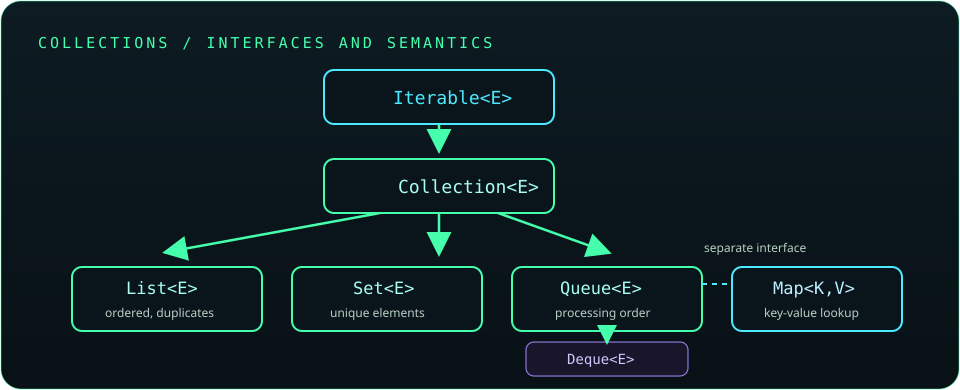

# Chapter 9: Collections Framework

The Collections Framework provides interfaces and implementations for groups of objects, along with iteration, sorting, and utility operations. Choose a collection based on ordering, uniqueness, lookup, mutation, and performance requirements.

## 192. Introduction to the Collections Framework

The framework includes collection interfaces, implementations, algorithms, and iteration tools. It reduces the need to build common data structures from scratch.

```java
java.util.List<String> names = new java.util.ArrayList<>();
names.add("Asha");
names.add("Lin");
```

Program to interfaces so implementations can change without rewriting dependent logic.

**Key takeaway:** Use the standard framework for common data-structure behavior.

## 193. Collection hierarchy

`Collection<E>` is the main root for groups of elements, with `List`, `Set`, and `Queue` as important subinterfaces. `Map<K,V>` stores key-value associations but is not a subtype of `Collection`.



**Key takeaway:** Choose the interface that matches the required semantics before choosing an implementation.

## 194. `Iterable` and `Collection`

`Iterable<T>` provides an iterator and enables enhanced `for` loops. `Collection<T>` extends it with operations such as `add`, `remove`, `contains`, and `size`.

```java
for (String name : names) {
    System.out.println(name);
}
```

Not every iterable is a collection; streams and custom sources can also be iterable-like or traversable.

**Key takeaway:** `Iterable` provides traversal; `Collection` adds group operations.

## 195. `List` interface

A `List<E>` is an ordered sequence that permits positional access and usually allows duplicates. Indexes are zero-based, and structural changes can shift later elements.

```java
java.util.List<String> tasks = new java.util.ArrayList<>();
tasks.add("read");
tasks.add("practice");
```

Use a list when order and positional operations matter.

**Key takeaway:** A list preserves sequence and can contain repeated values.

## 196. `ArrayList`

`ArrayList<E>` is a resizable-array implementation of `List`. It offers fast indexed reads and amortized constant-time append, while inserting or removing near the front shifts later elements.

```java
java.util.List<Integer> scores = new java.util.ArrayList<>();
scores.add(90);
scores.add(85);
```

It is a strong default for most list use cases.

**Key takeaway:** Prefer `ArrayList` unless workload or semantics suggest another implementation.

## 197. `LinkedList`

`LinkedList<E>` is a doubly linked list implementing both `List` and `Deque`. Indexed access requires traversal, so it is not automatically faster than `ArrayList` for insertions.

```java
java.util.Deque<String> queue = new java.util.LinkedList<>();
queue.addLast("first");
queue.removeFirst();
```

Consider `ArrayDeque` for most queue or stack workloads without null elements.

**Key takeaway:** Select `LinkedList` for a specific deque/list need, not from the assumption that linked insertion is always faster.

## 198. `Vector`

`Vector` is a legacy resizable-array list whose individual methods are synchronized. It remains for compatibility, but newer code generally uses `ArrayList` and explicit synchronization when needed.

```java
java.util.Vector<String> legacy = new java.util.Vector<>();
legacy.add("compatibility");
```

Method-level synchronization does not make a multi-operation workflow automatically atomic.

**Key takeaway:** Use `Vector` mainly when maintaining existing APIs that require it.

## 199. `Stack`

`Stack` is a legacy LIFO collection extending `Vector`. Its inheritance exposes list operations that do not fit stack semantics; `Deque` is the preferred modern stack abstraction.

```java
java.util.Deque<String> stack = new java.util.ArrayDeque<>();
stack.push("page");
String top = stack.pop();
```

**Key takeaway:** Prefer `Deque` for stack behavior.

## 200. `Set` interface

A `Set<E>` contains no duplicate elements according to its equality rules. Different implementations provide different ordering and performance behavior.

```java
java.util.Set<String> languages = new java.util.HashSet<>();
languages.add("Java");
languages.add("Java"); // set still has one equal element
```

Choose an ordered implementation if iteration order is part of the requirement.

**Key takeaway:** A set models membership and uniqueness, not positional indexing.

## 201. `HashSet`

`HashSet<E>` uses hashing for expected constant-time membership and updates, assuming a well-distributed hash function. It does not guarantee iteration order.

```java
java.util.Set<String> tags = new java.util.HashSet<>();
tags.add("java");
tags.contains("java");
```

Elements must implement consistent `equals()` and `hashCode()` behavior.

**Key takeaway:** Use `HashSet` for fast membership when ordering is unnecessary.

## 202. `LinkedHashSet`

`LinkedHashSet<E>` maintains predictable insertion order while enforcing uniqueness. Its extra linkage costs memory compared with `HashSet`.

```java
java.util.Set<String> ordered = new java.util.LinkedHashSet<>();
ordered.add("first");
ordered.add("second");
```

**Key takeaway:** Choose `LinkedHashSet` when uniqueness and insertion-order iteration are both required.

## 203. `TreeSet`

`TreeSet<E>` stores unique elements in sorted order using natural ordering or a comparator. Basic operations are logarithmic in the number of elements.

```java
java.util.Set<Integer> sorted = new java.util.TreeSet<>();
sorted.add(12);
sorted.add(3);
```

The comparator must be consistent with the intended equality semantics.

**Key takeaway:** Use `TreeSet` when sorted iteration or range operations matter.

## 204. `Queue` interface

`Queue<E>` represents elements waiting for processing. Its paired methods such as `offer`/`add`, `poll`/`remove`, and `peek`/`element` differ in how they signal capacity or emptiness.

```java
java.util.Queue<String> jobs = new java.util.ArrayDeque<>();
jobs.offer("compile");
String next = jobs.poll();
```

**Key takeaway:** Prefer the non-throwing `offer`, `poll`, and `peek` forms when absence or capacity is expected.

## 205. `Deque` interface

`Deque<E>` supports adding and removing at both ends. It can act as a FIFO queue or LIFO stack.

```java
java.util.Deque<Integer> values = new java.util.ArrayDeque<>();
values.addLast(1);
values.addFirst(0);
```

`ArrayDeque` rejects null elements.

**Key takeaway:** Use a deque when operations at both ends or stack semantics are needed.

## 206. `PriorityQueue`

`PriorityQueue<E>` retrieves the least element by natural order or comparator; it does not sort all elements during iteration. Insert and remove operations are generally logarithmic.

```java
java.util.PriorityQueue<Integer> smallestFirst = new java.util.PriorityQueue<>();
smallestFirst.offer(9);
smallestFirst.offer(2);
System.out.println(smallestFirst.poll()); // 2
```

Use a reversed comparator for max-first behavior.

**Key takeaway:** A priority queue exposes the next priority element, not a fully sorted collection.

## 207. `ArrayDeque`

`ArrayDeque<E>` is a resizable-array deque that provides efficient operations at both ends and is often preferred over `Stack` or `LinkedList` for queue/stack use.

```java
java.util.Deque<String> recent = new java.util.ArrayDeque<>();
recent.push("current");
recent.pop();
```

It is not thread-safe; use a concurrent collection for concurrent access.

**Key takeaway:** `ArrayDeque` is a practical default for single-threaded queue and stack operations.

## 208. `Map` interface

`Map<K,V>` associates unique keys with values. It supports lookup, insertion, removal, and views such as `keySet()`, `values()`, and `entrySet()`.

```java
java.util.Map<String, Integer> inventory = new java.util.HashMap<>();
inventory.put("pens", 12);
```

Map keys should have stable equality and hash/order behavior while stored.

**Key takeaway:** A map models key-to-value lookup; it is separate from the Collection hierarchy.

## 209. `HashMap`

`HashMap<K,V>` is a hash-based map with expected constant-time basic operations under suitable hashing. It allows one null key and null values, and does not guarantee iteration order.

```java
java.util.Map<String, Integer> counts = new java.util.HashMap<>();
counts.merge("java", 1, Integer::sum);
```

It is not synchronized; use proper coordination or a concurrent map for shared mutation.

**Key takeaway:** Use `HashMap` for general-purpose key lookup when iteration order is irrelevant.

## 210. `LinkedHashMap`

`LinkedHashMap<K,V>` maintains predictable encounter order, usually insertion order; it can also be configured for access order. This makes it useful for deterministic iteration and some cache designs.

```java
java.util.Map<String, Integer> ordered = new java.util.LinkedHashMap<>();
ordered.put("first", 1);
ordered.put("second", 2);
```

Access-order maps still need a deliberate eviction policy and synchronization strategy if used as caches.

**Key takeaway:** Use `LinkedHashMap` when map iteration order is observable.

## 211. `TreeMap`

`TreeMap<K,V>` keeps keys sorted by natural order or a comparator and provides logarithmic basic operations. It supports range queries and ordered navigation.

```java
java.util.Map<Integer, String> grades = new java.util.TreeMap<>();
grades.put(90, "A");
grades.put(70, "C");
```

**Key takeaway:** Use `TreeMap` when sorted keys or range-based operations are needed.

## 212. `Hashtable`

`Hashtable` is a legacy synchronized map that disallows null keys and values. Modern alternatives include `HashMap` for ordinary use and `ConcurrentHashMap` for common concurrent-map needs.

```java
java.util.Hashtable<String, String> legacy = new java.util.Hashtable<>();
legacy.put("mode", "compatibility");
```

**Key takeaway:** Keep `Hashtable` for compatibility rather than choosing it for new code.

## 213. `Properties`

`Properties` stores string-based configuration and supports loading and storing property files. Its legacy API inherits from `Hashtable`, but values should be treated as strings.

```java
java.util.Properties settings = new java.util.Properties();
settings.setProperty("mode", "safe");
String mode = settings.getProperty("mode", "default");
```

Use `setProperty()` and `getProperty()` rather than raw object-valued methods.

**Key takeaway:** `Properties` is a string configuration format; validate and protect secrets appropriately.

## 214. Iterators

An `Iterator<E>` traverses a collection and can optionally remove the current element through its own `remove()` operation. It is the underlying protocol used by enhanced `for`.

```java
for (java.util.Iterator<String> it = names.iterator(); it.hasNext();) {
    if (it.next().isBlank()) {
        it.remove();
    }
}
```

Do not structurally modify most collections behind an active iterator.

**Key takeaway:** Use the iterator's mutation method when removing during traversal.

## 215. `Iterator` and `ListIterator`

`ListIterator<E>` extends iteration for lists with bidirectional traversal, index queries, and controlled add/set operations. A normal iterator moves forward only.

```java
java.util.ListIterator<String> it = names.listIterator();
while (it.hasNext()) {
    System.out.println(it.nextIndex() + ": " + it.next());
}
```

**Key takeaway:** Use `ListIterator` only when list-specific navigation or mutation is required.

## 216. Enhanced `for` loop

The enhanced `for` loop traverses arrays and `Iterable` values without exposing an index. It is concise for read-only traversal.

```java
for (int score : scores) {
    System.out.println(score);
}
```

Use an indexed loop or iterator when the index or safe removal is necessary.

**Key takeaway:** Choose the simplest traversal form that preserves the needed information.

## 217. Fail-fast and weakly consistent iteration

Many ordinary collection iterators are fail-fast on a best-effort basis when they detect unsupported structural modification. Concurrent collections may instead provide weakly consistent iterators that tolerate concurrent changes without representing a single frozen snapshot.

```java
java.util.concurrent.ConcurrentHashMap<String, Integer> shared =
        new java.util.concurrent.ConcurrentHashMap<>();
```

Fail-fast behavior is a bug detector, not a thread-safety guarantee.

**Key takeaway:** Do not rely on `ConcurrentModificationException` for synchronization or correctness.

## 218. `Collections` utility class

`Collections` provides algorithms and wrappers for collections, including sorting, searching, reversing, and unmodifiable views.

```java
java.util.Collections.sort(names);
java.util.Collections.reverse(names);
```

For new code, many operations are also available directly on collection interfaces.

**Key takeaway:** Reuse standard collection algorithms instead of reimplementing them.

## 219. Immutable and unmodifiable collections

Factory methods such as `List.of()` create unmodifiable collections; `Collections.unmodifiableList()` creates an unmodifiable view backed by another collection. Unmodifiable does not necessarily mean deeply immutable if elements or the backing collection can change.

```java
java.util.List<String> fixed = java.util.List.of("red", "blue");
```

Copy mutable input when callers must not observe later changes.

**Key takeaway:** Distinguish an immutable value from an unmodifiable view of mutable state.

## 220. Comparable and Comparator in collections

Sorted sets, sorted maps, and sorting algorithms depend on a consistent comparison rule. Natural ordering comes from `Comparable`; a context-specific ordering comes from `Comparator`.

```java
names.sort(java.util.Comparator.comparingInt(String::length));
```

If ordering treats distinct values as equal, sorted sets or maps may treat them as the same key/element.

**Key takeaway:** Comparison semantics affect both order and uniqueness in sorted collections.

## 221. Generics

Generics parameterize types with compile-time type information, reducing casts and preventing many type errors. Java generics are invariant: `List<Integer>` is not a subtype of `List<Number>`.

```java
java.util.List<String> words = new java.util.ArrayList<>();
words.add("safe");
```

**Key takeaway:** Use generic types to express and check element relationships.

## 222. Generic classes and methods

A generic class declares type parameters for its instances; a generic method declares type parameters for one operation. The compiler can often infer method type arguments from invocation context.

```java
static <T> T first(java.util.List<T> items) {
    return items.get(0);
}
```

**Key takeaway:** Parameterize reusable behavior rather than using raw `Object` and casts.

## 223. Bounded type parameters

A bound restricts a type parameter to a type or interface and its subtypes. Intersection bounds may require a type to satisfy multiple contracts.

```java
static <T extends Comparable<? super T>> T maximum(T first, T second) {
    return first.compareTo(second) >= 0 ? first : second;
}
```

**Key takeaway:** Bounds express capabilities that generic algorithms require.

## 224. Wildcards and variance

Wildcards describe unknown type arguments. `? extends T` is useful for producers of `T`; `? super T` is useful for consumers of `T`—the PECS guideline.

```java
static void copy(
        java.util.List<? extends Number> source,
        java.util.List<? super Number> destination) {
    destination.add(source.get(0));
}
```

Wildcards increase flexibility at API boundaries while preserving type safety.

**Key takeaway:** Use `extends` for reading a type family and `super` for writing values into it.

## 225. Type erasure

Java implements most generics through type erasure: type parameters are largely removed at runtime, with bounds and compiler-generated casts/bridges supporting compatibility. Consequently, `List<String>` and `List<Integer>` share the same runtime class.

```java
System.out.println(new java.util.ArrayList<String>().getClass()
        == new java.util.ArrayList<Integer>().getClass());
```

This explains restrictions such as not creating `new T()` or testing `instanceof List<String>`.

**Key takeaway:** Generics are primarily a compile-time type-safety feature, not separate runtime collection types.

## 226. Custom generic data structures

A custom generic structure stores and returns a type parameter without assuming its concrete type. It should define invariants, null handling, and complexity clearly.

```java
class Box<T> {
    private T value;
    void set(T value) { this.value = value; }
    T get() { return value; }
}
```

Prefer standard collection types unless a domain-specific structure provides meaningful behavior.

**Key takeaway:** Add custom data structures only when their contract is clearer than an existing collection.

## 227. Internal working of `HashMap`

`HashMap` uses a key's hash to select a bucket, then uses equality checks to distinguish keys within that bucket. In modern JDK implementations, heavily populated buckets may be treeified under certain conditions.

```java
java.util.Map<String, Integer> map = new java.util.HashMap<>();
map.put("key", 1);
```

Internal thresholds are implementation details; rely on API complexity and correctness contracts instead.

**Key takeaway:** Correct key equality and hashing are essential for reliable hash-map behavior.

## 228. Hashing and collision handling

A collision occurs when multiple keys map to the same bucket. `hashCode()` need not be unique, but equal keys must have equal hashes; `equals()` resolves key identity within a bucket.

```java
@Override
public int hashCode() {
    return java.util.Objects.hash(id);
}
```

Do not mutate fields used by `equals()` or `hashCode()` while an object is a map key or set element.

**Key takeaway:** Stable equality and hash behavior preserves collection lookup invariants.

## 229. Legacy collections

Legacy collection classes include `Vector`, `Stack`, and `Hashtable`; older APIs may also expose `Enumeration`. Newer interfaces and implementations provide more consistent designs.

```java
java.util.Enumeration<String> values = legacyVector.elements();
while (values.hasMoreElements()) {
    System.out.println(values.nextElement());
}
```

Understand legacy APIs for maintenance, but prefer modern interfaces for new designs.

**Key takeaway:** Use legacy collections when compatibility requires them, not by default.

## 230. Choosing the right collection

Choose based on required semantics: `List` for ordered duplicates, `Set` for uniqueness, `Queue`/`Deque` for processing order, and `Map` for key-based lookup. Then select an implementation based on ordering, concurrency, and expected workload.

```java
java.util.Set<String> uniqueSorted = new java.util.TreeSet<>();
```

Measure real bottlenecks rather than selecting a complex structure from theoretical assumptions alone.

**Key takeaway:** Specify behavior first, then optimize implementation choice.

## 231. Time complexity of common collection operations

Common expected costs include constant-time indexed access for `ArrayList`, amortized constant-time append, linear search, and expected constant-time hash lookup. Tree-based operations are logarithmic; linked-list indexed access is linear.

| Structure | Typical lookup/access | Typical insert/remove |
|---|---:|---:|
| `ArrayList` by index | O(1) | End: amortized O(1); middle: O(n) |
| `HashSet` / `HashMap` | Expected O(1) | Expected O(1) |
| `TreeSet` / `TreeMap` | O(log n) | O(log n) |
| `LinkedList` by index | O(n) | At known end/node: O(1) |

Actual costs depend on workload, hashing, and implementation details.

**Key takeaway:** Complexity helps compare designs, but benchmark representative workloads when performance matters.
