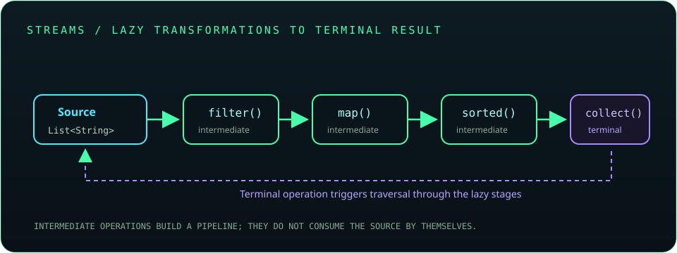

# Chapter 10: Functional Java and Streams

Java's functional features represent behavior as values and provide declarative operations over data. Lambdas and streams can make transformations concise, but clear pipelines and controlled side effects matter more than using functional syntax everywhere.

## 232. Functional interfaces

A functional interface has exactly one abstract method and can be implemented by a lambda expression or method reference. It may also contain default and static methods.

```java
@FunctionalInterface
interface Formatter {
    String format(String value);
}
```

`@FunctionalInterface` asks the compiler to verify the contract.

**Key takeaway:** Functional interfaces are Java's target types for behavior values.

## 233. Lambda expressions

A lambda provides an implementation of a functional interface's abstract method. The compiler infers parameter and result types from the target interface where possible.

```java
java.util.function.Predicate<String> nonEmpty = text -> !text.isEmpty();
```

Keep lambdas short; extract named methods when behavior needs explanation or reuse.

**Key takeaway:** Lambdas express behavior compactly against a known functional interface.

## 234. Method references

Method references point to an existing method in a context where a compatible functional interface is expected. Common forms reference a static method, a particular object, or an instance method on an arbitrary object.

```java
names.forEach(System.out::println);
```

Use a lambda when it makes parameter flow or transformation clearer.

**Key takeaway:** A method reference is concise only when the referenced operation remains obvious.

## 235. Constructor references

A constructor reference uses `TypeName::new` to create objects through a functional interface. The interface's argument types must match an available constructor.

```java
java.util.function.Supplier<java.util.ArrayList<String>> factory =
        java.util.ArrayList::new;
```

**Key takeaway:** Constructor references let factories be passed as behavior.

## 236. Built-in functional interfaces

`java.util.function` provides common interfaces such as `Predicate<T>`, `Function<T,R>`, `Consumer<T>`, and `Supplier<T>`, along with primitive-specialized variants.

```java
java.util.function.Function<String, Integer> length = String::length;
```

Prefer these standard contracts over creating duplicates with identical behavior.

**Key takeaway:** Reuse standard functional types to make behavior signatures familiar.

## 237. `Predicate`

`Predicate<T>` tests a value and returns a boolean. Predicates can be combined with `and()`, `or()`, and `negate()`.

```java
java.util.function.Predicate<String> longName = name -> name.length() > 5;
```

Keep predicate behavior deterministic when used in a stream pipeline.

**Key takeaway:** A predicate answers a yes-or-no question about a value.

## 238. `Function`

`Function<T,R>` transforms an input of type `T` into a result of type `R`. `andThen()` and `compose()` combine functions in a defined order.

```java
java.util.function.Function<String, Integer> length = String::length;
```

**Key takeaway:** A function maps one value to another.

## 239. `Consumer`

`Consumer<T>` accepts a value and returns no result, usually performing an action. Its `andThen()` method composes actions.

```java
java.util.function.Consumer<String> print = System.out::println;
```

Use consumers for effects at clear boundaries rather than hiding mutation inside transformations.

**Key takeaway:** A consumer represents an action that uses a value.

## 240. `Supplier`

`Supplier<T>` produces a value without receiving an argument. It may create a new object or calculate a value when invoked.

```java
java.util.function.Supplier<java.time.Instant> clock = java.time.Instant::now;
```

Do not assume a supplier is pure or returns the same value on every call.

**Key takeaway:** A supplier represents deferred value production.

## 241. `BiFunction` and related interfaces

`BiFunction<T,U,R>` transforms two inputs into a result. Related interfaces include `BiPredicate<T,U>` and `BiConsumer<T,U>`.

```java
java.util.function.BiFunction<Integer, Integer, Integer> sum = Integer::sum;
```

Primitive-specialized types can avoid boxing for common numeric operations.

**Key takeaway:** Use a two-argument functional interface when the operation naturally depends on two values.

## 242. Default and static interface methods

Default methods provide inherited behavior to implementors; static interface methods belong to the interface itself and are called through its name. Default-method conflicts may require an implementing class to override.

```java
interface Describable {
    default String description() { return "item"; }
    static String category() { return "general"; }
}
```

**Key takeaway:** Default methods evolve interfaces; static methods group related utilities.

## 243. Stream API

A stream is a pipeline for processing a source of elements through intermediate transformations and terminal operations. Streams do not store data and are generally single-use.



**Key takeaway:** A stream describes data processing; the terminal operation triggers it.

## 244. Creating streams

Streams can come from collections, arrays, values, ranges, generators, or I/O APIs. Prefer a source that clearly represents the data and its ownership.

```java
java.util.stream.Stream<String> words = java.util.List.of("java", "streams").stream();
```

Use `Stream.of()` for a small fixed set and primitive streams for numeric sequences when useful.

**Key takeaway:** Stream creation defines the source; it does not by itself process every element.

## 245. Intermediate and terminal operations

Intermediate operations such as `filter()` and `map()` are lazy and return another stream. Terminal operations such as `count()`, `forEach()`, and `collect()` consume the pipeline.

```java
long count = names.stream().filter(name -> name.length() > 3).count();
```

A consumed stream cannot be reused.

**Key takeaway:** Pipelines run only when a terminal operation is invoked.

## 246. `filter()`

`filter()` retains elements that satisfy a predicate and discards the rest. It preserves encounter order for ordered streams.

```java
java.util.List<String> nonBlank = names.stream()
        .filter(name -> !name.isBlank())
        .toList();
```

**Key takeaway:** Filter selects elements without changing their values.

## 247. `map()` and `flatMap()`

`map()` transforms each element independently; `flatMap()` transforms each element into a stream and flattens the resulting streams into one sequence.

```java
java.util.List<String> tokens = lines.stream()
        .flatMap(line -> java.util.Arrays.stream(line.split("\\s+")))
        .toList();
```

**Key takeaway:** Use `map` for one-to-one transformation and `flatMap` for one-to-many expansion.

## 248. `sorted()`

`sorted()` returns a stream ordered by natural ordering or a comparator. It is a stateful operation that may need to buffer elements.

```java
java.util.List<String> sorted = names.stream()
        .sorted(java.util.Comparator.comparingInt(String::length))
        .toList();
```

**Key takeaway:** Sort only when ordering is required by the result.

## 249. `distinct()`

`distinct()` removes duplicate elements according to `equals()` and `hashCode()`. For ordered streams it preserves the first encountered representative.

```java
java.util.List<String> unique = names.stream().distinct().toList();
```

Custom objects need correct equality behavior for logical duplicates.

**Key takeaway:** Stream distinctness uses equality semantics, not object identity.

## 250. `reduce()`

`reduce()` combines elements into a single result using an associative accumulation operation. An identity, when supplied, should truly be an identity for the operator.

```java
int total = scores.stream().reduce(0, Integer::sum);
```

For mutable result containers, prefer `collect()` over mutating state inside `reduce()`.

**Key takeaway:** Reduction is best for associative value combination.

## 251. `collect()`

`collect()` performs a mutable reduction using a collector, such as gathering elements into a list or map. The collector controls how partial results are accumulated and combined.

```java
java.util.List<String> upper = names.stream()
        .map(String::toUpperCase)
        .collect(java.util.stream.Collectors.toList());
```

`Stream.toList()` is a concise choice when an unmodifiable result is acceptable.

**Key takeaway:** Collectors are the standard way to build aggregate results from a stream.

## 252. Collectors and grouping

`Collectors` provides downstream operations such as `toList()`, `toSet()`, `joining()`, `groupingBy()`, and `counting()`. Grouping produces a map from classification keys to grouped values.

```java
java.util.Map<Integer, java.util.List<String>> byLength =
        names.stream().collect(java.util.stream.Collectors.groupingBy(String::length));
```

**Key takeaway:** Use collector composition to express common aggregation without manual mutable state.

## 253. Partitioning and aggregation

`partitioningBy()` divides values into `true` and `false` groups based on a predicate. Aggregating downstream collectors can count, sum, average, or summarize values.

```java
java.util.Map<Boolean, java.util.List<Integer>> groups =
        scores.stream().collect(
                java.util.stream.Collectors.partitioningBy(score -> score >= 60));
```

**Key takeaway:** Partition for two predicate groups; group for multiple classifier keys.

## 254. Primitive streams

`IntStream`, `LongStream`, and `DoubleStream` provide numeric operations without boxing each primitive element. They include operations such as `sum()`, `average()`, and ranges.

```java
int sum = java.util.stream.IntStream.rangeClosed(1, 5).sum();
```

Convert to an object stream with `boxed()` when object APIs are needed.

**Key takeaway:** Primitive streams are useful for numeric pipelines and reducing boxing.

## 255. Parallel streams

Parallel streams split work across threads and combine partial results. They can help only when the workload is sufficiently large, independently processable, and safe for parallel execution.

```java
long count = values.parallelStream().filter(this::expensiveCheck).count();
```

Avoid shared mutable side effects and benchmark against a sequential stream.

**Key takeaway:** Parallelism is a measured performance choice, not a default optimization.

## 256. Stream laziness

Intermediate operations are lazy: they run as elements are requested by a terminal operation. Short-circuiting operations such as `findFirst()` may stop before consuming the entire source.

```java
java.util.Optional<String> first = names.stream()
        .filter(name -> name.startsWith("A"))
        .findFirst();
```

**Key takeaway:** Laziness enables staged processing and short-circuit evaluation.

## 257. Stream side effects and best practices

Prefer stateless, non-interfering transformations. Do not mutate the stream source while processing it, and avoid using `peek()` as a substitute for a defined result operation.

```java
java.util.List<String> normalized = names.stream()
        .map(String::strip)
        .filter(name -> !name.isEmpty())
        .toList();
```

Use a loop when it communicates complex control flow more clearly.

**Key takeaway:** Readable, side-effect-light pipelines are easier to test and parallelize.
