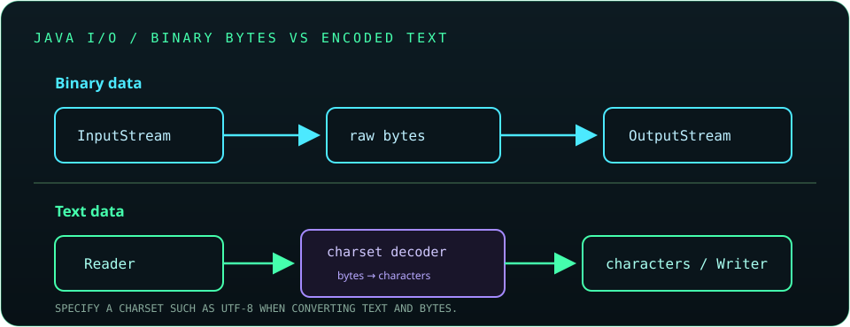

# Chapter 11: Java I/O, Files, and Serialization

Java I/O APIs move data between programs, memory, and external resources. Choose byte or character abstractions according to the data, specify character encodings, close resources deterministically, and treat serialized input as untrusted.

## 258. Java I/O package

`java.io` provides streams, readers, writers, files, and serialization APIs. Newer file and channel APIs live largely in `java.nio` and `java.nio.file`.

```java
java.nio.file.Path path = java.nio.file.Path.of("notes.txt");
System.out.println(path.toAbsolutePath());
```

Use the API family whose abstraction best matches the task; the packages can interoperate through adapters.

**Key takeaway:** Java I/O includes both classic streams and newer NIO file abstractions.

## 259. Byte streams

Byte streams transfer raw 8-bit data and are appropriate for binary formats such as images, compressed files, and network protocols.

```java
try (java.io.InputStream input = java.nio.file.Files.newInputStream(
        java.nio.file.Path.of("image.bin"))) {
    int firstByte = input.read();
}
```

Use buffered streams when repeated small reads or writes would otherwise cause excessive underlying I/O operations.

**Key takeaway:** Byte streams preserve raw bytes and do not interpret character encoding.

## 260. Character streams

Character streams transfer text through readers and writers, decoding or encoding bytes according to a charset. Specify the charset explicitly when converting files.



```java
try (java.io.Reader reader = java.nio.file.Files.newBufferedReader(
        java.nio.file.Path.of("notes.txt"), java.nio.charset.StandardCharsets.UTF_8)) {
    System.out.println(reader.read());
}
```

**Key takeaway:** Character streams interpret bytes as text using an encoding.

## 261. `InputStream` and `OutputStream`

`InputStream` reads bytes and `OutputStream` writes bytes. The `read()` method returns `-1` at end of stream; it does not return a byte value of `-1`.

```java
try (java.io.InputStream in = java.nio.file.Files.newInputStream(source);
     java.io.OutputStream out = java.nio.file.Files.newOutputStream(target)) {
    in.transferTo(out);
}
```

**Key takeaway:** Check stream end-of-input and close streams with try-with-resources.

## 262. `Reader` and `Writer`

`Reader` and `Writer` are character-oriented abstractions. They are used for text and may wrap byte streams with an explicit charset decoder or encoder.

```java
try (java.io.Reader reader = new java.io.StringReader("hello")) {
    System.out.println(reader.read());
}
```

**Key takeaway:** Use readers and writers when the data is text, not arbitrary bytes.

## 263. `FileReader` and `FileWriter`

`FileReader` and `FileWriter` are legacy convenience classes for character files. Modern code should prefer `Files.newBufferedReader()` and `Files.newBufferedWriter()` with an explicit charset.

```java
try (java.io.BufferedReader reader = java.nio.file.Files.newBufferedReader(
        java.nio.file.Path.of("notes.txt"), java.nio.charset.StandardCharsets.UTF_8)) {
    System.out.println(reader.readLine());
}
```

Explicit encodings make behavior portable across systems.

**Key takeaway:** Prefer `Files` APIs and name the charset for predictable text I/O.

## 264. `BufferedReader` and `BufferedWriter`

Buffered wrappers reduce frequent lower-level I/O calls and provide convenient line-oriented reading. `BufferedWriter.newLine()` writes the platform line separator.

```java
try (java.io.BufferedWriter writer = java.nio.file.Files.newBufferedWriter(
        java.nio.file.Path.of("out.txt"), java.nio.charset.StandardCharsets.UTF_8)) {
    writer.write("Java");
    writer.newLine();
}
```

**Key takeaway:** Buffer text I/O for efficient sequential reading and writing.

## 265. `PrintWriter`

`PrintWriter` provides convenient formatted text output with methods such as `print()`, `println()`, and `printf()`. It can suppress I/O exceptions, so check `checkError()` when that behavior matters.

```java
try (java.io.PrintWriter writer = new java.io.PrintWriter("report.txt")) {
    writer.printf("Count: %d%n", 3);
}
```

Prefer explicit encoding-aware APIs when output encoding is important.

**Key takeaway:** Convenient printing does not remove the need to detect write failures.

## 266. `DataInputStream` and `DataOutputStream`

Data streams read and write Java primitive values in a portable binary format, preserving their types and order. The reader must consume values in the same order and type sequence used by the writer.

```java
try (java.io.DataOutputStream out = new java.io.DataOutputStream(
        java.nio.file.Files.newOutputStream(java.nio.file.Path.of("data.bin")))) {
    out.writeInt(42);
    out.writeUTF("Java");
}
```

**Key takeaway:** Data streams encode primitives; define and version the record layout yourself.

## 267. `File` class

`File` is a legacy abstraction for a file-system path and basic operations. It does not represent file contents and has limited error reporting compared with `Path` and `Files`.

```java
java.io.File file = new java.io.File("notes.txt");
System.out.println(file.exists());
```

Use `Path` for new file-system code.

**Key takeaway:** `File` is a path-like legacy API, not a stream or file handle.

## 268. `Path` and `Paths`

`Path` represents a file-system path; `Path.of()` is the modern factory, while `Paths.get()` remains available. Paths can be composed, normalized, and resolved without immediately accessing the file system.

```java
java.nio.file.Path config = java.nio.file.Path.of("config", "app.properties");
```

A path may be relative, absolute, or invalid for a particular file system.

**Key takeaway:** Use `Path` to model locations and `Files` to operate on them.

## 269. `Files` utility class

`Files` provides operations for reading, writing, copying, moving, deleting, and inspecting paths. Convenience methods are useful for small files; streaming APIs are more appropriate for large files.

```java
java.nio.file.Files.writeString(
        java.nio.file.Path.of("hello.txt"), "Hello", java.nio.charset.StandardCharsets.UTF_8);
```

Handle I/O exceptions and permissions explicitly.

**Key takeaway:** `Files` is the main utility API for common path operations.

## 270. Java NIO

Java NIO includes buffers, channels, selectors, and the NIO.2 file APIs. NIO supports scalable and flexible I/O patterns, including non-blocking operations for suitable channel types.

```java
java.nio.ByteBuffer buffer = java.nio.ByteBuffer.allocate(16);
buffer.putInt(42);
buffer.flip();
```

Use the simplest abstraction that meets the application's throughput and control requirements.

**Key takeaway:** NIO provides lower-level control, but not every file task needs channels or selectors.

## 271. Buffers and channels

A channel transfers data to or from a `ByteBuffer`. A buffer has position, limit, and capacity; after writing data into it, call `flip()` before reading that data.

```java
buffer.flip();
int value = buffer.getInt();
buffer.clear();
```

The read/write mode transition is a common source of bugs.

**Key takeaway:** Track buffer state deliberately: fill, flip, drain, then clear or compact.

## 272. File and directory operations

`Files` supports creating directories, listing entries, checking attributes, and moving or deleting files. Operations can fail because of permissions, missing paths, or file-system rules.

```java
java.nio.file.Path directory = java.nio.file.Path.of("logs");
java.nio.file.Files.createDirectories(directory);
```

Use try-with-resources for directory streams and other closeable traversal resources.

**Key takeaway:** File-system operations are external effects and must handle failure conditions.

## 273. Reading and writing files

For small text files, `Files.readString()` and `Files.writeString()` are concise. For large files, process buffered lines or streams to avoid loading the entire content into memory.

```java
try (java.util.stream.Stream<String> lines =
        java.nio.file.Files.lines(java.nio.file.Path.of("large.txt"))) {
    lines.filter(line -> !line.isBlank()).forEach(System.out::println);
}
```

`Files.lines()` returns a resource that must be closed.

**Key takeaway:** Match the reading strategy to the file size and close lazy file-backed streams.

## 274. File encodings

Text files are bytes encoded using a charset such as UTF-8. The same bytes can decode to different text under different charsets, so choose the encoding explicitly at file boundaries.

```java
String text = java.nio.file.Files.readString(
        java.nio.file.Path.of("notes.txt"), java.nio.charset.StandardCharsets.UTF_8);
```

**Key takeaway:** Encoding is part of a text file's contract, not something to guess.

## 275. ZIP and unzip operations

ZIP archives contain named entries, often files and directories. Java provides `ZipInputStream` and `ZipOutputStream` for sequential entry-based operations.

```java
try (java.util.zip.ZipOutputStream zip = new java.util.zip.ZipOutputStream(
        java.nio.file.Files.newOutputStream(java.nio.file.Path.of("archive.zip")))) {
    zip.putNextEntry(new java.util.zip.ZipEntry("readme.txt"));
    zip.write("Java".getBytes(java.nio.charset.StandardCharsets.UTF_8));
    zip.closeEntry();
}
```

When extracting untrusted archives, validate entry paths to prevent path traversal.

**Key takeaway:** ZIP processing requires careful resource handling and safe destination-path validation.

## 276. Working with ZIP files

For random access to archive entries, `ZipFile` can inspect and read entries without manually scanning a stream from the beginning. Close the archive when finished.

```java
try (java.util.zip.ZipFile zip = new java.util.zip.ZipFile("archive.zip")) {
    var entry = zip.getEntry("readme.txt");
    if (entry != null) {
        System.out.println(entry.getSize());
    }
}
```

Check for missing entries and handle malformed or unexpectedly large archives.

**Key takeaway:** Choose streaming ZIP APIs for sequential work and `ZipFile` for entry lookup.

## 277. Serialization

Serialization converts an object graph into a byte representation. Java's built-in object serialization is legacy technology and should not be used for untrusted data.

```java
// Prefer an explicit, documented data format for durable or external interchange.
```

For persistent data or network APIs, formats with explicit schemas and safe parsers are generally preferable.

**Key takeaway:** Serialization is a format and security boundary, not a transparent storage shortcut.

## 278. Deserialization

Deserialization reconstructs objects from bytes and may invoke class-specific logic. Untrusted serialized input can enable dangerous gadget chains, excessive resource use, or unexpected object creation.

```java
// Do not deserialize arbitrary bytes from users or untrusted networks.
```

Avoid native Java deserialization for untrusted data; if legacy use is unavoidable, apply strict class filters and resource limits.

**Key takeaway:** Treat deserialization as executing a complex parser on attacker-controlled input.

## 279. `Serializable` and `serialVersionUID`

`Serializable` is a marker interface enabling Java's native object serialization. `serialVersionUID` identifies a serialization version and can make compatibility changes explicit.

```java
class Settings implements java.io.Serializable {
    private static final long serialVersionUID = 1L;
}
```

Compatibility identifiers do not make serialization safe or guarantee semantic compatibility.

**Key takeaway:** Use `Serializable` only for controlled legacy needs and plan version evolution.

## 280. `transient` keyword

`transient` excludes an instance field from default Java serialization. After deserialization, such a field receives its default value unless restored explicitly.

```java
class Session implements java.io.Serializable {
    private transient String temporaryToken;
}
```

Do not rely on `transient` alone as a complete secret-management strategy.

**Key takeaway:** Mark non-persistent state transient and define how it is reinitialized.

## 281. Serialization security considerations

Native deserialization of untrusted streams can instantiate unexpected types and trigger dangerous behavior. If legacy serialization is unavoidable, use `ObjectInputFilter` allowlists, limits, and strict input provenance.

```java
// Prefer parsing a constrained data format with an explicit schema.
```

Never assume that a byte stream is safe because it was produced by a Java application.

**Key takeaway:** Reject untrusted serialized object graphs; prefer constrained formats.

## 282. Object cloning and copying

`Object.clone()` is a legacy mechanism that usually performs a shallow field copy and requires `Cloneable`. Copy constructors or explicit factory methods make copy depth and invariants easier to control.

```java
class Point {
    final int x;
    final int y;
    Point(Point source) { this.x = source.x; this.y = source.y; }
}
```

For mutable nested state, decide which objects are copied and which are intentionally shared.

**Key takeaway:** Prefer explicit copy APIs whose ownership behavior is clear.

## 283. Resource management

Files, sockets, channels, and similar resources should be closed deterministically. `AutoCloseable` and try-with-resources ensure cleanup on both success and failure paths.

```java
try (var input = java.nio.file.Files.newInputStream(path)) {
    input.transferTo(output);
}
```

Garbage collection does not provide timely external-resource cleanup.

**Key takeaway:** Acquire closeable resources in try-with-resources and keep their scope narrow.
