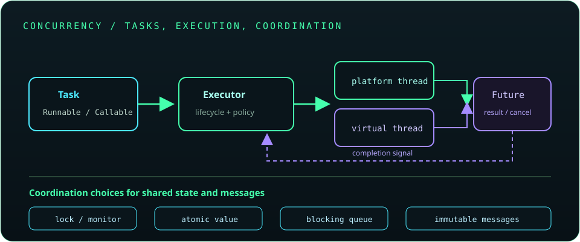

# Chapter 12: Multithreading and Concurrency

Concurrency lets a program make progress on multiple tasks during overlapping periods; parallelism means tasks execute at the same instant on multiple cores. Correct concurrent code makes ownership, synchronization, cancellation, and task completion explicit. Prefer executors and higher-level concurrency utilities to manually managing thread lifecycles.



## 284. Processes versus threads

A process has its own address space and operating-system resources. Threads within a process share its heap and open resources, but each thread has its own call stack and execution state. Processes provide stronger isolation; threads make communication cheaper but require coordination around shared data.

**Key takeaway:** Shared memory makes threads efficient and makes data races possible.

## 285. Multithreading fundamentals

Multithreading allows independent tasks to overlap. It can improve responsiveness and throughput, but does not automatically make a program faster: contention, scheduling, synchronization, and task size all matter.

```java
Thread worker = new Thread(() -> System.out.println("Working"));
worker.start();
```

Calling `start()` schedules a new thread; calling `run()` directly is an ordinary method call on the current thread.

**Key takeaway:** Add concurrency to solve a measured responsiveness or throughput need, not as decoration.

## 286. Thread lifecycle

A Java thread moves among `NEW`, `RUNNABLE`, `BLOCKED`, `WAITING`, `TIMED_WAITING`, and `TERMINATED`. `RUNNABLE` includes a thread that is executing and one eligible to run; the JVM does not expose a separate `RUNNING` state.

```java
Thread worker = new Thread(() -> {});
System.out.println(worker.getState()); // NEW
worker.start();
```

**Key takeaway:** Thread state is a diagnostic snapshot, not a synchronization mechanism.

## 287. Creating threads using `Thread`

Subclassing `Thread` can put task logic and thread control into one class. It limits reuse because the class cannot extend another class and couples work to a specific execution mechanism.

```java
Thread worker = new Thread(() -> processBatch());
worker.start();
```

Prefer expressing work as `Runnable` or `Callable` and selecting the execution policy separately.

**Key takeaway:** Use a `Thread` directly for small demonstrations or deliberately managed dedicated threads.

## 288. Creating threads using `Runnable`

`Runnable` represents a task that returns no result and does not declare checked exceptions. It is a functional interface and can be passed to a `Thread` or submitted to an executor.

```java
Runnable task = () -> System.out.println(Thread.currentThread().getName());
new Thread(task).start();
```

**Key takeaway:** Separate the task (`Runnable`) from the mechanism that runs it.

## 289. `Callable` and `Future`

`Callable<V>` returns a result and may throw checked exceptions. Submitting it to an `ExecutorService` returns a `Future<V>` that can be queried, cancelled, or used to retrieve the result.

```java
java.util.concurrent.Future<Integer> result =
        executor.submit(() -> calculateTotal());
int total = result.get();
```

`get()` blocks until completion; handle `InterruptedException` and `ExecutionException` rather than hiding them.

**Key takeaway:** A `Future` is a handle to an asynchronous result, not the result itself.

## 290. Thread priorities

Thread priority is a scheduling hint whose effect is platform- and JVM-dependent. It does not establish task order, fairness, or correctness.

**Key takeaway:** Never use priority to coordinate threads or to promise a latency guarantee.

## 291. `sleep()`, `join()`, and `yield()`

`sleep()` pauses the current thread for a duration; it does not release monitors it owns. `join()` waits for another thread to finish. `yield()` is only a scheduler hint and may do nothing.

```java
worker.start();
worker.join(); // Wait for worker completion.
```

**Key takeaway:** Use locks, conditions, latches, or futures to coordinate; do not poll with sleeps.

## 292. Thread interruption

Interruption is a cooperative cancellation signal. Blocking methods such as `sleep()` and `join()` usually throw `InterruptedException` and clear the interrupt flag; code should finish cleanup and propagate the exception or restore the flag.

```java
try {
    Thread.sleep(1000);
} catch (InterruptedException e) {
    Thread.currentThread().interrupt();
    return;
}
```

**Key takeaway:** Do not swallow interruption; preserve the cancellation request.

## 293. Synchronization

Synchronization provides mutual exclusion and a happens-before relationship for memory visibility. A synchronized region is guarded by a monitor; threads acquiring the same monitor see writes published by its previous owner.

**Key takeaway:** Synchronize around the smallest complete invariant, using the same lock consistently.

## 294. Synchronized methods and blocks

A synchronized instance method locks `this`; a synchronized static method locks the class's `Class` object. A synchronized block lets code choose a private lock and protect only the state transition that needs it.

```java
private final Object lock = new Object();
private int count;
void increment() {
    synchronized (lock) {
        count++;
    }
}
```

**Key takeaway:** Prefer a private lock object over exposing a lock that unrelated code can acquire.

## 295. Race conditions

A race condition occurs when a result depends on unpredictable timing between operations. `count++`, for example, is a read-modify-write sequence and can lose updates when multiple threads execute it without coordination.

**Key takeaway:** Protect shared invariants with synchronization, atomics, confinement, or immutable state.

## 296. Deadlocks and starvation

Deadlock occurs when threads wait cyclically for locks that other threads hold. Starvation occurs when a thread is repeatedly denied progress; livelock occurs when threads remain active but keep preventing one another from completing.

Reduce risk with a global lock order, short critical sections, time-bounded acquisition where appropriate, and thread-dump diagnostics.

**Key takeaway:** Lock ordering and bounded coordination help prevent liveness failures.

## 297. Thread communication

Threads coordinate by publishing state through synchronized/volatile fields, atomic variables, blocking queues, locks and conditions, or higher-level synchronizers. A blocking queue often expresses producer-consumer communication more safely than manually coordinating a shared list.

**Key takeaway:** Choose a communication primitive that expresses the relationship between tasks.

## 298. `wait()`, `notify()`, and `notifyAll()`

These `Object` methods coordinate through a monitor. A thread must own that monitor to call them, and `wait()` releases it while waiting. Always test the condition in a loop because wakeups can be spurious and another thread may change the condition first.

```java
synchronized (lock) {
    while (!ready) {
        lock.wait();
    }
}
```

Prefer `Condition`, `BlockingQueue`, or other higher-level utilities for new coordination code.

**Key takeaway:** Guard the condition with the same monitor and re-check it after every wakeup.

## 299. `volatile` keyword

Reads and writes of a volatile variable are visible across threads and ordered by the Java Memory Model. Volatile does not make compound operations such as `count++` atomic and does not protect multi-field invariants.

**Key takeaway:** Use `volatile` for independent state publication, not general mutual exclusion.

## 300. Atomic variables

Classes such as `AtomicInteger` provide thread-safe single-variable operations, commonly using compare-and-set. They are useful for counters and state transitions that fit one atomic value.

```java
java.util.concurrent.atomic.AtomicInteger count =
        new java.util.concurrent.atomic.AtomicInteger();
count.incrementAndGet();
```

For invariants spanning multiple fields, use a lock or a different design.

**Key takeaway:** Atomicity of one variable does not make a larger transaction atomic.

## 301. Locks and explicit locking

The `Lock` interface supports explicit acquisition, timed and interruptible acquisition, and multiple conditions. Explicit locks require disciplined release, normally in a `finally` block.

```java
lock.lock();
try {
    updateState();
} finally {
    lock.unlock();
}
```

**Key takeaway:** Use an explicit lock when its additional capabilities solve a real need.

## 302. `ReentrantLock`

`ReentrantLock` permits the owning thread to acquire the same lock again and supports options such as fairness, timed acquisition, and `Condition` objects. Fairness can reduce throughput and does not guarantee fair scheduling outside that lock.

**Key takeaway:** Keep lock ownership and release paths easy to audit.

## 303. Executor framework

Executors separate task submission from thread creation and lifecycle management. `ExecutorService` accepts tasks, returns futures, and should be shut down when its owner is finished with it.

```java
var pool = java.util.concurrent.Executors.newFixedThreadPool(4);
try {
    pool.submit(() -> processBatch());
} finally {
    pool.shutdown();
}
```

Production code should define how it waits for termination and handles tasks that do not finish.

**Key takeaway:** Manage a pool as a resource with a clear owner and shutdown policy.

## 304. Thread pools

A thread pool reuses worker threads and can bound concurrency. Pool size and queue policy affect latency, memory use, and backpressure; unbounded queues can hide overload while accumulating work.

**Key takeaway:** Choose pool sizing and rejection behavior from workload limits, not a universal formula.

## 305. `Future` and `CompletableFuture`

`Future` offers result retrieval and cancellation; `CompletableFuture` composes dependent actions and error handling without manually blocking between each step.

```java
java.util.concurrent.CompletableFuture
        .supplyAsync(() -> loadUser())
        .thenApply(user -> user.displayName())
        .exceptionally(error -> "Unavailable");
```

Async stages without an explicit executor may use a shared common pool. Use an appropriate executor for blocking work or workload isolation.

**Key takeaway:** Compose asynchronous stages and make executor ownership explicit.

## 306. Concurrent collections

Concurrent collections provide thread-safe operations designed for concurrent access. They do not make arbitrary multi-step sequences atomic; compound operations should use atomic collection methods or explicit coordination.

**Key takeaway:** Use the collection designed for the access pattern and understand its consistency guarantees.

## 307. `BlockingQueue`

A `BlockingQueue` blocks producers or consumers when capacity or data availability requires it. A bounded queue can provide backpressure and prevent unlimited task accumulation.

```java
queue.put(task);       // Wait for capacity.
Task next = queue.take(); // Wait for an item.
```

**Key takeaway:** A bounded queue gives producer-consumer pipelines a clear capacity limit.

## 308. `CountDownLatch` and `Semaphore`

`CountDownLatch` lets one or more threads wait for a fixed number of events. A `Semaphore` controls access to a limited number of permits, for example concurrent requests to a constrained service.

**Key takeaway:** A latch is one-shot coordination; a semaphore manages reusable permits.

## 309. `ConcurrentHashMap`

`ConcurrentHashMap` supports concurrent retrievals and updates without locking the entire map for every operation. Use atomic methods such as `computeIfAbsent` for compound per-key updates, and avoid assuming a whole-map traversal is a snapshot.

**Key takeaway:** Prefer its atomic map operations over separate get-then-put sequences.

## 310. Fork/Join framework

Fork/Join is designed for recursively decomposed, mostly CPU-bound tasks. Workers use work-stealing to balance subtasks; splitting work too finely can make scheduling cost exceed useful work.

**Key takeaway:** Use Fork/Join when tasks divide into independent chunks that can be recombined.

## 311. Parallel processing

Parallel streams and parallel algorithms can improve throughput for sufficiently large, independent workloads. Shared mutable state, blocking operations, ordering constraints, and common-pool contention can make them slower or incorrect.

**Key takeaway:** Measure parallel work against a sequential baseline and keep operations stateless where possible.

## 312. Virtual threads

Virtual threads are lightweight threads managed by the Java runtime and are well suited to applications with many concurrent tasks that spend time waiting on blocking I/O. They do not make CPU-bound work faster and should generally be created per task rather than pooled.

```java
try (var executor = java.util.concurrent.Executors.newVirtualThreadPerTaskExecutor()) {
    executor.submit(() -> handleRequest());
}
```

The try-with-resources form is available on modern JDKs; check the target Java release before using newer APIs.

**Key takeaway:** Virtual threads simplify high-concurrency blocking code, but downstream limits still matter.

## 313. Structured concurrency concepts

Structured concurrency treats related child tasks as one unit whose lifetime is bounded by a parent scope. This makes cancellation, failure propagation, and joining related work easier to reason about.

The Java API has evolved through preview releases; verify the target JDK's status and API before depending on a specific class or method.

**Key takeaway:** Keep child-task lifetimes within the operation that started them.

## 314. Thread safety and concurrency best practices

Prefer immutable values, thread confinement, and message passing; minimize shared mutable state. Define cancellation and shutdown behavior, avoid holding locks during slow I/O, and test with realistic load while using thread dumps and profilers to investigate problems.

**Key takeaway:** Clear ownership and bounded work are more reliable than adding locks after races appear.
