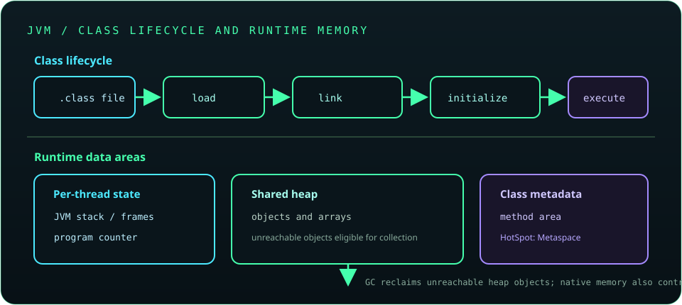

# Chapter 13: JVM Internals and Performance

The Java Virtual Machine loads and executes class files, manages runtime memory, and adapts execution using compilation and garbage collection. Diagnose performance with measurements and production evidence; do not tune from intuition alone. JVM behavior and command-line options can vary across Java vendors and releases.



## 315. JVM architecture

The JVM specification defines an abstract machine; implementations such as HotSpot provide class loading, bytecode execution, JIT compilation, garbage collection, and native interfaces. A JDK includes a JVM plus development tools and libraries; the JVM alone is not the Java development kit.

**Key takeaway:** Separate Java language rules, JVM specification guarantees, and vendor-specific implementation behavior.

## 316. Class loading

Class loading locates binary class definitions and creates corresponding runtime classes. The lifecycle continues through loading, linking (verification, preparation, and resolution), and initialization.

**Key takeaway:** Loading makes a class available; initialization runs its static initialization logic.

## 317. Class loaders

Class loaders define where classes come from and establish runtime type identity. In the traditional delegation model, a loader asks its parent first; two classes with the same name loaded by different defining loaders are different runtime types.

**Key takeaway:** A class is identified by both its binary name and defining class loader.

## 318. Linking and initialization

Verification checks class-file structure and bytecode constraints; preparation allocates static storage with default values; resolution connects symbolic references. Initialization runs static field initializers and static blocks in a defined order, typically on first active use.

**Key takeaway:** Static initialization is executable code and should avoid fragile external side effects.

## 319. Bytecode and bytecode inspection

The Java compiler translates source into platform-independent class-file bytecode. The `javap` tool can inspect class structure and instructions, which is useful for learning compiler output and debugging linkage issues.

```text
javap -c -p MyClass
```

Bytecode inspection helps explain behavior but does not replace language-level reasoning or runtime profiling.

**Key takeaway:** Bytecode is the JVM instruction format, not the same as native machine code.

## 320. JVM memory areas

Each thread has a program counter and JVM stack; the heap is shared and stores objects; the method area holds per-class structures, commonly implemented using Metaspace in HotSpot. Native memory also includes stacks, code cache, and other runtime allocations.

**Key takeaway:** Process memory is larger than the Java heap.

## 321. Stack versus heap

Each thread's stack stores frames for active method calls, including local variables and intermediate state. The heap stores objects whose lifetimes can outlast a method call; references on stacks may point to heap objects.

**Key takeaway:** Stack and heap are different runtime areas with different ownership and capacity behavior.

## 322. Metaspace

HotSpot stores class metadata in native memory called Metaspace, rather than in the Java heap. Class-loader leaks can retain class metadata; increasing a Metaspace limit may mask but not fix the root cause.

**Key takeaway:** Diagnose class unloading and class-loader reachability when Metaspace grows unexpectedly.

## 323. Garbage collection fundamentals

Garbage collection reclaims heap objects that are no longer reachable from GC roots. The collector may pause application threads or use concurrent phases; collection does not guarantee immediate cleanup of files, sockets, or other external resources.

**Key takeaway:** Make external-resource cleanup explicit; do not rely on garbage collection for it.

## 324. Garbage collectors and their trade-offs

Collectors trade throughput, pause-time goals, memory overhead, and operational complexity. The right collector depends on the JDK, heap size, allocation pattern, latency objective, and workload; defaults change across releases.

**Key takeaway:** Choose a collector from measured goals, then validate under production-like load.

## 325. Strong, weak, soft, and phantom references

Strong references keep reachable objects alive. Weak references do not prevent collection; soft references may be cleared under memory pressure; phantom references support post-mortem cleanup coordination through a reference queue.

Soft references are not a predictable general-purpose cache policy.

**Key takeaway:** Reference strength changes reachability, not the need for explicit resource lifecycle management.

## 326. Memory leaks in Java

A Java memory leak occurs when objects remain reachable even though the application no longer needs them. Common causes include unbounded caches, listeners not removed, static collections, and class loaders retained by threads.

**Key takeaway:** Look for unexpectedly retained object graphs, not only allocations that fail to be freed.

## 327. Just-In-Time (JIT) compilation

The JIT compiler can compile frequently executed bytecode into optimized native code using runtime profiling. Warm-up, inlining, deoptimization, and workload shape affect observed performance.

**Key takeaway:** Benchmark long enough to account for warm-up and use representative inputs.

## 328. Java Flight Recorder

Java Flight Recorder (JFR) captures low-overhead events such as allocations, thread activity, garbage collection, and I/O. Recordings can be started with supported JDK tools or APIs and analyzed to locate bottlenecks.

**Key takeaway:** JFR provides time-correlated runtime evidence for diagnosis.

## 329. Java Mission Control

Java Mission Control (JMC) analyzes JFR recordings and presents event timelines, allocation data, thread activity, and other diagnostics. Availability and packaging may differ by JDK distribution.

**Key takeaway:** Use JMC to explore recordings; interpret findings in the context of application behavior.

## 330. Profiling and performance analysis

A profiler samples or instruments execution to reveal CPU hotspots, allocation pressure, lock contention, and I/O waits. Start with a clear performance hypothesis and profile the environment that reproduces the issue.

**Key takeaway:** Profile before optimizing and verify that the change improves the measured objective.

## 331. Java troubleshooting tools

JDK tools include `jcmd`, `jstack`, `jmap`, `jstat`, and `jfr`, with availability and recommended use evolving across releases. `jcmd` is commonly used to query a running JVM and request diagnostics such as thread dumps or recordings.

```text
jcmd <pid> Thread.print
```

Confirm the target process and tool/JDK compatibility before issuing commands in production.

**Key takeaway:** Collect the diagnostic artifact that answers the current question and protect sensitive data in dumps.

## 332. Java agents and instrumentation

Java agents can observe or transform class definitions through instrumentation APIs. They are used by profilers, monitoring tools, and bytecode frameworks, but transformation can affect compatibility, startup, and performance.

**Key takeaway:** Treat agents as runtime dependencies and validate their impact across JDK upgrades.

## 333. Java assertions

Assertions express internal assumptions using the `assert` statement and can be enabled at runtime with `-ea`. They are disabled by default and must not replace validation of external input or required application behavior.

```java
assert index >= 0 : "index must be non-negative";
```

**Key takeaway:** Assertions check programmer assumptions, not user-input contracts.

## 334. Logging fundamentals

Logging records operational events with severity, context, and useful identifiers. Prefer parameterized logging, avoid secrets and sensitive payloads, and choose a logging facade/backend consistent with the application.

**Key takeaway:** Logs should help explain system behavior without exposing confidential data.

## 335. Debugging in an IDE

IDE debuggers can set breakpoints, inspect values, step through code, and evaluate expressions. Conditional breakpoints and thread-aware views help with concurrency, but debugger pauses can change timing and conceal or create race symptoms.

**Key takeaway:** Use debugger observations as evidence, then confirm behavior without debugger timing effects.

## 336. Java security fundamentals

The Java platform provides APIs for cryptography, TLS, permissions, and secure coding, but application security depends on correct configuration and threat-aware design. Keep the JDK patched, validate external input, protect secrets, and avoid unsafe deserialization.

**Key takeaway:** A managed runtime does not automatically make an application secure.
