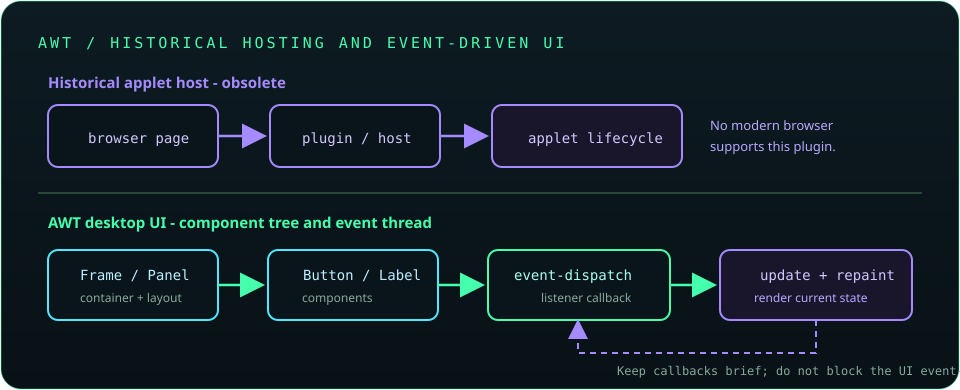

# Chapter 14: Applets and AWT - Essentials Only

Applets are obsolete: modern browsers no longer run the Java browser plugin, and current JDKs have removed the applet API. Study them only to understand older code and the history of Java GUI deployment. AWT remains part of Java desktop history and supplies foundational windowing, component, layout, and event concepts.



## 337. What applets were and why they were used

An applet was a Java program embedded in a web page and hosted by a browser plugin or applet viewer. It was once used to deliver interactive content without installing a standalone application, but depended on a browser plugin and security model that are no longer available.

**Key takeaway:** Applets are a historical deployment model, not a modern web-development option.

## 338. Basic applet lifecycle concepts

The historical `Applet` lifecycle included initialization, starting, stopping, and destruction callbacks. A host could call start and stop more than once as a page became visible or hidden; cleanup belonged in the destruction lifecycle.

Current Java installations do not support applet execution, so lifecycle names are useful when reading legacy code rather than for new programs.

**Key takeaway:** Understand the old host-managed lifecycle, but do not build new applets.

## 339. Applet parameters and document base

HTML could provide named parameters to an applet, while its document base identified the URL of the containing page. Those values let old applets configure behavior or locate related resources.

**Key takeaway:** Applet parameters and document-relative resources belong to an obsolete browser-plugin environment.

## 340. Why applets are no longer supported in modern browsers

Browser vendors removed plugin architectures, including the Java plugin, because of security, compatibility, and maintenance risks. Modern browsers do not provide a supported runtime path for applets, and current JDKs removed the applet API.

**Key takeaway:** Do not recommend installing an old plugin or weakening browser security to run applets.

## 341. AWT introduction

The Abstract Window Toolkit (`java.awt`) is Java's original desktop GUI toolkit. It provides windows, controls, graphics, colors, fonts, layout managers, and event classes, with peer components historically backed by native operating-system widgets.

**Key takeaway:** AWT is foundational Java GUI technology and remains relevant for legacy maintenance.

## 342. AWT components and containers

AWT `Component` represents a visual element; `Container` is a component that can hold other components. A `Frame` is a top-level window, while a `Panel` groups child components inside another container.

**Key takeaway:** Build a GUI as a containment hierarchy and let layout managers position its children.

## 343. Frames, panels, buttons, and labels

`Frame` provides a top-level window, `Panel` groups controls, `Button` triggers an action, and `Label` displays non-editable text. AWT component creation and updates should be performed on the event-dispatch thread.

```java
java.awt.EventQueue.invokeLater(() -> {
    java.awt.Frame frame = new java.awt.Frame("Example");
    frame.add(new java.awt.Label("Hello, AWT"));
    frame.setSize(320, 160);
    frame.setVisible(true);
});
```

**Key takeaway:** Keep GUI work on the event-dispatch thread and avoid blocking it.

## 344. Background and foreground colors

AWT components expose foreground and background colors through `setForeground()` and `setBackground()`. Color choices should maintain readable contrast, and custom painting belongs in the component's painting lifecycle rather than arbitrary drawing calls.

**Key takeaway:** Configure component appearance through its API and preserve accessible contrast.

## 345. Layout managers

Layout managers calculate component size and position as a container changes. `FlowLayout`, `BorderLayout`, and `GridLayout` provide common arrangements without hard-coded pixel coordinates.

**Key takeaway:** Prefer layouts over fixed positions so interfaces adapt to resizing and different environments.

## 346. Event handling

AWT uses listener interfaces to react to events such as button actions and window closing. Register a listener with the component, then keep its callback short so the event-dispatch thread remains responsive.

```java
button.addActionListener(event -> status.setText("Submitted"));
```

Long-running work should be moved off the UI thread and results posted back safely.

**Key takeaway:** Handle UI events quickly and marshal UI updates to the event-dispatch thread.

## 347. Basic animation concepts

Simple GUI animation updates state over time and requests repainting; painting renders the current state. A timer can schedule updates, but animation must not block the event-dispatch thread or assume perfectly regular timing.

**Key takeaway:** Separate state updates from painting and keep each event-dispatch task brief.

## 348. AWT versus Swing versus JavaFX

AWT provides foundational native-peer controls; Swing builds a richer, mostly lightweight component set on top of AWT; JavaFX is a separate modernized UI toolkit with scene graphs, CSS styling, and property bindings. Project requirements, support status, dependencies, and deployment targets determine the best choice.

| Toolkit | Role | Typical consideration |
| --- | --- | --- |
| AWT | Original desktop GUI foundation | Useful for legacy code and platform integration |
| Swing | Mature component toolkit built on AWT | Common in existing Java desktop applications |
| JavaFX | Separate scene-graph UI toolkit | Often requires adding and managing JavaFX modules/dependencies |

**Key takeaway:** Choose a supported toolkit for the project; none of these makes applets viable again.
