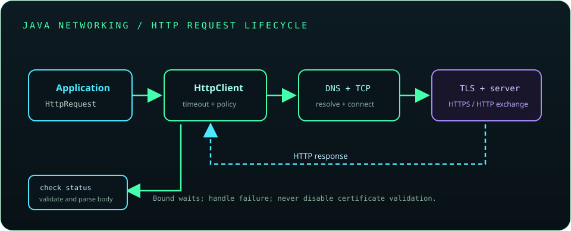

# Chapter 15: Java Networking

Java networking APIs range from low-level sockets to the higher-level HTTP client. Use the narrowest abstraction that meets the protocol need, set timeouts, close resources, and validate remote data. Network failures are normal operational outcomes and should be handled explicitly.



## 349. Networking fundamentals

Networking moves data between processes using layered protocols. Applications commonly use a name or address plus a port to reach a service, while transport and application protocols define delivery and message meaning.

**Key takeaway:** Debug networking by identifying the layer where the failure occurs.

## 350. IP addresses, ports, and protocols

An IP address identifies a network interface or destination; a port identifies a transport endpoint within a host. Protocols such as TCP, UDP, and HTTP define different communication behavior at different layers.

**Key takeaway:** An IP address identifies a host route, while a port identifies a service endpoint.

## 351. TCP versus UDP

TCP provides a reliable, ordered byte stream with connection setup and retransmission. UDP sends independent datagrams without built-in delivery or ordering guarantees, which can suit latency-sensitive or application-managed protocols.

**Key takeaway:** TCP and UDP provide different transport semantics; neither is a drop-in replacement for the other.

## 352. The `InetAddress` class

`InetAddress` represents an IP address and can resolve host names using system name-service configuration. DNS lookup may block or fail, and results can vary due to caching and network configuration.

```java
java.net.InetAddress address = java.net.InetAddress.getByName("example.com");
System.out.println(address.getHostAddress());
```

**Key takeaway:** Name resolution is an external operation with latency and failure modes.

## 353. URLs and URIs

A URI is a structured identifier; a URL is a locator that identifies how to access a resource. Java's `URI` type is useful for parsing and composing identifiers, while the `URL` type supports older access patterns.

```java
java.net.URI endpoint = java.net.URI.create("https://example.com/api/items?page=1");
```

Use URI-aware APIs rather than concatenating user-controlled strings into endpoints.

**Key takeaway:** Parse and validate structured identifiers instead of treating them as plain text.

## 354. `URLConnection` and HTTP connections

`URLConnection` is a general connection abstraction, with `HttpURLConnection` as a legacy HTTP implementation. New HTTP code should normally use `java.net.http.HttpClient`, which provides clearer request, response, timeout, and asynchronous APIs.

**Key takeaway:** Use `HttpClient` for new HTTP integrations and retain URL connections mainly for existing code.

## 355. Socket programming

Socket programming provides stream or datagram communication between endpoints. It requires explicit framing, encoding, timeout, error, and resource-lifecycle decisions; a TCP connection alone does not define application message boundaries.

**Key takeaway:** Define a protocol on top of a socket and handle partial reads and writes.

## 356. `Socket` and `ServerSocket`

`Socket` represents a TCP endpoint; `ServerSocket` listens for connection requests and accepts sockets for individual clients. Accepted sockets should use bounded timeouts and deterministic cleanup.

```java
try (java.net.ServerSocket server = new java.net.ServerSocket(8080);
     java.net.Socket client = server.accept()) {
    client.setSoTimeout(5000);
}
```

This minimal blocking example serves one connection at a time; production servers need deliberate concurrency and capacity limits.

**Key takeaway:** A server socket accepts connections; each accepted socket carries one client conversation.

## 357. Client-server communication

A client initiates a request or connection; a server accepts and responds according to a protocol. Both sides need agreement on message format, encoding, error behavior, authentication, and connection lifecycle.

**Key takeaway:** Document the wire protocol independently of implementation classes.

## 358. Sending and receiving data

Socket streams transfer bytes, so text protocols need an agreed charset and framing scheme. Reads may return fewer bytes than requested; loop until the complete frame is read, the peer closes, or an error occurs.

**Key takeaway:** Never assume one read call returns one complete application message.

## 359. Multithreaded servers

A multithreaded server can handle independent clients concurrently by dispatching accepted connections to managed workers. Bound the worker count, request queue, timeouts, and per-client resources to prevent overload.

**Key takeaway:** Concurrency improves service capacity only when resource usage is bounded.

## 360. HTTP fundamentals

HTTP is a request-response application protocol with methods, headers, status codes, and optional message bodies. HTTPS carries HTTP over TLS to protect the channel and authenticate the server.

**Key takeaway:** HTTP semantics are defined by the request and response, not by a raw socket alone.

## 361. HTTP methods and status codes

Methods such as GET, POST, PUT, PATCH, and DELETE communicate the intended operation; status codes summarize the result. Method safety and idempotency matter when clients retry after timeouts.

**Key takeaway:** Choose methods and retry behavior based on their semantics, not convenience.

## 362. The Java `HttpClient` API

`HttpClient` is Java's modern API for sending HTTP requests synchronously or asynchronously. Reusing a client can share configuration and connection resources; configure proxy, TLS, redirects, and timeouts to match the application.

```java
var client = java.net.http.HttpClient.newBuilder()
        .connectTimeout(java.time.Duration.ofSeconds(5))
        .build();
```

**Key takeaway:** Configure and reuse a client rather than creating one for every request.

## 363. HTTP requests and responses

`HttpRequest` captures a URI, method, headers, timeout, and body publisher; `HttpResponse` exposes status, headers, and a body handler result. Choose a body handler that fits the response size and media type.

```java
var request = java.net.http.HttpRequest.newBuilder(endpoint)
        .header("Accept", "application/json")
        .GET()
        .build();
var response = client.send(request,
        java.net.http.HttpResponse.BodyHandlers.ofString());
```

**Key takeaway:** Validate response status and content before using its body.

## 364. Timeouts and error handling

Connection and request timeouts bound how long an operation can wait. Handle interruption, timeout, connection errors, non-success status codes, and malformed responses as distinct outcomes; retry only when the operation is safe and policy permits it.

**Key takeaway:** Bound network waits and make retry rules explicit.

## 365. JSON processing

JSON is a text data format, not a complete object model or parser built into the Java SE API. Use a maintained JSON library, bind to validated data-transfer types, and handle missing, extra, or incorrectly typed fields according to the API contract.

**Key takeaway:** Parse JSON with a suitable library and treat remote fields as untrusted input.

## 366. Networking security and TLS basics

TLS provides encryption in transit and server authentication when certificate and hostname checks succeed. Keep certificate validation enabled, protect credentials, use HTTPS, validate destinations, and avoid logging authorization headers or sensitive request bodies.

**Key takeaway:** Do not disable TLS verification to work around certificate or hostname errors.
