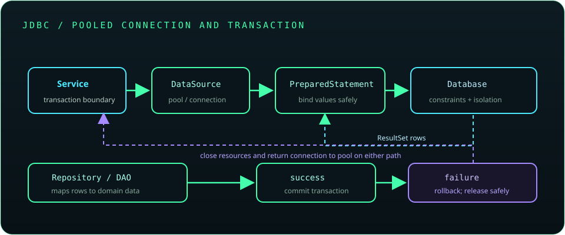

# Chapter 16: JDBC - Java Database Connectivity

JDBC is the Java API for communicating with relational databases. Use a `DataSource`, parameterized SQL, explicit transaction boundaries, and deterministic resource cleanup. Keep database concerns behind a repository or DAO boundary, and keep credentials out of source control.



## 367. Database fundamentals

A database stores and retrieves data while managing concurrent access, durability, and consistency. Applications choose storage and transaction boundaries based on their data model, workload, and reliability needs.

**Key takeaway:** A database is a shared system with failure and consistency behavior to account for.

## 368. Relational databases and SQL basics

Relational databases organize data into tables of rows and columns, with keys and constraints expressing relationships and integrity rules. SQL defines data definition and manipulation, including `SELECT`, `INSERT`, `UPDATE`, and `DELETE`.

**Key takeaway:** Let schema constraints enforce important data invariants close to the stored data.

## 369. JDBC architecture

JDBC defines interfaces such as `Connection`, `PreparedStatement`, and `ResultSet`; a database driver implements the protocol-specific behavior. Applications use the API to execute SQL and map returned values into domain or data-transfer objects.

**Key takeaway:** JDBC standardizes Java access, while the driver handles database-specific communication.

## 370. JDBC drivers

A JDBC driver translates JDBC calls into a database's wire protocol. Drivers are usually distributed as dependencies and must be compatible with the database server, Java version, and application packaging.

**Key takeaway:** Use a maintained driver and document its version as part of the application's dependency set.

## 371. Database connectivity setup

Add the database driver to the build, configure a JDBC URL and credentials through deployment configuration, and provide a `DataSource`. Test against the actual database engine when behavior depends on its SQL dialect or transaction semantics.

**Key takeaway:** Connectivity setup includes dependency, endpoint, credentials, TLS, and environment configuration.

## 372. `DriverManager` and `DataSource`

`DriverManager` is a simple way to obtain connections and is convenient for examples or small tools. `DataSource` is the preferred application abstraction because it can support pooling, configuration, and container-managed resource lookup.

```java
try (java.sql.Connection connection = dataSource.getConnection()) {
    // Use the connection within a small scope.
}
```

**Key takeaway:** Prefer an injected/configured `DataSource` in applications.

## 373. Creating a database connection

A connection represents a session with the database and consumes server and client resources. Acquire it for a bounded unit of work and close it promptly; a pool typically returns it to the pool rather than physically closing the network connection.

**Key takeaway:** Close every borrowed connection so it can be safely reused.

## 374. `Connection`, `Statement`, and `ResultSet`

`Connection` manages database interaction and transaction settings; `Statement` executes SQL text; `ResultSet` exposes returned rows. These JDBC resources are `AutoCloseable` and should be scoped with try-with-resources.

**Key takeaway:** Close result sets and statements as well as the connection.

## 375. `PreparedStatement`

`PreparedStatement` binds values to parameter placeholders and separates data from SQL syntax. It is the normal choice for values supplied at runtime and can also support efficient repeated execution.

```java
String sql = "SELECT id, name FROM customer WHERE email = ?";
try (var statement = connection.prepareStatement(sql)) {
    statement.setString(1, email);
}
```

Identifiers such as table names generally cannot be bound as values; choose them from a strict allowlist when dynamic SQL requires them.

**Key takeaway:** Bind user-provided values; do not concatenate them into SQL.

## 376. Executing SQL queries

Use `executeQuery()` for a query that returns a `ResultSet`, `executeUpdate()` for data changes or DDL, and `execute()` when the result kind is not known or can vary. Match the method to the statement's expected result.

**Key takeaway:** Select the JDBC execution method that matches the SQL result.

## 377. Insert, update, delete, and select operations

CRUD operations map to `INSERT`, `SELECT`, `UPDATE`, and `DELETE`. Check the affected-row count for updates and deletes, and use database constraints to handle uniqueness and referential integrity reliably.

**Key takeaway:** Treat affected-row counts and constraint failures as part of application behavior.

## 378. CRUD applications

A CRUD application typically validates input, calls a service, uses a repository to persist data, and maps results for the caller. Keep SQL and connection management out of UI or request-handler code.

**Key takeaway:** Separate validation, business rules, and persistence for testability.

## 379. SQL injection and prevention

SQL injection occurs when untrusted text changes the structure of a query. Parameterized statements protect values; escaping ad hoc strings is error-prone and is not a substitute for binding.

**Key takeaway:** Use prepared statements for values and allowlists for dynamic identifiers.

## 380. Transactions

A transaction groups operations into a logical unit with database-defined atomicity and isolation behavior. With JDBC, a connection is commonly the transaction boundary, and autocommit determines whether each statement commits independently.

**Key takeaway:** Place related reads and writes within an intentional transaction boundary.

## 381. Commit and rollback

With autocommit disabled, call `commit()` when the full unit succeeds and `rollback()` after failure. Always restore or release the connection safely; pooled connections should not be returned with unintended transaction state.

```java
connection.setAutoCommit(false);
try {
    updateAccount(connection);
    connection.commit();
} catch (java.sql.SQLException e) {
    connection.rollback();
    throw e;
}
```

Production code should preserve the original failure if rollback also fails.

**Key takeaway:** Commit only after all required operations succeed; roll back failed units.

## 382. Transaction isolation

Isolation levels control which effects of concurrent transactions are visible, with trade-offs in consistency, locking, and throughput. Database engines implement levels differently; understand the target database's behavior before relying on a specific anomaly being prevented.

**Key takeaway:** Choose isolation based on the correctness invariant and verify database-specific semantics.

## 383. Batch processing

Batch execution can reduce round trips when many similar statements are sent together. Use `addBatch()` and `executeBatch()`, inspect update counts, and choose batch sizes that fit driver and database limits.

**Key takeaway:** Batch related writes, but keep batches bounded and handle partial failures.

## 384. Stored procedures with `CallableStatement`

`CallableStatement` invokes database procedures or functions and supports input, output, and input/output parameters. Stored-procedure syntax and behavior vary by database vendor.

```java
try (var call = connection.prepareCall("{call refresh_summary(?)}")) {
    call.setLong(1, accountId);
    call.execute();
}
```

**Key takeaway:** Use stored procedures deliberately and document their database-specific contract.

## 385. Database metadata

`DatabaseMetaData` reports driver and database capabilities, version, and schema information; `ResultSetMetaData` describes returned columns. Metadata can support tooling and diagnostics but should not replace explicit application schema management.

**Key takeaway:** Use metadata for introspection, not as a hidden substitute for a schema contract.

## 386. Connection pooling

A connection pool reuses database connections and limits concurrent sessions. Configure maximum size, acquisition timeout, validation, idle lifetime, and leak detection for the workload and database capacity.

**Key takeaway:** Pooling controls resource pressure; it does not make connections unlimited or transactions safe by itself.

## 387. JDBC exception handling

`SQLException` provides message, SQLState, vendor code, and chained exceptions. Log useful context without exposing credentials or sensitive parameter values; translate failures at a boundary while retaining the original cause.

**Key takeaway:** Classify database errors and preserve diagnostic details without leaking secrets.

## 388. DAO pattern

A Data Access Object encapsulates persistence operations behind an interface, allowing callers to work with domain-level methods instead of SQL details. Keep transaction ownership clear; a service often coordinates a transaction spanning multiple DAOs.

**Key takeaway:** A DAO separates persistence mechanics from business logic.

## 389. Database configuration and credentials

Configure JDBC URLs, usernames, and passwords outside source control, using environment-specific configuration and a secrets manager or platform secret store. Use least-privilege database accounts and TLS where appropriate.

**Key takeaway:** Never commit credentials or print them in logs.

## 390. JDBC mini-project

Build a small record manager with a schema, a `DataSource`, prepared CRUD statements, a DAO/repository, validation, and a transaction for any multi-step update. Add tests against a disposable or test database and verify failure and cleanup paths.

**Key takeaway:** A useful JDBC project demonstrates safe SQL, resource management, transactions, and testable persistence boundaries.
