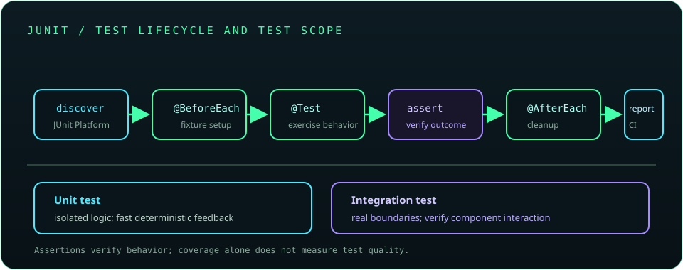

# Chapter 17: Unit Testing with JUnit

Automated tests make behavior repeatable and provide fast feedback as code changes. JUnit Jupiter supplies the JUnit 5 programming model; Mockito can replace collaborators when isolation is valuable. Prefer tests of observable behavior, and use integration tests when real framework, database, or network behavior matters.



## 391. Why testing matters

Tests detect regressions, clarify expected behavior, and make refactoring safer. They are executable examples, but only cover the scenarios and assertions that developers choose.

**Key takeaway:** Tests reduce uncertainty; they do not prove the absence of every defect.

## 392. Unit testing fundamentals

A unit test checks a small unit of behavior in isolation, usually without network, file-system, or database dependencies. Good tests are deterministic, focused, readable, and independent of execution order.

**Key takeaway:** Keep unit tests fast and predictable so they can run frequently.

## 393. JUnit 5 and its architecture

JUnit 5 is an umbrella for the JUnit Platform, Test Engines, and programming models such as Jupiter. Build tools discover tests through the platform; Jupiter supplies annotations and assertions for modern JUnit tests.

**Key takeaway:** JUnit 5's architecture separates test APIs from test discovery and execution.

## 394. Test classes and test methods

JUnit Jupiter uses `@Test` to mark test methods. Test class visibility and instantiation rules are more flexible than JUnit 4's conventions; follow the framework and build-tool discovery configuration used by the project.

```java
import org.junit.jupiter.api.Test;
import static org.junit.jupiter.api.Assertions.assertEquals;

class CalculatorTest {
    @Test
    void addsTwoNumbers() {
        assertEquals(5, new Calculator().add(2, 3));
    }
}
```

**Key takeaway:** Name tests after behavior and keep each assertion scenario understandable.

## 395. Assertions

Assertions compare actual behavior with expected values. Jupiter provides assertions for equality, truth, nullability, exceptions, and grouped checks; a failing assertion reports a test failure to the runner.

**Key takeaway:** Assert externally observable outcomes rather than implementation details.

## 396. Test lifecycle methods

`@BeforeEach` and `@AfterEach` run around each test; `@BeforeAll` and `@AfterAll` run once for a test class, with static requirements depending on the test instance lifecycle. Use lifecycle hooks for shared setup only when that makes test intent clearer.

**Key takeaway:** Lifecycle methods should not hide important test inputs or expected behavior.

## 397. Setup and teardown

Setup creates the minimum state for a scenario; teardown releases resources or restores shared state. Prefer local variables and try-with-resources where possible, because local cleanup is easier to reason about than global fixtures.

**Key takeaway:** Make resource ownership and test cleanup explicit.

## 398. Parameterized tests

Parameterized tests run one test body with multiple inputs supplied by sources such as `@ValueSource`, `@CsvSource`, or `@MethodSource`. They are useful when examples share the same behavior and assertion structure.

```java
@org.junit.jupiter.params.ParameterizedTest
@org.junit.jupiter.params.provider.ValueSource(strings = {"", "   "})
void rejectsBlankNames(String name) {
    org.junit.jupiter.api.Assertions.assertThrows(
            IllegalArgumentException.class, () -> validateName(name));
}
```

**Key takeaway:** Parameterize repeated cases without obscuring what differs between them.

## 399. Exception testing

`assertThrows()` verifies that an operation fails with an expected exception type and returns the exception for additional assertions. Test meaningful message or cause details only when they form part of the contract.

**Key takeaway:** Check expected failure behavior, not just the success path.

## 400. Nested tests

`@Nested` groups related tests inside a test class and can communicate contexts such as valid and invalid input. Avoid deep nesting that makes setup inheritance or test discovery difficult to follow.

**Key takeaway:** Use nested tests to clarify behavior groups, not to create elaborate fixture hierarchies.

## 401. Test organization and naming

Organize tests by production class or behavior area, and use clear names that describe the scenario and outcome. Keep test data close to its use and avoid dependencies between test methods.

**Key takeaway:** A reader should understand a test's intent without tracing unrelated helpers.

## 402. Mocking fundamentals

A mock stands in for a collaborator so a test can control responses or verify an interaction. Mocking is most useful at meaningful boundaries; excessive mocking couples tests to implementation and can allow behavior errors to pass.

**Key takeaway:** Mock external or complex collaborators when isolation helps, not every object.

## 403. Mockito basics

Mockito creates mocks, stubs method results, and verifies interactions. Prefer constructor injection and explicit collaborators, and verify interactions only when they are part of the behavior contract.

```java
var gateway = org.mockito.Mockito.mock(PaymentGateway.class);
org.mockito.Mockito.when(gateway.charge(100)).thenReturn(true);
```

Use the project's JUnit extension or `MockitoAnnotations` lifecycle consistently for annotated mocks.

**Key takeaway:** Stub only what the scenario needs and keep mock behavior explicit.

## 404. Testing services and repositories

Service unit tests can mock repositories to check business rules and error handling. Repository tests should use an integration setup that exercises actual SQL and mappings, often with a disposable database; mocks cannot verify database behavior.

**Key takeaway:** Test business decisions in isolation and persistence behavior against a real test database.

## 405. Test coverage

Coverage tools measure which code was executed, not whether behavior was asserted correctly. High line coverage can coexist with weak tests; use coverage to locate untested areas, then assess meaningful cases and edge conditions.

**Key takeaway:** Coverage is a diagnostic metric, not a quality score by itself.

## 406. Integration testing

Integration tests exercise multiple components across a real boundary such as a database, HTTP server, or framework container. Keep environments isolated, clean up test data, and avoid dependence on shared mutable services.

**Key takeaway:** Use integration tests where component interaction is itself a risk.

## 407. Maven or Gradle test execution

Maven conventionally runs tests with `mvn test`; Gradle uses `gradle test` or the wrapper `./gradlew test`. Configure the correct test engine and report failures clearly in local and CI builds.

**Key takeaway:** Run the project's wrapper so developers and CI use a consistent build version.

## 408. Test-driven development fundamentals

Test-driven development cycles through a failing test, the simplest implementation that passes, and refactoring while keeping tests green. It is a design and feedback technique, not a requirement to test every line before thinking through the problem.

**Key takeaway:** Use a fast feedback loop to shape behavior and preserve it through refactoring.
