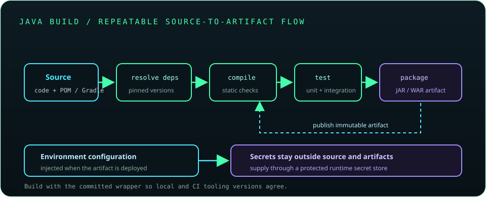

# Chapter 18: Build Tools and Professional Java Development

Build tools make Java projects reproducible by describing source layout, dependencies, compilation, tests, packaging, and automation. Keep builds deterministic, review dependency provenance, separate configuration from code, and ensure local development and CI use the same wrapper and checks.



## 409. Maven fundamentals

Maven is a convention-driven build and dependency-management tool. It uses a project object model and lifecycle phases to compile, test, package, and install or deploy artifacts.

**Key takeaway:** Maven conventions reduce per-project build setup when followed consistently.

## 410. Project structure and conventions

The standard Maven layout separates production code in `src/main/java`, resources in `src/main/resources`, tests in `src/test/java`, and test resources in `src/test/resources`. Consistent layout helps IDEs and build plugins discover project files.

**Key takeaway:** Follow conventional layout unless a concrete project constraint requires otherwise.

## 411. `pom.xml`

The Maven `pom.xml` declares project coordinates, properties, dependencies, plugins, and build configuration. Pin or centrally manage important plugin and dependency versions so builds do not change unexpectedly.

**Key takeaway:** Keep the POM readable and use properties or dependency management to centralize versions.

## 412. Dependencies and dependency scopes

Dependencies are external libraries resolved by Maven or Gradle. Maven scopes such as `compile`, `provided`, `runtime`, and `test` determine classpaths at different build phases and packaging contexts.

**Key takeaway:** Choose dependency scope based on where the application needs the library.

## 413. Maven lifecycle and plugins

Maven lifecycles include phases such as `validate`, `compile`, `test`, `package`, `verify`, and `install`. Plugins implement much of the work bound to lifecycle phases; invoking a later phase also runs earlier phases.

**Key takeaway:** Bind required checks into the lifecycle so a normal build cannot accidentally skip them.

## 414. Gradle fundamentals

Gradle provides an extensible task-based build system with Groovy and Kotlin DSLs. The Wrapper (`gradlew` or `gradlew.bat`) pins the Gradle distribution version for consistent execution across machines.

**Key takeaway:** Commit and use the Gradle Wrapper rather than relying on a developer's global Gradle version.

## 415. Build automation

An automated build resolves dependencies, compiles, runs checks, and produces distributable artifacts in a repeatable sequence. CI should use clean workspaces or well-defined caches and report failures instead of masking them.

**Key takeaway:** A one-command build should provide trustworthy feedback from source to artifact.

## 416. Dependency management

Dependency management handles versions, transitive libraries, exclusions, and conflict resolution. Review updates, lock or constrain versions where appropriate, and scan dependency trees for known vulnerabilities and unexpected packages.

**Key takeaway:** Dependencies are code you ship and should be reviewed as part of the supply chain.

## 417. Environment-specific configuration

Environment-specific values such as endpoints and feature settings should be provided through configuration sources rather than hard-coded in source. Keep configuration validated, documented, and distinct from credentials.

**Key takeaway:** Build one artifact where possible and configure it for each deployment environment.

## 418. Git and version control

Git records project history through commits and branches, enabling review and collaboration. Make focused commits, keep generated files intentional, and avoid committing secrets or local environment state.

```text
git status
git diff --check
git log --oneline
```

**Key takeaway:** Review the diff before committing and keep changes small enough to understand.

## 419. Logging with SLF4J and Logback

SLF4J is a logging facade that lets application code call a stable logging API; Logback is one possible backend. Use parameterized messages and appropriate levels, and avoid logging passwords, tokens, or sensitive personal data.

**Key takeaway:** Depend on a logging API and configure one backend with operationally useful output.

## 420. Code quality and formatting

Consistent formatting and naming reduce review friction. Automated formatters and style checks make conventions repeatable; keep style-only changes separate from behavior changes when practical.

**Key takeaway:** Automate routine formatting so reviews focus on correctness.

## 421. Static analysis tools

Static analyzers inspect source and bytecode for likely bugs, risky patterns, and maintainability concerns without running the program. Integrate selected checks into the build and CI, then triage warnings according to the project's risk.

**Key takeaway:** Static analysis adds useful signals but requires human interpretation.

## 422. Documentation with Javadoc

Javadoc documents public APIs using comments on types and members, with tags such as `@param`, `@return`, and `@throws`. Write contracts that explain behavior, constraints, and failure conditions rather than restating method names.

**Key takeaway:** Document public API guarantees and generated documentation with the build.

## 423. Packaging Java applications

Packaging collects classes and resources into an artifact such as a JAR or WAR. Verify that required runtime dependencies and configuration are handled correctly for the chosen launch and deployment model.

**Key takeaway:** Test the packaged artifact, not only IDE execution.

## 424. Creating executable JAR files

An executable JAR declares an entry point such as `Main-Class` in its manifest. Dependencies must be supplied through the runtime classpath, bundled appropriately, or handled by a packaging plugin.

```text
java -jar application.jar
```

**Key takeaway:** A manifest entry does not automatically include every dependency.

## 425. Application configuration and secrets management

Configuration should provide non-secret environment values, while credentials and keys belong in a dedicated secret store or deployment platform. Restrict access, rotate secrets, and avoid embedding them in artifacts, logs, or version control.

**Key takeaway:** Treat secret storage, access, and rotation as operational requirements.
