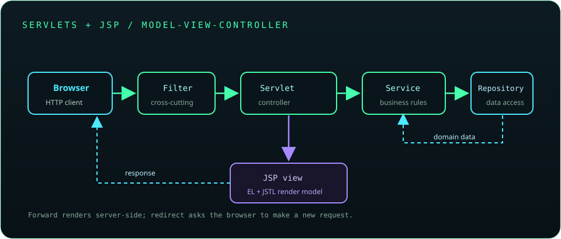

# Chapter 19: Servlets and JSP

Servlets and JavaServer Pages (JSP) are traditional Java web technologies hosted by a servlet container. They remain useful for understanding and maintaining existing applications; for new user interfaces, keep request handling and business logic in Java components and use JSP Expression Language (EL) and JSTL rather than scriptlets.



## 426. Client-server web architecture

A browser or API client sends HTTP requests to a server, which processes them and returns responses. The server may route requests through a web server, a servlet container, application code, and persistence services.

**Key takeaway:** Keep transport handling, business rules, and persistence responsibilities distinct.

## 427. HTTP request-response cycle

An HTTP request includes a method, target, headers, and optionally a body; the response includes a status, headers, and optionally a body. Each response should communicate success or failure using an appropriate status and content type.

**Key takeaway:** The HTTP contract includes method, status, headers, and body semantics.

## 428. Web servers and servlet containers

A web server handles HTTP connections and static content; a servlet container implements the servlet API, manages servlet lifecycles, and dispatches requests. Some products combine both roles.

**Key takeaway:** The container supplies the runtime services that servlet code relies on.

## 429. Introduction to Servlets

A servlet is a server-side Java component that receives requests and creates responses through the servlet API. Servlet code is packaged and deployed to a compatible container rather than launched as a standalone `main` method.

**Key takeaway:** A servlet container owns servlet instantiation and request dispatch.

## 430. Servlet lifecycle

The container creates a servlet, calls `init()` once, invokes `service()` for requests, and later calls `destroy()` before removing it. A servlet instance may serve concurrent requests, so request-specific mutable state must not be stored in ordinary instance fields.

**Key takeaway:** Design servlet instances to be thread-safe and keep per-request state local.

## 431. Creating a basic servlet

A servlet can extend `HttpServlet` and override a method such as `doGet()` or `doPost()`. Modern deployments use the Jakarta Servlet namespace (`jakarta.servlet`); older Java EE applications commonly use `javax.servlet`, which is not the same package.

```java
@jakarta.servlet.annotation.WebServlet("/health")
public class HealthServlet extends jakarta.servlet.http.HttpServlet {
    @Override
    protected void doGet(jakarta.servlet.http.HttpServletRequest request,
                         jakarta.servlet.http.HttpServletResponse response)
            throws java.io.IOException {
        response.setContentType("text/plain;charset=UTF-8");
        response.getWriter().write("ok");
    }
}
```

**Key takeaway:** Match the Servlet API namespace and version to the target container.

## 432. Handling GET and POST

GET retrieves a representation and should not perform a state-changing action. POST submits data or requests processing; the handler should validate input, authorize the action, and return an appropriate response.

**Key takeaway:** Choose methods based on their semantics and protect state-changing requests.

## 433. Request and response objects

`HttpServletRequest` exposes request metadata, parameters, headers, and body access; `HttpServletResponse` controls status, headers, content type, and output. Set response metadata before obtaining or committing the body where practical.

**Key takeaway:** Treat request data as untrusted and produce correctly typed, encoded responses.

## 434. Request parameters and form data

Servlet parameter APIs expose submitted form values and query parameters as strings. Validate expected presence, size, format, and allowed values; configure request character encoding before reading form parameters when required by the application and container.

**Key takeaway:** Parsing a string parameter does not validate its meaning or safety.

## 435. Forwarding and redirection

A forward transfers control to another server-side resource within the same request and can share request attributes. A redirect sends a response telling the client to make a new request, changing the browser URL and usually losing request attributes.

**Key takeaway:** Forward to a server-side view; redirect after a successful state-changing form submission when appropriate.

## 436. Servlet configuration

Servlets can be mapped and configured using annotations or deployment descriptors such as `web.xml`. Configuration should be explicit, validated, and consistent with the deployed Servlet specification.

**Key takeaway:** Keep endpoint mapping and configuration discoverable and aligned with the container version.

## 437. Session management

An `HttpSession` associates server-side state with a client, typically through a session identifier. Store only necessary data, set appropriate inactivity limits, rotate identifiers after authentication, and invalidate sessions on logout.

**Key takeaway:** Session identifiers are credentials and require secure handling.

## 438. Cookies

Cookies let the server ask a browser to store and return small values. Session cookies should use `Secure` on HTTPS, `HttpOnly` against script access where appropriate, and a deliberate `SameSite` policy.

**Key takeaway:** Never place passwords or sensitive authorization data in a client-readable cookie.

## 439. Request, session, and application scopes

Request scope lasts for one request; session scope lasts across a user's session; application scope is shared by the web application. Shared application state must be thread-safe and should not hold user-specific data.

**Key takeaway:** Choose the narrowest scope that matches the data's lifetime and audience.

## 440. Filters

A filter can inspect or wrap requests and responses before and after servlet processing. Filters are commonly used for cross-cutting concerns such as authentication checks, character encoding, and request logging, but should not duplicate core business rules.

**Key takeaway:** Use filters for request-pipeline concerns and define their ordering deliberately.

## 441. Listeners

Servlet listeners receive lifecycle events for the application, sessions, and request attributes. They can initialize or clean up application resources, but those resources must have a clearly owned lifecycle and safe concurrency behavior.

**Key takeaway:** Listeners should manage lifecycle boundaries without hiding application logic.

## 442. Introduction to JSP

JSP is a server-side view technology translated and compiled into a servlet by the container. It can render dynamic content, but modern JSP pages should focus on presentation rather than Java business logic.

**Key takeaway:** Treat JSP as a view layer, not as the application's controller or service layer.

## 443. JSP lifecycle

The container translates JSP source into a servlet, compiles it, loads it, and invokes it to process requests. Changes may trigger recompilation depending on the container and deployment configuration.

**Key takeaway:** JSP execution ultimately runs as servlet code managed by the container.

## 444. JSP directives

Directives configure translation, imports, content type, tag libraries, and inclusion behavior. Common directives include `page`, `taglib`, and `include`; use tag libraries to express view logic cleanly.

**Key takeaway:** Directives affect translation and should be kept clear and minimal.

## 445. JSP expressions and declarations

JSP expression language and declarations are older mechanisms for embedding Java expressions or declarations into page translation. Prefer EL, JSTL, and controller-provided model attributes instead of adding Java snippets to views.

**Key takeaway:** Keep Java code out of presentation templates where modern alternatives exist.

## 446. JSP scriptlets - historical awareness only

Scriptlets (`<% ... %>`) embed Java statements directly into a JSP. They mix presentation with control flow, hinder testing, and are discouraged for modern development.

**Key takeaway:** Recognize scriptlets in legacy systems, but do not introduce new ones.

## 447. Expression Language (EL)

JSP EL accesses scoped attributes and bean properties using expressions such as `${customer.name}`. It keeps common value rendering concise; encode output appropriately for its context to mitigate injection risks.

**Key takeaway:** EL reads view data but does not replace validation or context-aware output encoding.

## 448. JSTL

JSTL provides standard tags for iteration, conditionals, formatting, and other common view tasks. It helps avoid scriptlets; exact tag library dependencies and URIs depend on the JSP/Jakarta Pages version used by the project.

**Key takeaway:** Use standard tag libraries for simple presentation logic rather than Java scriptlets.

## 449. JSP implicit objects

JSP exposes implicit objects for request, response, session, application, and other context. Prefer explicit model attributes and scoped EL access so views have clear data dependencies.

**Key takeaway:** Implicit convenience should not obscure what data the view expects.

## 450. JSP and Servlet integration

A servlet can prepare data as request attributes and forward to a JSP for rendering. A JSP should render the model and avoid performing database access or mutating business state.

**Key takeaway:** Let a controller prepare the view model and let the JSP render it.

## 451. MVC architecture

Model-View-Controller separates domain/application state, presentation, and request coordination. A servlet commonly acts as the controller, services implement business behavior, and JSP/JSTL render the view.

**Key takeaway:** MVC keeps request handling, business rules, and HTML rendering independently understandable.

## 452. Form validation

Validate form data on the server even when client-side validation is present. Normalize values, report field-specific errors, reject unexpected input, and encode rendered values for their output context.

**Key takeaway:** Client validation improves usability; server validation enforces the contract.

## 453. Authentication and authorization fundamentals

Authentication establishes identity; authorization decides whether that identity may perform an action. Protect routes and state-changing operations on the server, use secure session practices, and apply a least-privilege policy.

**Key takeaway:** Hiding a button is not authorization; enforce access at the server boundary.

## 454. Deploying a Java web application

A web application is built for a target servlet specification and deployed to a compatible container. Configure environment values, database connectivity, TLS termination, health checks, and logs for the target environment.

**Key takeaway:** Verify API and container compatibility before deployment.

## 455. WAR files

A WAR (Web Application Archive) packages web application classes, dependencies, and resources for servlet-container deployment. Container-provided APIs should generally use provided scope so duplicate API classes are not bundled.

**Key takeaway:** Package only the dependencies the target runtime does not provide.

## 456. Tomcat fundamentals

Apache Tomcat is a servlet container and HTTP server implementation that runs compatible Java web applications. Configure connectors, deployments, TLS, resource limits, and logging deliberately; keep Tomcat and application dependencies patched.

**Key takeaway:** Match Tomcat's supported Servlet/Jakarta Pages versions to the application's APIs.

## 457. JSP and Servlet mini-project

Build a small MVC application with a servlet controller, service, repository, JSP view using EL/JSTL, server-side form validation, and session-aware authentication flow. Package it as a WAR and test it on the chosen container version.

**Key takeaway:** Keep business logic in services, persistence in repositories, and JSP focused on rendering.
