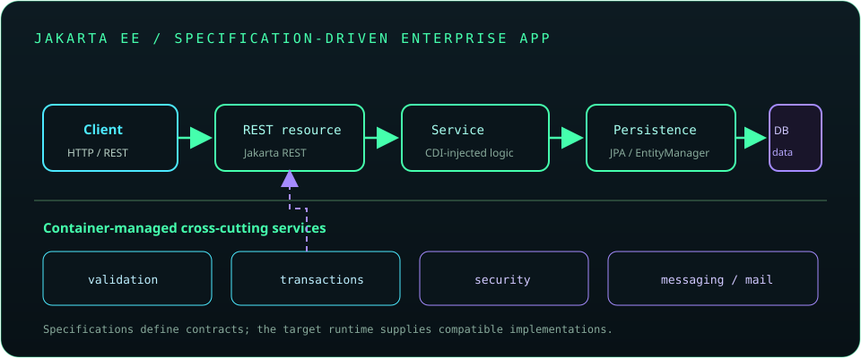

# Chapter 20: Jakarta EE and Enterprise Java

Jakarta EE is a set of specifications for enterprise Java services, implemented by compatible runtimes. It standardizes APIs for dependency injection, web endpoints, validation, persistence, messaging, and other concerns. Learn the contracts and deployment model separately from any one vendor's implementation.



## 458. Java EE versus Jakarta EE

Java EE was the former name of the enterprise Java specifications stewarded by Oracle; the platform moved to the Eclipse Foundation and was renamed Jakarta EE. Newer Jakarta EE versions use the `jakarta.*` namespace, while older Java EE code commonly uses `javax.*`.

**Key takeaway:** Namespace migration is a source and binary compatibility concern; match API versions to the target runtime.

## 459. Enterprise application architecture

Enterprise applications commonly separate web/API boundaries, application services, domain logic, and persistence. A runtime may provide container-managed transactions, security, naming, messaging, and lifecycle services.

**Key takeaway:** Use platform services deliberately and keep business rules independent of deployment mechanics.

## 460. Dependency injection

Dependency injection supplies an object's collaborators from outside rather than constructing them internally. This separates policy from wiring and can make components easier to test and replace.

```java
@jakarta.inject.Inject
OrderService(PaymentGateway gateway) {
    this.gateway = gateway;
}
```

**Key takeaway:** Inject stable abstractions and make required dependencies explicit.

## 461. Contexts and Dependency Injection (CDI)

CDI provides dependency injection, contextual scopes, lifecycle callbacks, and interceptors for Jakarta applications. A CDI container resolves beans by type and qualifiers and manages their scope according to the application runtime.

**Key takeaway:** Understand bean discovery, qualifiers, and scope when debugging injection.

## 462. Jakarta REST (RESTful APIs)

Jakarta REST (formerly JAX-RS) maps annotated resources and methods to HTTP endpoints. Resource methods should validate input, delegate business work, and return deliberate statuses and representations.

**Key takeaway:** Keep endpoint adapters thin and put reusable business rules in services.

## 463. JSON-B and JSON-P

JSON-B binds JSON to Java objects; JSON-P provides a lower-level API for parsing and generating JSON values and streams. Choose based on whether object mapping or explicit JSON structure control is needed.

**Key takeaway:** Validate parsed data and use the JSON API appropriate to the desired control level.

## 464. Jakarta Validation

Jakarta Validation defines constraints such as `@NotNull`, `@Size`, and custom validators. Framework integrations can trigger validation at boundaries, but applications should still define how invalid data is reported to callers.

**Key takeaway:** Put constraints near the data contract and translate violations into safe client errors.

## 465. Jakarta Persistence (JPA)

Jakarta Persistence (JPA) specifies object-relational mapping and persistence contexts through APIs such as `EntityManager`. A provider implements the specification and communicates with the database.

**Key takeaway:** JPA is a specification; provider behavior and database semantics still matter.

## 466. Entity classes and relationships

Entities represent persistent identity and may define relationships using annotations such as `@ManyToOne` or `@OneToMany`. Model ownership and fetch behavior explicitly; entities should not automatically become public API payloads.

**Key takeaway:** Keep persistence relationships intentional and separate entity models from external DTOs.

## 467. Entity lifecycle

An entity may be new, managed, detached, or removed relative to a persistence context. Managed changes are tracked and can be flushed to the database; detached objects are not automatically tracked by the original context.

**Key takeaway:** Understand persistence-context membership before expecting changes to be saved.

## 468. JPQL

JPQL queries entities and their attributes using an object-oriented query language, not raw table and column names. Parameters should be bound rather than interpolated into query text.

```java
var query = entityManager.createQuery(
        "select o from Order o where o.status = :status", Order.class);
query.setParameter("status", status);
```

**Key takeaway:** Query entity models with bound values and verify generated SQL where performance matters.

## 469. Entity managers

`EntityManager` manages a persistence context, performs lookups, persists and removes entities, and creates queries. It is not generally safe for concurrent use by multiple threads; scope it according to the container and transaction model.

**Key takeaway:** Do not share an entity manager across concurrent requests.

## 470. Transactions

Transactions group persistence operations into one unit of work. Jakarta applications may use container-managed transactions or explicitly managed transactions, depending on the runtime and application model.

**Key takeaway:** Make transaction ownership and boundaries explicit, especially when work spans services.

## 471. Bean Validation

Bean Validation annotates fields, parameters, and return values with constraints and supports validation groups for different use cases. Validation catches contract violations but does not replace authorization or domain invariants.

**Key takeaway:** Validate shape and constraints at boundaries, then enforce business rules in the domain.

## 472. Enterprise security concepts

Enterprise security includes identity, authentication, authorization, secure transport, and least-privilege access to resources. Use established identity and security mechanisms rather than inventing password, token, or cryptographic protocols.

**Key takeaway:** Enforce access checks at server-side boundaries and protect credentials in transit and at rest.

## 473. Messaging fundamentals

Messaging decouples producers and consumers through destinations such as queues or topics. Delivery, ordering, redelivery, acknowledgement, and transaction behavior depend on the broker and messaging API.

**Key takeaway:** Define delivery and duplicate-processing behavior as part of the message contract.

## 474. Jakarta Mail

Jakarta Mail provides APIs for constructing, sending, and reading email through providers and mail protocols. Configure transport credentials outside source control, handle delivery failures, and avoid treating email delivery as synchronous proof of user receipt.

**Key takeaway:** Email is an external, failure-prone integration with privacy and delivery constraints.

## 475. Application server concepts

An application server implements enterprise APIs and manages application deployment, resources, transactions, security, and component lifecycles. A lightweight web container may implement a smaller subset of the platform.

**Key takeaway:** Confirm which specifications and versions the chosen server actually supports.

## 476. Enterprise deployment and configuration

Enterprise deployment packages application components and supplies environment-specific resources such as data sources, credentials, and messaging destinations. Keep secrets outside artifacts and document the required runtime contracts.

**Key takeaway:** A portable artifact still requires compatible runtime services and secure configuration.
