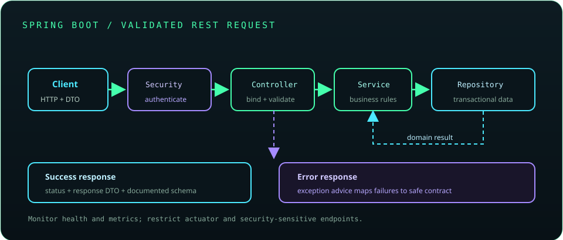

# Chapter 21: Spring Framework and Spring Boot

Spring provides infrastructure for dependency injection, web applications, data access, security, and testing. Spring Boot builds on Spring with auto-configuration and opinionated defaults. Production applications still need explicit validation, error handling, secure configuration, observability, and operational limits.



## 477. Spring Framework introduction

The Spring Framework offers an application context, dependency injection, transaction abstractions, web frameworks, and integration support. Applications select modules that fit their architecture instead of treating Spring as one indivisible feature.

**Key takeaway:** Know which Spring module supplies each behavior in the application.

## 478. Inversion of Control (IoC)

Inversion of Control means a framework manages object creation and lifecycle rather than application code constructing every dependency directly. Spring's application context is a container that configures and supplies managed components.

**Key takeaway:** IoC moves wiring and lifecycle responsibilities to a container.

## 479. Dependency Injection (DI)

Dependency Injection is a form of IoC in which an object's collaborators are supplied externally. Constructor injection makes required dependencies explicit, supports immutability, and simplifies unit tests.

```java
@Service
class BillingService {
    private final PaymentGateway gateway;
    BillingService(PaymentGateway gateway) {
        this.gateway = gateway;
    }
}
```

**Key takeaway:** Prefer constructor injection for required dependencies.

## 480. Spring beans and bean lifecycle

A Spring bean is an object created and managed by the application context. The container can apply configuration, post-processors, proxies, initialization callbacks, and destruction callbacks according to bean scope and context lifetime.

**Key takeaway:** Framework proxies and lifecycle callbacks affect behavior beyond ordinary construction.

## 481. Spring configuration

Spring configuration can use component scanning, Java configuration with `@Configuration` and `@Bean`, and externalized properties. Prefer explicit configuration for important infrastructure and avoid duplicating component registrations.

**Key takeaway:** Make application wiring understandable and keep deployment values external.

## 482. Component scanning

Component scanning discovers annotated types such as `@Component`, `@Service`, `@Repository`, and `@Controller`. Package boundaries determine discovery; overly broad scanning can register unintended components or complicate modularity.

**Key takeaway:** Keep component scans focused on the application's packages.

## 483. Spring Boot fundamentals

Spring Boot simplifies setup through auto-configuration, starters, an embedded server option, and executable packaging. Boot conventions accelerate development but do not remove the need to understand the underlying Spring components.

**Key takeaway:** Learn what Boot configures and how to override or disable it safely.

## 484. Project setup and starters

Starters group commonly used dependencies, such as web, validation, or data access. Use a compatible Spring Boot dependency-management setup and avoid manually mixing framework versions that the platform expects to align.

**Key takeaway:** Select starters for actual requirements and keep versions managed consistently.

## 485. Auto-configuration

Auto-configuration conditionally creates beans based on classpath dependencies, existing beans, and configuration properties. An application can provide its own bean or adjust properties to change defaults.

**Key takeaway:** When behavior is surprising, inspect the condition and configuration that activated it.

## 486. Application properties and YAML

Spring Boot reads configuration from files such as `application.properties` or `application.yaml`, along with other property sources. Configuration types should be validated and documented; do not store production secrets in committed files.

**Key takeaway:** Externalize configuration and validate critical values at startup.

## 487. Profiles and environment configuration

Profiles activate environment-specific beans or configuration, while property sources can override values. Avoid using profiles as a substitute for a clear deployment configuration model or as the sole protection for secrets.

**Key takeaway:** Keep environment differences explicit, minimal, and safely managed.

## 488. Spring MVC

Spring MVC maps HTTP requests to controller methods and coordinates message conversion, validation, exception handling, and response writing. Controllers should adapt HTTP to application operations rather than becoming large business-logic classes.

**Key takeaway:** Keep controllers thin and delegate meaningful work to services.

## 489. REST API development

Spring REST controllers expose HTTP resources using annotations such as `@RestController` and mapping annotations. Define method semantics, status codes, media types, validation, and compatibility behavior as an API contract.

**Key takeaway:** An endpoint is a public contract that should be designed and tested deliberately.

## 490. Request mapping and controllers

Request mappings select handlers by path, HTTP method, headers, and other conditions. Use clear resource-oriented paths and avoid ambiguous overlapping mappings.

```java
@GetMapping("/api/books/{id}")
BookResponse getBook(@PathVariable long id) { ... }
```

**Key takeaway:** Make routing conditions specific enough to be predictable.

## 491. Request and response DTOs

DTOs define the data accepted and returned at an API boundary. They decouple external contracts from persistence entities and let the application control which fields can be read or changed.

**Key takeaway:** Do not expose database entities as an accidental API schema.

## 492. Validation

Spring integrates Jakarta Bean Validation with request binding, commonly through `@Valid` or `@Validated`. Validation errors should be translated into a stable response that identifies client-correctable problems without leaking implementation details.

**Key takeaway:** Validate incoming DTOs at the boundary and enforce domain rules in services.

## 493. Exception handling in REST APIs

Exception handlers such as `@RestControllerAdvice` map known failures to consistent HTTP responses. Avoid returning stack traces or internal exception messages; log server-side diagnostics with safe identifiers.

**Key takeaway:** Separate client errors from server failures and keep the response contract stable.

## 494. Spring Data JPA

Spring Data JPA integrates repository abstractions with JPA providers. It can reduce boilerplate but still uses persistence contexts, transactions, mappings, and generated SQL that need deliberate design.

**Key takeaway:** Repository convenience does not eliminate database and ORM behavior.

## 495. Repositories and derived queries

Spring Data repositories can derive queries from method names or declare queries explicitly. Keep method names readable and inspect generated queries when performance, joins, or filtering behavior matters.

**Key takeaway:** Use derived queries for simple intent; explicit queries for complex behavior.

## 496. Pagination and sorting

Spring Data supports pageable and sortable queries. Validate page size and sort fields from clients to prevent excessive work or access to unintended properties.

**Key takeaway:** Bound page size and allowlist externally supplied sorting options.

## 497. Database migrations with Flyway or Liquibase

Migration tools version schema changes as ordered, reviewed scripts or changelogs. Apply changes consistently across environments and plan backward-compatible migrations for rolling deployments.

**Key takeaway:** Schema changes are versioned application changes; test upgrade and rollback strategies.

## 498. Spring transactions

`@Transactional` typically applies transaction behavior through a proxy or interception mechanism. Understand propagation, isolation, rollback rules, and proxy boundaries; self-invocation may bypass proxy-based interception.

**Key takeaway:** Put transaction boundaries on externally invoked service operations and test failure behavior.

## 499. Spring Security

Spring Security provides authentication, authorization, filter chains, and integration points for web and method security. Defaults and configuration vary by version, so verify which security behavior is active rather than assuming endpoints are open or protected.

**Key takeaway:** Define and test an explicit security policy for every exposed route.

## 500. Authentication and authorization

Authentication establishes who or what is making a request; authorization determines what that principal may do. Enforce authorization server-side and default to denial when permissions are unclear.

**Key takeaway:** Identity alone does not grant permission to every operation.

## 501. Password hashing and secure credentials

Passwords should be stored using a purpose-built adaptive password hashing algorithm with unique salts, not reversible encryption or a fast general-purpose hash. Keep signing keys and service credentials in a protected secret store and rotate them appropriately.

**Key takeaway:** Never store plaintext passwords or hard-code production credentials.

## 502. JWT-based authentication concepts

JSON Web Tokens (JWTs) encode claims and may be signed or encrypted depending on the token type. Validate signature, issuer, audience, expiration, and intended use; a signed token is not confidential unless separately encrypted.

**Key takeaway:** Validate token claims and protect signing keys; do not trust decoded claims alone.

## 503. Testing Spring applications

Use unit tests for isolated business rules and Spring test support when wiring or framework behavior is part of the requirement. Keep context-heavy tests focused and use integration tests for real database and HTTP boundaries.

**Key takeaway:** Test the smallest layer that can provide confidence in the behavior.

## 504. Actuator and application monitoring

Spring Boot Actuator exposes operational endpoints for health, metrics, and diagnostics when configured. Restrict sensitive endpoints, expose only necessary data, and integrate metrics with production monitoring.

**Key takeaway:** Operational endpoints are part of the attack surface and need access controls.

## 505. API documentation with OpenAPI

OpenAPI describes HTTP endpoints, parameters, schemas, and responses in a machine-readable contract. Generate or maintain documentation consistently and review it for accuracy, security-sensitive details, and compatibility.

**Key takeaway:** API documentation should reflect the contract clients can actually rely on.

## 506. Building a production-ready REST service

A production service combines validated inputs, stable error contracts, secure authorization, bounded database and network work, health signals, structured logs, metrics, tests, and externalized configuration. Deploy with migration and rollback plans.

**Key takeaway:** Production readiness is an operational and security property, not a dependency starter.
