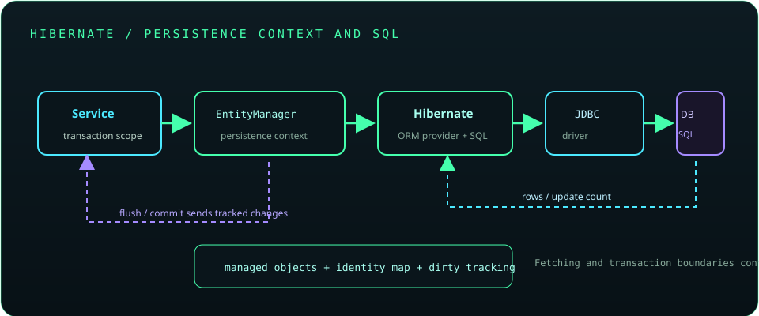

# Chapter 22: Hibernate and ORM

Object-relational mapping (ORM) connects object models to relational data, but it does not remove the need to understand SQL, transactions, indexes, or query plans. Hibernate is a widely used JPA provider. Effective ORM use requires explicit fetching, bounded query counts, and careful persistence-context and transaction management.



## 507. Object-relational mapping

ORM maps objects and relationships to tables, keys, and foreign keys. It can reduce repetitive mapping code, but object graphs and relational set operations have different behavior and performance characteristics.

**Key takeaway:** ORM is a mapping tool, not a substitute for relational modeling or SQL understanding.

## 508. Hibernate architecture

Hibernate implements JPA and provides additional APIs and configuration. It translates entity operations and HQL/JPQL into SQL, manages persistence contexts, and coordinates with JDBC and the database.

**Key takeaway:** Distinguish portable JPA contracts from Hibernate-specific features.

## 509. Entities and entity mapping

An entity is a persistent class with identity and mapping metadata. Mapping annotations or XML define tables, columns, relationships, and constraints; design entities around domain invariants rather than exposing every database column.

**Key takeaway:** An entity is a persistence model, not automatically a DTO or API response.

## 510. Primary keys and generated identifiers

Entity identity is represented by a primary key, which may be assigned by the application or generated by the database/provider. Identifier strategy affects inserts, batching, and portability.

**Key takeaway:** Choose an identifier strategy deliberately and do not confuse database identity with object equality.

## 511. One-to-one relationships

A one-to-one association maps two entities with a unique relationship, often represented by a foreign key with a uniqueness constraint. Decide which side owns the relationship and verify the generated schema matches the intended integrity rule.

**Key takeaway:** Enforce one-to-one cardinality in the database as well as the object model.

## 512. One-to-many relationships

A one-to-many association represents a parent related to multiple children. The child-side foreign key usually owns the database relationship; helper methods should keep both sides of a bidirectional association consistent.

**Key takeaway:** Model ownership and collection updates explicitly.

## 513. Many-to-one relationships

A many-to-one association maps a child or dependent entity to one parent, commonly through a foreign key. It is often the owning side in a bidirectional one-to-many relationship.

**Key takeaway:** Understand the owning side because it controls relationship updates.

## 514. Many-to-many relationships

A many-to-many association uses a join table to represent links between two sets of entities. If the relationship itself has attributes or lifecycle, model the join as an explicit entity instead.

**Key takeaway:** Use an association entity when the link has meaningful data or behavior.

## 515. Lazy and eager fetching

Lazy fetching defers loading a relationship until accessed; eager fetching requests it as part of loading, though exact SQL shape depends on the query and provider. Accessing an uninitialized lazy association outside its persistence context can fail.

**Key takeaway:** Choose fetch plans per use case rather than marking every relationship eager.

## 516. The N+1 query problem

The N+1 problem occurs when one query loads a collection and then one additional query runs for each row's related data. Detect it through SQL logging, metrics, or tests, and address it with fetch joins, entity graphs, projections, or batching as appropriate.

**Key takeaway:** Measure query counts and design fetch plans to match the response use case.

## 517. HQL and JPQL

Hibernate Query Language and JPQL query entities and mapped attributes rather than raw table names. Bind parameters, select only needed data, and inspect generated SQL for performance and portability.

```java
var query = entityManager.createQuery(
        "select p from Product p where p.category = :category", Product.class);
query.setParameter("category", category);
```

**Key takeaway:** Entity queries still generate SQL that should be understood and measured.

## 518. Criteria queries

Criteria APIs construct queries programmatically using a typed or structured model. They are useful for dynamic filters but may be verbose; keep query-building logic organized and verify generated SQL.

**Key takeaway:** Use criteria for genuinely dynamic query composition, not just to avoid readable JPQL.

## 519. Cascading and orphan removal

Cascade settings propagate selected entity operations across associations; orphan removal can delete a child removed from a relationship. These settings can cause database deletes and should reflect aggregate ownership rather than convenience.

**Key takeaway:** Cascade only operations that the relationship's lifecycle truly owns.

## 520. First-level and second-level caching

The persistence context is the first-level cache and is scoped to an entity manager/session. An optional second-level cache is shared across contexts and requires deliberate consistency, invalidation, and deployment configuration.

**Key takeaway:** Treat second-level caching as a consistency design decision, not a free speed switch.

## 521. Optimistic and pessimistic locking

Optimistic locking uses a version column to detect conflicting updates at commit or flush time. Pessimistic locking asks the database to lock rows, potentially reducing concurrency and increasing deadlock risk.

**Key takeaway:** Choose locking based on conflict patterns and handle conflict exceptions explicitly.

## 522. ORM performance tuning

Tune ORM performance by measuring SQL count, result size, transaction duration, index use, allocations, and database plans. Avoid loading large object graphs, fetching unused columns, and keeping persistence contexts open too long.

**Key takeaway:** Tune the SQL and transaction behavior that the ORM actually produces.

## 523. Database schema migrations

Schema migration tools version database changes in controlled steps. Coordinate schema and application releases, preserve compatibility during rolling deployment, and test migrations against representative data.

**Key takeaway:** ORM schema auto-generation is not a production migration strategy.

## 524. Hibernate best practices

Keep transactions short, use DTO projections at API boundaries, avoid unbounded collections, parameterize queries, and monitor generated SQL. Keep sessions and entity managers confined to their intended unit of work.

**Key takeaway:** Use ORM deliberately while retaining control of SQL, fetching, and transaction behavior.
