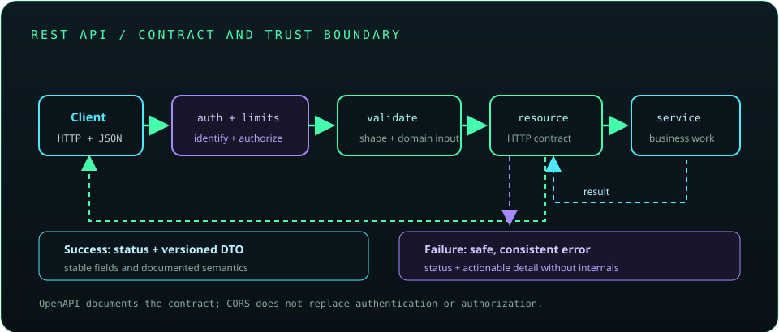

# Chapter 23: REST APIs and Backend Architecture

An API is a versioned contract between independent clients and a server. Design resources and HTTP semantics clearly, validate and authorize every operation, bound pagination and workload, and return consistent errors. Security and compatibility are part of the API design from its first release.

## 525. REST principles

REST is an architectural style built around resources, representations, a uniform interface, stateless requests, and cache semantics. Many APIs are called RESTful while using only some of these constraints; be clear about the contract actually implemented.

**Key takeaway:** Design around resources and consistent HTTP semantics rather than arbitrary RPC-shaped endpoints.

## 526. Resource design

Resources represent concepts identified by URIs, often with collection and item paths such as `/books` and `/books/{id}`. Model relationships and actions consistently, and avoid leaking internal database table structure into the public URI scheme.

**Key takeaway:** Stable resource names form part of the client-facing contract.

## 527. HTTP methods and status codes in API design

HTTP methods communicate operation semantics: GET retrieves, POST creates or processes, PUT replaces, PATCH partially updates, and DELETE removes. Status codes should distinguish successful outcomes, client errors, authentication failures, missing resources, and server errors.

**Key takeaway:** Method idempotency and status codes shape safe retries and client behavior.

## 528. JSON serialization and deserialization

JSON encodes structured data as text; libraries map between JSON and Java types. Define field names, null and unknown-field behavior, numeric precision, date/time formats, and compatibility rules instead of relying on accidental serializer defaults.

**Key takeaway:** Serialization is part of the API schema and should be versioned and tested.

## 529. DTOs and mapping

Data-transfer objects define request and response shapes independently of persistence entities. Mapping makes conversions explicit and prevents accidental exposure of internal fields, lazy associations, or writable properties clients should not control.

**Key takeaway:** Use API DTOs to control what clients can observe and modify.

## 530. API versioning

Versioning allows an API to evolve while managing incompatible changes. Common approaches include URI versions, media types, and headers; publish deprecation timelines and compatibility guarantees for clients.

**Key takeaway:** Version only when compatibility requires it, and communicate support and deprecation clearly.

## 531. Pagination, filtering, and sorting

Pagination bounds response size; filters and sort options constrain selection and ordering. Validate limits, allowlist sortable fields, define stable ordering for cursor traversal, and consider total-count query cost.

**Key takeaway:** Bound result work and make ordering deterministic for clients.

## 532. Idempotency

An operation is idempotent when repeating it has the same intended effect as performing it once. Clients may retry after network timeouts without knowing whether the server completed the request; idempotency keys can deduplicate selected state-changing operations.

**Key takeaway:** Design retries with duplicate requests and partial failure in mind.

## 533. API validation and error responses

Validate syntax, size, type, and domain constraints at the API boundary. Return a consistent error structure with a useful status and safe details; do not expose stack traces, SQL, or secret-bearing internals.

**Key takeaway:** Error responses should be stable, actionable, and free of sensitive implementation detail.

## 534. CORS

Cross-Origin Resource Sharing is a browser policy controlled by server response headers that determines which origins may access a resource. Configure only the required origins, methods, and headers; CORS is not authentication and does not restrict non-browser clients.

**Key takeaway:** CORS controls browser cross-origin access, not API authorization.

## 535. Rate limiting

Rate limiting constrains request frequency or resource consumption per principal, key, or network source. Define quota windows, burst behavior, and client responses such as `429 Too Many Requests`; combine limits with workload and abuse monitoring.

**Key takeaway:** Rate limits protect capacity and should communicate retry behavior clearly.

## 536. API authentication and authorization

Authentication verifies a caller's identity; authorization determines allowed actions and resources. Apply checks to each operation and object, avoid trusting client-supplied identifiers as permission, and use TLS to protect credentials and tokens in transit.

**Key takeaway:** Authenticate the principal and authorize every resource operation server-side.

## 537. OpenAPI and Swagger

OpenAPI describes operations, schemas, authentication schemes, and responses in a machine-readable document. Swagger tools can display and exercise that description; generated docs should not expose internal-only endpoints or secrets.

**Key takeaway:** Keep the API description aligned with the implemented contract.

## 538. API testing with Postman

Postman can send requests, manage environments, and organize repeatable API checks. Keep secrets out of shared collections and use automated tests in CI for critical contract behavior rather than relying solely on manual clicks.

**Key takeaway:** Use API clients for exploration and automate repeatable assertions.

## 539. API security best practices

Use TLS, strong authentication, object-level authorization, input validation, output encoding, bounded request sizes, secure error handling, and dependency updates. Avoid leaking tokens or personal data in URLs, logs, or error messages.

**Key takeaway:** Secure every boundary and minimize what the API accepts, returns, and logs.

## 540. Webhooks

A webhook sends an event notification to a client-provided endpoint. Sign payloads, verify timestamps and signatures, retry with backoff, prevent replay, and make delivery idempotent because duplicates and delays are expected.

**Key takeaway:** Treat webhook delivery as at-least-once and verify authenticity before processing.

## 541. API integration project

Build an API with resource-oriented routes, DTOs, validation, authentication and authorization, bounded pagination, consistent errors, OpenAPI documentation, and automated integration tests. Include idempotent handling for any operation clients may retry.

**Key takeaway:** A reliable API includes its operational, security, and compatibility contract, not just endpoints.
