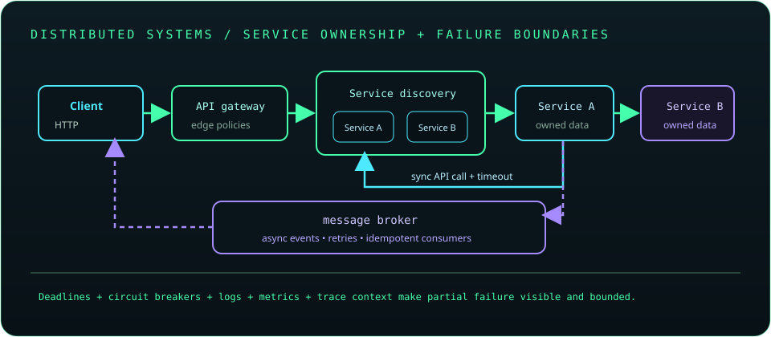

# Chapter 24: Microservices and Distributed Systems

Microservices split an application into independently deployable services, but add network, data consistency, observability, and operational costs. Define boundaries around capabilities and ownership before splitting systems. Treat every remote call and message as fallible, potentially duplicated, and subject to delays.

## 542. Monoliths versus microservices

A monolith deploys an application as one unit and can keep calls and transactions local. Microservices deploy independently and can scale or evolve separately, but require network communication, distributed operations, and stronger platform operations.

**Key takeaway:** Prefer the simplest deployment architecture that fits the team's and product's needs.

## 543. Service boundaries and domain modeling

Service boundaries should align with business capabilities, data ownership, and change patterns. Bounded contexts help clarify where terms and invariants differ; splitting by technical layer often creates chatty services without true independence.

**Key takeaway:** A service should own a cohesive capability and its data lifecycle.

## 544. Service-to-service communication

Services communicate through synchronous requests or asynchronous messages. Define contracts, authentication, timeouts, payload limits, compatibility, and failure behavior for every communication path.

**Key takeaway:** A service call is a remote failure boundary, even inside one cluster.

## 545. REST-based service communication

REST over HTTP is a common synchronous service protocol. Use stable resource contracts, explicit status behavior, bounded requests, TLS, and compatible DTOs; avoid coupling callers to internal database schemas.

**Key takeaway:** Version and observe service APIs as contracts between independently changing systems.

## 546. Synchronous versus asynchronous communication

Synchronous calls return a result within the request path and are straightforward to reason about, but add latency and availability dependencies. Asynchronous messages decouple timing and can absorb bursts, but require eventual-consistency, retry, and duplicate handling.

**Key takeaway:** Choose communication style from interaction and consistency requirements.

## 547. Service discovery

Service discovery maps logical service names to current endpoints as instances start, stop, or move. It may be provided by DNS, a platform, or a registry; clients should handle stale records and connection failures.

**Key takeaway:** Discovery finds candidates, not guarantees that a selected instance is healthy.

## 548. API gateways

An API gateway provides an edge entry point for routing, TLS termination, authentication integration, and selected cross-cutting policies. Avoid moving core business logic into the gateway or creating a centralized bottleneck.

**Key takeaway:** Keep gateway responsibilities focused on edge concerns.

## 549. Centralized configuration

Centralized configuration manages settings shared across service instances or environments. Configuration changes need validation, access control, versioning, and a rollout strategy; secrets should use a dedicated protected store.

**Key takeaway:** Configuration is operational state and should be governed like code.

## 550. Resilience and fault tolerance

Resilience limits the impact of partial failures through timeouts, bounded retries, circuit breakers, bulkheads, fallback design, and graceful degradation. No mechanism makes an unavailable dependency reliable; it controls failure propagation.

**Key takeaway:** Make failure behavior explicit and protect both caller and dependency capacity.

## 551. Timeouts and retries

Timeouts bound how long a caller waits. Retries can help with transient failures but multiply load and may repeat an operation that already succeeded; use limited attempts, backoff, jitter, and idempotency where appropriate.

**Key takeaway:** Set end-to-end deadlines and retry only failures that are safe and likely transient.

## 552. Circuit breakers

A circuit breaker temporarily stops calls to a failing dependency after a failure threshold and probes recovery after a cool-down. It can reduce wasted waits but needs meaningful thresholds, metrics, and carefully chosen fallback behavior.

**Key takeaway:** A circuit breaker limits repeated calls; it does not repair the dependency.

## 553. Distributed tracing

Distributed tracing correlates spans across service boundaries using trace context. Propagate context through HTTP and messaging, sample thoughtfully, and avoid recording secrets or sensitive payloads in span attributes.

**Key takeaway:** Trace context makes latency and failures across a request path observable.

## 554. Centralized logging

Centralized logging collects structured events from multiple services for search and correlation. Include trace or request identifiers, timestamps, service identity, and severity; apply retention, access, and redaction policies.

**Key takeaway:** Central logs aid diagnosis but must not become a channel for secrets.

## 555. Metrics and observability

Metrics summarize behavior over time, such as request rate, errors, latency, saturation, queue depth, and resource use. Pair technical signals with service objectives and alerts that lead to actionable investigation.

**Key takeaway:** Measure user-visible service health and the resource constraints behind it.

## 556. Distributed transactions

A distributed transaction spans multiple independently managed resources or services. A single ACID database transaction usually cannot atomically cover a network of services; coordination can reduce availability and increase coupling.

**Key takeaway:** Prefer local transactions plus explicit workflow or compensation where possible.

## 557. Saga pattern

A saga models a long-running operation as a sequence of local transactions with compensating actions for selected failures. Compensation is a new business action, not necessarily a perfect rollback, and can itself fail or require manual intervention.

**Key takeaway:** Define forward steps, compensation, retries, and recovery states explicitly.

## 558. Event-driven architecture

Event-driven systems publish facts about completed changes for interested consumers. Events create loose temporal coupling but introduce delivery, ordering, schema evolution, and eventual-consistency concerns.

**Key takeaway:** Events describe facts and should have stable, versionable contracts.

## 559. Message queues

Queues buffer work between producers and consumers and often support competing consumers, acknowledgement, and redelivery. Set capacity, retention, dead-letter, and retry policies so backlogs and poison messages are observable.

**Key takeaway:** Queue acceptance is not proof that downstream processing completed.

## 560. Kafka fundamentals

Apache Kafka stores ordered records in partitioned append-only logs. Consumer groups divide partition work, and offsets track progress; ordering is generally per partition rather than global.

**Key takeaway:** Partition keys and offset commits affect ordering, throughput, and replay behavior.

## 561. RabbitMQ fundamentals

RabbitMQ routes messages through exchanges, bindings, and queues using broker-defined routing semantics. Acknowledgements, persistence, publisher confirms, and dead-letter policies affect delivery guarantees.

**Key takeaway:** Understand routing and acknowledgement behavior instead of assuming enqueue equals successful processing.

## 562. Idempotent consumers

An idempotent consumer safely handles a message more than once, commonly by recording a stable event identifier or making the state transition naturally repeatable. Duplicate delivery is normal in many messaging systems.

**Key takeaway:** Design consumers for redelivery and commit progress only when effects are durable.

## 563. Eventual consistency

Eventual consistency means replicas or services may temporarily disagree but converge if updates stop and communication continues. User flows should account for delayed visibility, and operations should expose meaningful pending or retry states.

**Key takeaway:** Eventual consistency is an application behavior to design for, not merely a database setting.

## 564. Caching with Redis

Redis is an in-memory data store often used for caching, coordination, and selected data structures. Define cache ownership, expiration, invalidation, consistency, memory limits, and outage behavior.

**Key takeaway:** A cache improves selected reads but adds another dependency and consistency path.

## 565. Microservice security

Secure microservices with authenticated service identities, authorization, encrypted transport, least privilege, secret rotation, safe input handling, and network boundaries. Do not trust traffic merely because it originates inside a cluster.

**Key takeaway:** Apply zero-trust principles between services and at the external edge.

## 566. Microservices deployment

Deployments require artifact versioning, configuration, health and readiness checks, resource limits, observability, rollout strategy, and rollback planning. Coordinate compatibility when services and message schemas update independently.

**Key takeaway:** Independent deployment works only when operational contracts are also independent and monitored.

## 567. Distributed systems design principles

Distributed systems experience latency, partial failures, clock differences, duplicate messages, and independent state. Use deadlines, idempotency, explicit ownership, observability, and tested recovery rather than assuming perfect connectivity.

**Key takeaway:** Design for partial failure as the normal case.
