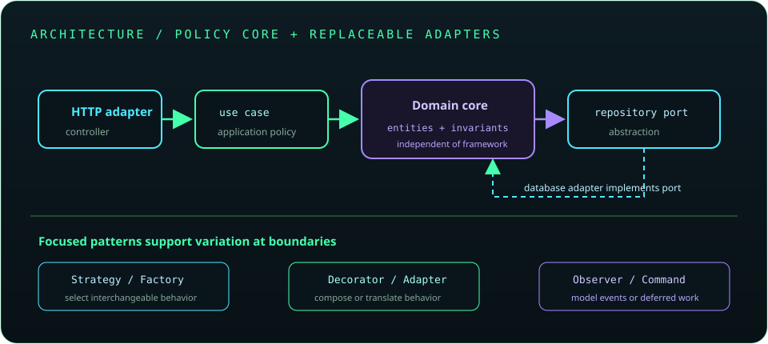

# Chapter 25: Advanced Java Design and Architecture

Good architecture makes important decisions visible and change safer; it does not require maximal abstraction. Use principles and patterns to address a concrete design pressure, keep boundaries explicit, and refactor in small behavior-preserving steps.



## 568. SOLID principles

SOLID describes five object-oriented design principles: single responsibility, open-closed, Liskov substitution, interface segregation, and dependency inversion. They guide coupling and change, but should be applied with judgment rather than as rigid rules.

**Key takeaway:** Use SOLID to reason about change impact and substitutability, not to maximize class count.

## 569. DRY, KISS, and YAGNI

DRY discourages duplicating knowledge; KISS favors straightforward designs; YAGNI avoids speculative features. Premature abstraction can be harder to maintain than a small amount of clear duplication.

**Key takeaway:** Remove duplication when the shared rule is real and stable.

## 570. Composition over inheritance

Composition builds behavior by delegating to collaborators; inheritance specializes a subtype through a base-class contract. Composition often reduces coupling to implementation details and avoids brittle hierarchies.

**Key takeaway:** Prefer composition unless subtype substitution expresses a genuine is-a relationship.

## 571. Design patterns overview

Design patterns name recurring collaboration structures, such as object creation, behavior selection, or event notification. A pattern is useful when it clarifies a real design problem; applying one without need adds concepts and indirection.

**Key takeaway:** Learn the trade-off a pattern addresses, not only its class diagram.

## 572. Singleton

A Singleton restricts access to one shared instance, but global mutable state can hinder tests and lifecycle control. In Java, an enum can provide a robust singleton implementation when a true single instance is justified.

```java
enum MetricsRegistry {
    INSTANCE
}
```

**Key takeaway:** Prefer dependency injection and explicit ownership over global singleton access.

## 573. Factory and Abstract Factory

A Factory centralizes object creation and can hide implementation selection. Abstract Factory groups creation of related objects behind a common contract.

**Key takeaway:** Introduce a factory when creation policy or family selection is nontrivial.

## 574. Builder

Builder constructs an object through named, staged configuration rather than a long positional constructor. It is useful for many optional parameters or validation at construction, but unnecessary for simple value types.

**Key takeaway:** Use a builder when it improves construction readability and invariant enforcement.

## 575. Prototype

Prototype creates a new object by copying an existing configured instance. Copy semantics must define whether nested mutable objects are shared or duplicated; Java's legacy `clone()` often obscures that distinction.

**Key takeaway:** Prefer explicit copy methods or copy constructors with documented depth.

## 576. Adapter

Adapter translates one interface into another expected by a caller. It is useful for integrating a third-party or legacy API without spreading its shape through the application.

**Key takeaway:** Put compatibility translation at the boundary.

## 577. Decorator

Decorator wraps an object implementing the same abstraction and adds behavior while preserving the interface. Wrappers can compose concerns such as buffering or instrumentation without subclassing every combination.

**Key takeaway:** Use decorators for composable behavior and keep wrapper ordering understandable.

## 578. Facade

Facade offers a simpler entry point over a complex subsystem. It can reduce coupling for a specific use case but should not become an unstructured service that owns every responsibility.

**Key takeaway:** Expose a focused workflow rather than forwarding every subsystem operation.

## 579. Proxy

A proxy stands in for another object and may control access, add lazy behavior, or intercept calls. Framework proxies can implement transactions or security, but proxy boundaries and self-invocation behavior can affect semantics.

**Key takeaway:** Know when calls cross a proxy and what behavior the proxy adds.

## 580. Strategy

Strategy encapsulates interchangeable algorithms behind a common interface, allowing a caller to select behavior without condition-heavy logic.

**Key takeaway:** Use a strategy when alternatives vary independently and share a meaningful contract.

## 581. Observer

Observer lets subscribers receive notifications about state changes or events. Define subscription lifecycle, ordering, failure isolation, and whether notification is synchronous or asynchronous.

**Key takeaway:** Events decouple senders and receivers but make delivery and lifecycle behavior explicit.

## 582. Template Method

Template Method defines an algorithm skeleton in a base class and lets subclasses override selected steps. It is useful when the sequence is stable and variation is limited, but can constrain composition.

**Key takeaway:** Prefer a strategy or callback when algorithm steps need more flexible composition.

## 583. Command

Command represents a request as an object, enabling queuing, logging, retries, or undo in appropriate systems. Commands should make side effects and retry safety clear.

**Key takeaway:** Model an operation as data when it must be stored, queued, or composed.

## 584. Chain of Responsibility

Chain of Responsibility passes a request through handlers until one processes or rejects it. Each handler should have explicit continuation and error behavior to prevent requests being silently dropped.

**Key takeaway:** A chain is useful for ordered, composable processing such as request filters.

## 585. Dependency Injection as a design principle

Dependency injection keeps object construction separate from use and makes dependencies replaceable. Constructor injection exposes required collaborators; containers automate wiring but do not replace sound dependency boundaries.

**Key takeaway:** Depend on small, purposeful abstractions where variation or isolation matters.

## 586. Repository and Service patterns

A repository abstracts persistence operations around domain concepts; a service coordinates application use cases and transaction boundaries. Keep responsibilities distinct and avoid generic wrappers that merely rename every database method.

**Key takeaway:** Place business workflows in services and persistence mechanics behind repositories.

## 587. DTO and Mapper patterns

DTOs define data exchanged across boundaries; mappers convert between representations such as entities and API models. Explicit mapping helps control fields and compatibility, though generated mappers can reduce repetitive code.

**Key takeaway:** Keep boundary data contracts distinct from internal domain and persistence models.

## 588. Layered architecture

Layered architecture separates responsibilities such as presentation, application, domain, and persistence. Dependencies should point through clear interfaces and avoid bypassing layers in ways that couple business rules to transport or storage.

**Key takeaway:** Layers clarify responsibilities when dependency direction remains disciplined.

## 589. Hexagonal architecture

Hexagonal architecture places application and domain behavior behind ports; adapters connect those ports to HTTP, databases, messaging, and other technologies. The core can be tested without requiring every external adapter.

**Key takeaway:** Put technology-specific translation at adapters and keep use-case contracts stable.

## 590. Clean Architecture

Clean Architecture organizes code so source dependencies point toward stable policy and domain rules. Use cases define application behavior, and outer adapters implement input/output details.

**Key takeaway:** Keep business policy independent of frameworks and infrastructure where practical.

## 591. Domain-Driven Design fundamentals

Domain-Driven Design uses a shared language, bounded contexts, entities, value objects, and aggregates to model complex business domains. It is most valuable when domain complexity justifies collaborative modeling; it is not a requirement for simple CRUD.

**Key takeaway:** Model the business language and invariants before choosing a technical pattern.

## 592. Refactoring techniques

Refactoring changes internal structure while preserving externally observable behavior. Use small steps, automated tests, focused diffs, and staged migrations when changing public interfaces or stored data.

**Key takeaway:** Establish behavior confidence before restructuring and verify it after each step.

## 593. UML and class diagrams

UML class diagrams can communicate classes, interfaces, relationships, and multiplicity. Keep diagrams at a useful level of abstraction and update or discard them when they stop matching the system.

**Key takeaway:** A diagram is a communication aid, not a substitute for code and contracts.

## 594. Code review and maintainability

Code review evaluates correctness, security, operability, readability, and fit with architecture. Small changes with focused tests are easier to review; explain non-obvious trade-offs and keep feedback about code rather than people.

**Key takeaway:** Maintainability is a team property supported by clear code and constructive review.
