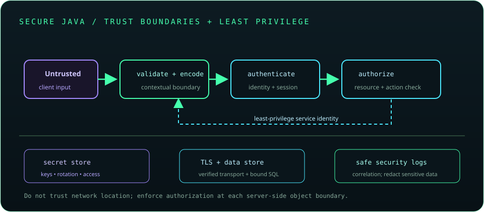

# Chapter 26: Security and Secure Java Development

Security is a property of the whole system: code, dependencies, configuration, identity, data, and operations. Define trust boundaries and likely threats, validate inputs, minimize privileges, protect secrets, and keep dependencies patched. Use established libraries and platform features rather than inventing cryptography or authentication protocols.



## 595. Secure coding fundamentals

Secure coding identifies assets, trust boundaries, threat actors, and misuse cases, then applies controls throughout design, implementation, testing, and operations. Security requirements should be testable and revisited as the system changes.

**Key takeaway:** Start with assets and trust boundaries, not a checklist alone.

## 596. Input validation and output encoding

Validate input against expected type, length, format, and allowed values at the boundary. Encode output for its destination context, such as HTML or JavaScript; validation alone does not prevent injection in every sink.

**Key takeaway:** Validate on input and encode for context at output.

## 597. Authentication versus authorization

Authentication establishes the identity of a user or service. Authorization decides what that principal may do to a resource; enforce it for each action and object on the server.

**Key takeaway:** A valid identity does not imply permission for every operation.

## 598. Password hashing

Passwords should be stored with an adaptive password-hashing scheme designed for credential storage, using unique salts and configurable work factors. Fast hashes such as plain SHA-256 are unsuitable for password storage.

**Key takeaway:** Use a vetted password-hashing library and never store plaintext passwords.

## 599. Secure session management

Session identifiers are bearer credentials. Use secure transport, HttpOnly and suitable SameSite cookie settings, rotate identifiers after authentication, expire inactive sessions, and invalidate them on logout.

**Key takeaway:** Protect session tokens from theft, fixation, replay, and unnecessary lifetime.

## 600. Cryptography fundamentals

Cryptography includes confidentiality, integrity, authenticity, and key agreement, each solving different problems. Correct algorithm selection, key generation, nonce use, parameter choice, and lifecycle management are essential.

**Key takeaway:** Prefer established protocols and libraries over custom cryptographic designs.

## 601. Hashing and digital signatures

A cryptographic hash maps data to a fixed-size digest and supports integrity checks; it does not provide secrecy. A digital signature uses a private key to authenticate data and can be verified with the associated public key.

**Key takeaway:** Hashing, encryption, and signatures provide different security properties.

## 602. Symmetric and asymmetric encryption

Symmetric encryption uses a shared secret key and is efficient for data encryption. Asymmetric cryptography uses public/private key pairs for operations such as key agreement and signatures; secure protocols often combine both approaches.

**Key takeaway:** Choose a reviewed authenticated-encryption construction and manage keys safely.

## 603. TLS and certificate fundamentals

TLS protects data in transit and authenticates endpoints through certificate validation and hostname checks. Certificate chains connect a server certificate to trusted authorities; do not disable validation to work around configuration errors.

**Key takeaway:** Keep TLS verification enabled and maintain trust and certificate configuration.

## 604. Java Cryptography Architecture

Java Cryptography Architecture (JCA) provides provider-based APIs for cryptographic services such as message digests, signatures, key generation, and encryption. Use standard algorithms and transformations explicitly and verify provider support on target JDKs.

```java
var digest = java.security.MessageDigest.getInstance("SHA-256");
byte[] hash = digest.digest(data);
```

This digest example is for integrity operations, not password storage.

**Key takeaway:** Use JCA through standard APIs and approved algorithm choices.

## 605. Key and secret management

Keys and secrets need secure generation, storage, access control, rotation, backup or recovery policy, and revocation. Keep them out of source code, logs, build artifacts, and broadly accessible configuration.

**Key takeaway:** Secret lifecycle and access controls are as important as the algorithm.

## 606. SQL injection prevention

SQL injection occurs when untrusted input alters SQL structure. Use parameterized statements or ORM binding for values and strict allowlists for dynamic identifiers; apply least-privilege database accounts.

**Key takeaway:** Bind values instead of concatenating them into queries.

## 607. Cross-site scripting and CSRF

Cross-site scripting (XSS) executes attacker-controlled content in a victim's browser and is mitigated through context-aware output encoding and safe content handling. Cross-site request forgery (CSRF) tricks an authenticated browser into sending an unwanted request; use appropriate tokens, SameSite policies, and origin checks for state changes.

**Key takeaway:** XSS and CSRF are different browser threats and need distinct controls.

## 608. SSRF and insecure deserialization

Server-side request forgery (SSRF) abuses server network access to reach unintended destinations; restrict schemes, hosts, redirects, and network egress. Insecure deserialization can instantiate unsafe object graphs or trigger gadget behavior; avoid deserializing untrusted native Java object streams.

**Key takeaway:** Treat remote destinations and serialized input as untrusted attack surfaces.

## 609. Dependency vulnerability scanning

Dependency scanners compare direct and transitive packages with vulnerability advisories. Review exploitability, affected versions, fixes, and dependency provenance; maintain an update process rather than ignoring findings indefinitely.

**Key takeaway:** Scan the full dependency graph and remediate with tested upgrades.

## 610. Secure logging and error handling

Logs should support diagnosis without recording passwords, tokens, keys, or unnecessary sensitive data. Return safe client errors while preserving detailed server-side context with restricted access and correlation identifiers.

**Key takeaway:** Protect logs as sensitive data and avoid exposing internal exception details.

## 611. Principle of least privilege

Least privilege grants users, services, processes, and database accounts only the permissions needed for their tasks. Separate identities and environments, and review permissions as systems and roles change.

**Key takeaway:** Limit both capability and blast radius by default.

## 612. OWASP Top 10 awareness

The OWASP Top 10 summarizes common web application risk categories such as broken access control, cryptographic failures, injection, and insecure design. Use it to guide threat review, not as a guarantee that unlisted risks are absent.

**Key takeaway:** Translate risk categories into concrete controls and tests for your application.

## 613. Security testing fundamentals

Security testing combines code review, static and dependency analysis, dynamic testing, and threat-specific cases. Test authorization boundaries, validation, secrets handling, dependency updates, and failure paths in controlled environments.

**Key takeaway:** Make security checks repeatable in development and CI while validating realistic threats.
