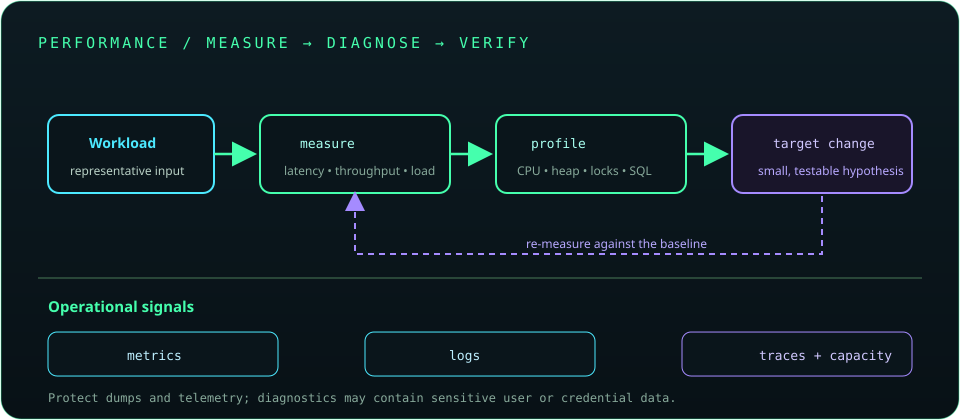

# Chapter 27: Performance, Scalability, and Observability

Performance engineering begins with a measurable objective and representative workload. Diagnose bottlenecks with profiling and telemetry before changing code. Scalability requires bounded resources and capacity planning; observability connects metrics, logs, traces, and runtime evidence to user-visible service behavior.

## 614. Performance measurement

Measure a defined workload, environment, and objective such as latency, throughput, or resource use. Control warm-up, data size, concurrency, and external dependencies so results are comparable.

**Key takeaway:** A performance result is meaningful only with its workload and measurement method.

## 615. CPU and memory profiling

Profilers identify CPU hotspots, allocation rates, retained objects, and blocking behavior. Sampling profilers are often useful in production-like environments; heap profiling and dumps require careful data protection because they may contain sensitive application state.

**Key takeaway:** Profile a representative workload and protect diagnostic artifacts.

## 616. Benchmarking with JMH

JMH is a Java Microbenchmark Harness designed to account for JVM warm-up, compilation, and measurement pitfalls. Use forks, warm-up and measurement iterations, representative inputs, and avoid dead-code elimination.

**Key takeaway:** Use JMH for microbenchmarks and production-like load tests for system behavior.

## 617. Garbage collection tuning

GC tuning considers allocation rate, live set, heap sizing, collector behavior, and pause or throughput goals. Begin with GC logs and JFR evidence, change one relevant setting at a time, and validate under representative load.

**Key takeaway:** Tune from observed GC behavior, not a copied flag set.

## 618. Heap dump analysis

A heap dump captures object and reference information that can reveal retained object graphs and memory leaks. Analyze dominators and retention paths with suitable tools, and store dumps securely because they may expose secrets or personal data.

**Key takeaway:** Find why objects remain reachable and treat heap dumps as sensitive.

## 619. Thread dump analysis

A thread dump snapshots thread states, stacks, and often lock ownership. Repeated dumps can reveal blocked threads, deadlocks, slow operations, or pool starvation; one snapshot may capture only a transient state.

**Key takeaway:** Compare multiple thread dumps and correlate them with workload and logs.

## 620. Lock contention analysis

Lock contention occurs when threads wait to enter synchronized or explicit critical sections. Profilers, JFR, and thread dumps can identify contended locks; reducing shared state or shortening critical sections may improve scalability.

**Key takeaway:** Measure contention before redesigning synchronization.

## 621. Database query optimization

Database optimization examines query plans, indexes, row counts, join behavior, round trips, and connection use. Optimize the query and access pattern measured in the target database, not merely the Java method surrounding it.

**Key takeaway:** Use database execution plans and real query telemetry to guide tuning.

## 622. Caching strategies

Caching can reduce repeated computation or remote access but introduces invalidation, staleness, memory, and stampede risks. Define cache key, expiration, ownership, consistency, and behavior during cache failure.

**Key takeaway:** Cache only measured hot data with an explicit freshness and failure policy.

## 623. Connection pool tuning

Pool sizing balances application concurrency with database capacity and service time. Acquisition timeouts, wait queues, leak detection, and database saturation provide signals; oversized pools can worsen contention rather than increase throughput.

**Key takeaway:** Tune a pool with database limits and request concurrency in view.

## 624. Efficient collections and algorithms

Collection choice and algorithm complexity affect CPU, allocation, and memory use. Prefer data structures whose ordering, access, mutation, and concurrency characteristics match the workload; measure before replacing clear code with complex optimizations.

**Key takeaway:** Choose suitable complexity and data structures, then validate with measurement.

## 625. Latency and throughput

Latency measures time to complete an operation; throughput measures operations completed per unit time. Under load, queueing and saturation can sharply increase tail latency even when average latency appears acceptable.

**Key takeaway:** Monitor latency distributions and throughput together, especially tail percentiles.

## 626. Load testing

Load testing applies an expected workload to measure capacity, latency, error rates, and resource behavior. Model realistic request mix, think time, data, and dependency behavior, and keep the test environment isolated from production users.

**Key takeaway:** Test the workload you expect to serve, not only a single endpoint at maximum speed.

## 627. Stress and endurance testing

Stress testing pushes a system beyond expected load to understand failure and recovery. Endurance testing sustains load to expose leaks, resource exhaustion, or degradation over time.

**Key takeaway:** Record where the system saturates and whether it recovers safely.

## 628. Metrics and alerting

Metrics track time-series signals such as request rate, errors, duration, saturation, and business outcomes. Alerts should target actionable symptoms and service objectives, avoiding noise from transient or non-user-impacting fluctuations.

**Key takeaway:** Alert on meaningful symptoms and provide context for diagnosis.

## 629. Distributed tracing

Tracing correlates spans across services and dependencies to show request paths and time spent. Propagate trace context consistently, choose sampling policies, and avoid capturing sensitive data in attributes.

**Key takeaway:** Traces explain cross-service paths that isolated logs or metrics cannot.

## 630. Production troubleshooting

Production troubleshooting starts with scope, timeline, and user impact, then correlates metrics, logs, traces, deployments, and runtime diagnostics. Mitigate safely first, preserve evidence, and verify recovery before making deeper changes.

**Key takeaway:** Follow evidence, protect the service, and validate each mitigation.

## 631. Capacity planning

Capacity planning estimates demand, resource consumption, scaling limits, and growth under normal and peak workloads. Include dependency quotas, failure headroom, and scaling delay; periodically validate assumptions through load tests and production telemetry.

**Key takeaway:** Plan for peak and degraded conditions, not only average utilization.
