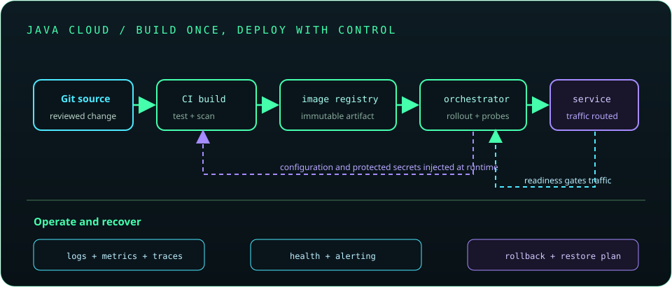

# Chapter 28: DevOps, Deployment, and Cloud-Native Java

Deployment is the repeatable process of building, configuring, releasing, operating, and recovering an application. Containers and orchestration platforms provide useful primitives, but do not replace secure configuration, resource limits, observability, compatibility, or an operational rollback plan.

## 632. Linux fundamentals for Java developers

Java services commonly run on Linux. Be comfortable with files and permissions, processes, signals, pipes, service logs, network inspection, and resource limits; use least privilege rather than running every process as root.

**Key takeaway:** Learn enough Linux to inspect the Java process and its resource and network environment.

## 633. Environment variables and process management

Environment variables provide process-level configuration, while process managers or orchestrators start, stop, restart, and monitor applications. Avoid putting secrets in broadly visible process arguments or diagnostic output.

**Key takeaway:** Define a controlled startup, shutdown, signal-handling, and configuration path.

## 634. Docker fundamentals

Docker builds and runs applications in container images with isolated process and filesystem views. A container shares the host kernel; it is not a virtual machine and should be treated as an application packaging and execution boundary.

**Key takeaway:** Containers package processes; they do not remove host or application security responsibilities.

## 635. Containerizing Java applications

A Java container should use a maintained base image, a non-root user, a predictable entry point, and explicitly configured resource limits. Keep logs on standard output/error and persist required data outside the ephemeral container filesystem.

**Key takeaway:** Design the application for replaceable instances and externalized state.

## 636. Docker images and multi-stage builds

Multi-stage builds compile or package in a build stage and copy only required artifacts into a smaller runtime stage. Pin base images thoughtfully, scan them, and rebuild regularly for security updates.

**Key takeaway:** Separate build tooling from the minimal runtime image.

## 637. Docker Compose

Docker Compose describes a local multi-container environment such as an application, database, and message broker. Use health checks, named networks, volumes, and non-production credentials; Compose is not a substitute for production orchestration policy.

**Key takeaway:** Make local dependencies reproducible without embedding real secrets.

## 638. Kubernetes fundamentals

Kubernetes orchestrates containerized workloads using objects such as Pods, Deployments, Services, and ConfigMaps. The control plane reconciles desired state, while resource requests, limits, scheduling, and health probes shape runtime behavior.

**Key takeaway:** Understand the declarative objects and failure model before deploying workloads.

## 639. Deployments, services, and configuration

A Deployment manages replica Pods and rollout state; a Service provides a stable network endpoint for selected Pods. Configuration can be injected through environment variables, mounted files, or platform-specific mechanisms.

**Key takeaway:** Separate stable service discovery from replaceable Pod addresses.

## 640. Secrets and config maps

ConfigMaps hold non-secret configuration; Kubernetes Secrets hold sensitive values but are not automatically safe without access controls, encryption-at-rest configuration, and careful handling. Restrict permissions and prefer an appropriate external secret manager where available.

**Key takeaway:** A resource named Secret still needs encryption, access control, and rotation.

## 641. Health checks and readiness probes

Liveness checks determine whether a container should be restarted; readiness checks determine whether it should receive traffic; startup probes protect slow-starting applications. A health endpoint should report meaningful conditions without triggering expensive dependency work on every probe.

**Key takeaway:** Readiness and liveness answer different operational questions.

## 642. CI/CD pipelines

Continuous integration builds and verifies changes frequently; continuous delivery or deployment automates promotion toward release. Pipelines should use protected credentials, immutable artifacts, auditable approvals where needed, and explicit failure handling.

**Key takeaway:** Automate the path from reviewed source to a verifiable deployed artifact.

## 643. Automated build and test pipelines

A Java pipeline can run compilation, unit and integration tests, static analysis, dependency checks, packaging, and image scanning. Cache dependencies carefully, preserve test reports, and fail when required verification fails.

**Key takeaway:** CI should repeat the same checks developers rely on locally.

## 644. Artifact repositories

Artifact repositories store versioned build outputs and dependencies for controlled sharing and deployment. Use immutable coordinates, access controls, retention policies, checksums or signatures, and provenance information.

**Key takeaway:** Promote the same verified artifact between environments instead of rebuilding it.

## 645. Cloud deployment fundamentals

Cloud deployment uses provider-managed compute, networking, storage, identity, and monitoring. Understand service limits, regions, availability zones, cost models, and responsibility boundaries for each managed service.

**Key takeaway:** Cloud services shift operational responsibilities; they do not eliminate them.

## 646. Cloud databases and managed services

Managed databases provide operational capabilities such as backups, patching, and failover, with provider-specific limits and connection behavior. Secure endpoints, size pools to service capacity, and test backup restoration rather than relying only on backup status.

**Key takeaway:** Validate managed-service limits and recovery paths against application needs.

## 647. Infrastructure as code concepts

Infrastructure as code describes resources and configuration in reviewable, repeatable definitions. Manage state securely, review plans before applying, separate environments, and avoid embedding secrets in code or state files.

**Key takeaway:** Treat infrastructure changes as code changes with review, testing, and rollback plans.

## 648. Logs, metrics, and traces in production

Logs capture events, metrics summarize behavior over time, and traces connect work across services. Correlate them with request identifiers while applying access, retention, and redaction controls.

**Key takeaway:** Observability should explain service behavior without exposing sensitive data.

## 649. Zero-downtime deployment strategies

Rolling, blue-green, and canary strategies gradually move traffic between application versions. They depend on backward-compatible API and schema changes, health checks, sufficient capacity, and a clear rollback decision.

**Key takeaway:** Zero-downtime is a system property that includes data and client compatibility.

## 650. Rollbacks and disaster recovery

Rollback restores a prior application or configuration version; disaster recovery restores service and data after a larger outage. Define recovery time and recovery point objectives, test restore procedures, and plan for irreversible schema or data changes.

**Key takeaway:** A recovery plan is credible only after it has been exercised.

## 651. Cloud-native Java considerations

Cloud-native Java applications should start and stop predictably, handle termination signals, expose health and telemetry, externalize state, and respect CPU and memory limits. Validate JVM heap and native-memory behavior within the container's actual resource budget.

**Key takeaway:** Tune the Java runtime for its real container environment and lifecycle.
