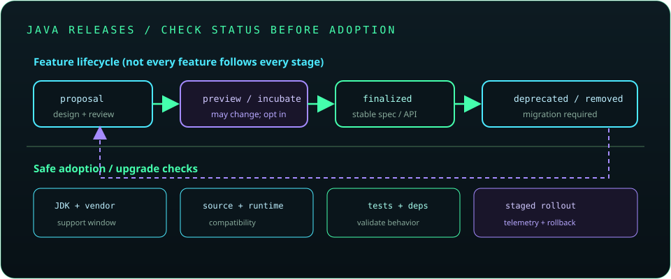

# Chapter 29: Modern Java and the Latest Language Features

Java evolves on a regular release cadence, so “modern Java” depends on the target JDK. Check the feature's finalization status, source and runtime compatibility, and release notes before adopting it. Prefer finalized language and API features for production unless preview use is an intentional, controlled choice.



## 652. Java release model and LTS versions

Java ships feature releases on a regular cadence, and some releases receive long-term support from vendors. LTS status and support duration depend on the vendor and distribution; choose a version based on support policy, ecosystem compatibility, and operational needs.

**Key takeaway:** Identify both the JDK version and its vendor support lifecycle.

## 653. Modern Java syntax and APIs

Modern Java includes records, pattern matching, switch expressions, improved collection APIs, and evolving concurrency features. Adopt features that improve clarity and verify that the build's source level and deployment runtime support them.

**Key takeaway:** Use newer language features to express intent, not simply because they are new.

## 654. Records and record patterns

Records provide concise immutable data carriers with generated component accessors, equality, and constructors. Record patterns can destructure record values in supported language contexts; they do not make nested referenced objects deeply immutable.

```java
record Point(int x, int y) {}
```

**Key takeaway:** Records suit transparent data, while invariants and mutable components still need deliberate design.

## 655. Sealed classes and interfaces

Sealed types restrict which classes or interfaces may directly extend or implement them using `permits`. They make a domain hierarchy explicit and can help a compiler reason about exhaustive pattern handling.

**Key takeaway:** Seal a hierarchy when its permitted variants are intentionally controlled.

## 656. Pattern matching for `instanceof`

Pattern matching for `instanceof` combines a type test with a safely scoped pattern variable, reducing repeated casts.

```java
if (value instanceof String text) {
    System.out.println(text.length());
}
```

**Key takeaway:** Pattern variables are only in scope where the type test guarantees the match.

## 657. Pattern matching in `switch`

Pattern matching in `switch` selects behavior by type and can use guards in supported releases. Exhaustiveness depends on the selector type and language rules; verify behavior under the project's source level.

**Key takeaway:** Use type patterns when they make a closed set of variants clearer than nested conditionals.

## 658. Switch expressions

Switch expressions produce a value and can use arrow labels and `yield` for block results. They reduce accidental fall-through compared with traditional statement switches.

```java
String label = switch (status) {
    case 200 -> "ok";
    case 404 -> "missing";
    default -> "other";
};
```

**Key takeaway:** Switch expressions make result-producing branch logic explicit.

## 659. Text blocks

Text blocks provide readable multi-line string literals using triple quotes. They normalize line terminators and apply incidental indentation rules, so inspect the resulting string when whitespace is significant.

**Key takeaway:** Use text blocks for readable embedded text, not as an implicit escaping or templating system.

## 660. Local variable type inference

`var` infers a local variable's static type from its initializer; it does not make the variable dynamically typed. It is limited to local declarations and should be used when the inferred type remains clear to readers.

**Key takeaway:** Use `var` to remove redundant type spelling, not meaningful type information.

## 661. Modern `Stream` API enhancements

The Stream API has gained operations and convenience methods across Java releases. Check the target JDK before using newer methods and remember that streams are single-use pipelines with lazy intermediate operations.

**Key takeaway:** Confirm API availability and preserve clear, side-effect-light pipelines.

## 662. Sequenced collections

Sequenced collection interfaces provide a common model for collections with defined encounter order, including operations for first/last elements and reversed views. Availability starts in recent Java releases, so use only when the deployment baseline supports them.

**Key takeaway:** Sequenced APIs express ordering capabilities without assuming every collection is ordered.

## 663. Virtual threads

Virtual threads are lightweight threads suited to large numbers of tasks that mostly wait on blocking operations. They do not speed up CPU-bound work and do not increase database, network, or downstream capacity.

**Key takeaway:** Virtual threads simplify concurrency, while resource limits and cancellation still matter.

## 664. Structured concurrency

Structured concurrency groups related child tasks under a bounded parent scope, helping with joining, cancellation, and failure propagation. APIs have progressed through preview/incubator stages across releases; check the exact target JDK and status before use.

**Key takeaway:** Structured task lifetimes make concurrency easier to reason about, but release status matters.

## 665. Scoped values

Scoped values provide a structured way to share immutable context across a bounded call tree, as an alternative to some uses of thread-local state. Their API status has changed across JDK releases; check the current documentation and compatibility level.

**Key takeaway:** Use scoped context deliberately and avoid assuming a preview API is stable.

## 666. Foreign Function and Memory API

The Foreign Function and Memory (FFM) API provides safer, structured access to native memory and foreign functions than older JNI patterns. Its capabilities and finalization status depend on JDK version; native access still carries safety and portability risks.

**Key takeaway:** FFM reduces boilerplate but does not remove native memory and ABI risks.

## 667. Vector API

The Vector API expresses data-parallel operations that a runtime may map to hardware vector instructions. It has evolved as an incubating API; benchmark realistic workloads and check portability and release status before depending on it.

**Key takeaway:** Vector code needs measured benefit and careful JDK-version management.

## 668. Java platform modules

The Java Platform Module System defines named modules, explicit dependencies, and exported packages. `module-info.java` can improve encapsulation and startup structure, but migration of large classpath applications requires dependency analysis.

**Key takeaway:** Use modules when explicit boundaries and encapsulation provide practical value.

## 669. Modern garbage collectors

Modern JDKs provide collectors with different throughput, pause-time, and footprint trade-offs. Availability, defaults, and tuning options vary by JDK and vendor; measure the actual service-level goal.

**Key takeaway:** Select and tune collectors from observed workload behavior.

## 670. Java compiler and runtime improvements

Java releases improve compiler diagnostics, runtime performance, garbage collection, security, and APIs. Benefits depend on workload and configuration; test the upgraded runtime rather than assuming every application improves identically.

**Key takeaway:** Runtime upgrades are valuable maintenance, but require compatibility and performance validation.

## 671. Preview features versus finalized features

Preview features require explicit enablement and may change or disappear in later releases; incubator APIs are also explicitly experimental. Finalized features have stable specifications, though APIs can still evolve or be deprecated.

**Key takeaway:** Treat preview and incubator use as an intentional compatibility commitment.

## 672. Java release notes and migration guides

Release notes, JEPs, vendor support matrices, and migration guides describe changes, removals, defaults, and compatibility concerns. Review them for each target upgrade and test compiler warnings and runtime behavior.

**Key takeaway:** Read release-specific documentation instead of relying on remembered version summaries.

## 673. Compatibility and deprecation management

Compatibility includes source, binary, behavioral, serialization, and operational compatibility. Deprecation warns that an API may be removed or discouraged; track replacements and plan migrations before upgrades force them.

**Key takeaway:** Treat deprecation warnings as migration work with tested replacements.

## 674. Upgrading Java applications safely

Upgrade through supported JDK steps, update build plugins and dependencies, run unit and integration tests, scan runtime flags and removed APIs, and test production-like performance. Roll out gradually with telemetry and a rollback plan.

**Key takeaway:** A safe Java upgrade is a staged, observable change across the entire toolchain.
