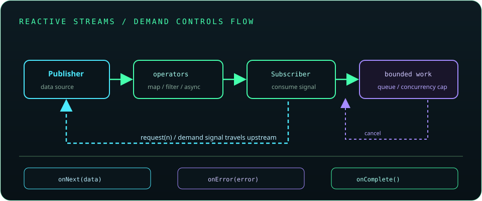

# Chapter 30: Reactive and Asynchronous Java

Asynchronous and reactive programming can improve concurrency and composability, particularly for I/O-heavy workloads, but introduce scheduling, cancellation, context propagation, and debugging complexity. Use a coherent model end to end and preserve backpressure so producers cannot overwhelm consumers.

## 675. Synchronous versus asynchronous programming

Synchronous calls complete before the caller continues; asynchronous operations return before completion and communicate results later. Async execution can improve responsiveness, but adds lifecycle, failure, and cancellation handling.

**Key takeaway:** Asynchrony changes when results arrive, not whether work consumes resources.

## 676. `CompletableFuture` in depth

`CompletableFuture` composes completion stages for values, transformations, combinations, and recovery. Async methods may use a shared common pool unless an executor is supplied; blocking work should use an appropriate bounded execution resource.

**Key takeaway:** Compose futures and handle exceptions and executors explicitly.

## 677. Reactive programming fundamentals

Reactive programming models data and events as asynchronous sequences with operators for transformation and composition. It can simplify streams of values over time, but requires disciplined subscription, cancellation, and error handling.

**Key takeaway:** Reactive operators should preserve clear ownership of subscriptions and failures.

## 678. Reactive Streams specification

Reactive Streams defines interoperable interfaces for publishers, subscribers, subscriptions, and processors, including demand signaling. Java's `Flow` API uses closely related concepts; libraries such as Reactor implement the specification.

**Key takeaway:** The protocol coordinates demand and signals between asynchronous stages.

## 679. Backpressure

Backpressure lets a consumer signal how many elements it can currently accept. It prevents uncontrolled buffering when producers are faster than downstream processing.

**Key takeaway:** Bound queues and request rates so overload is controlled instead of accumulated.

## 680. Project Reactor

Project Reactor is a reactive library commonly used with Spring. Its `Mono` and `Flux` types describe asynchronous publishers, and operators build pipelines that execute when subscribed to.

**Key takeaway:** Understand subscription and scheduler boundaries; assembling a pipeline does not necessarily execute it.

## 681. Mono and Flux

`Mono<T>` represents zero or one value, while `Flux<T>` represents zero to many values. Both signal completion or error and support operators; neither should be treated as a simple eager container.

**Key takeaway:** Choose the publisher cardinality that matches the contract.

## 682. Reactive error handling

Reactive errors are terminal signals in a stream unless an operator handles or transforms them. Recovery operators can provide fallback behavior, but should not silently convert failures into success-shaped values.

**Key takeaway:** Preserve error meaning and make retry or fallback policy explicit.

## 683. Spring WebFlux

Spring WebFlux supports reactive web applications on non-blocking runtimes and also offers a reactive programming model. Blocking calls on event-loop threads can harm throughput; isolate unavoidable blocking work appropriately.

**Key takeaway:** Use a non-blocking stack end to end when its concurrency model is needed.

## 684. Reactive database access concepts

Reactive database access requires a driver and database protocol that support non-blocking I/O; wrapping blocking JDBC calls in a reactive type does not make them non-blocking. Transactions, connection pools, and backpressure must match the data-access implementation.

**Key takeaway:** Verify the driver is actually reactive before designing a non-blocking persistence path.

## 685. Reactive versus traditional thread-per-request systems

Thread-per-request systems are straightforward and can work well, especially with virtual threads for blocking I/O. Reactive systems can handle many concurrent I/O operations with fewer platform threads but require non-blocking dependencies and more specialized debugging.

**Key takeaway:** Choose based on workload, dependencies, team experience, and measured resource needs.

## 686. Testing asynchronous and reactive code

Test eventual results, errors, cancellation, timeouts, and ordering with deterministic tools such as Reactor's `StepVerifier` or controlled executors. Avoid arbitrary sleeps that create flaky timing assumptions.

**Key takeaway:** Control scheduling and assert signals instead of guessing with delays.
