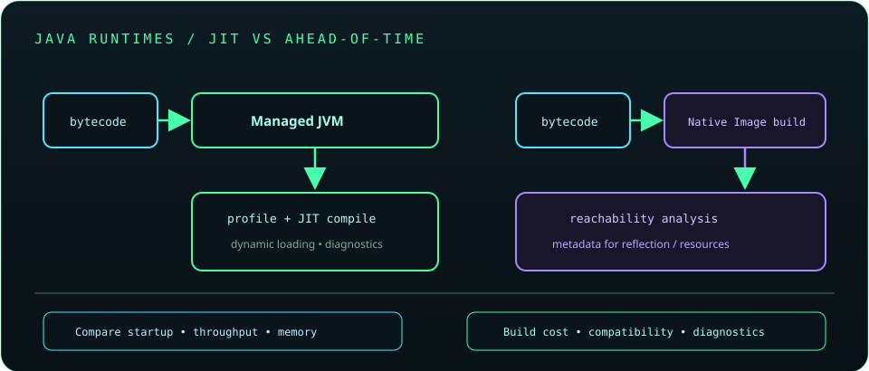

# Chapter 31: GraalVM and Modern Runtime Technologies

GraalVM provides runtime technologies for Java and other languages, including a native-image compiler. Ahead-of-time native executables can reduce startup time or memory for suitable services but impose build, compatibility, reflection, and observability trade-offs. Benchmark the deployed workload before choosing a runtime.

## 687. GraalVM overview

GraalVM is a distribution and technology ecosystem that includes a Java runtime and additional compiler and language capabilities. Available features depend on the specific GraalVM distribution, release, and licensing terms.

**Key takeaway:** Check the exact runtime distribution and feature support rather than assuming every GraalVM build is identical.

## 688. JIT compilation concepts

Just-in-time compilation uses runtime profiling to optimize frequently executed code. It can adapt to actual execution patterns, but warm-up and optimization decisions affect startup and steady-state behavior.

**Key takeaway:** Evaluate both warm-up and steady-state performance for long-running workloads.

## 689. Native Image

Native Image analyzes reachable application code and builds a native executable ahead of runtime. Closed-world analysis can require explicit metadata for reflection, resources, proxies, and dynamic class loading.

**Key takeaway:** Native Image trades some dynamic behavior for build-time reachability and deployment characteristics.

## 690. Ahead-of-time compilation

Ahead-of-time compilation produces machine code before deployment, potentially reducing startup work. It may increase build time and constrain dynamic runtime behavior; results depend on application shape and target platform.

**Key takeaway:** Compare startup, throughput, build cost, and portability rather than optimizing one metric alone.

## 691. Reflection configuration for native images

Reflection configuration describes types, constructors, methods, resources, or proxies that static analysis cannot infer. Framework metadata hints and build-time analysis can reduce manual setup, but runtime testing remains necessary.

**Key takeaway:** Exercise reflection-heavy paths in native-image tests and keep metadata aligned with code.

## 692. Native executable builds

Native builds require a compatible toolchain and target environment, and can be more resource-intensive than ordinary Java compilation. Reproduce builds in CI, record the compiler and platform, and test the actual executable artifact.

**Key takeaway:** Build reproducibility and target-platform testing are essential for native artifacts.

## 693. Startup time and memory optimization

Native executables may improve startup and some memory profiles, especially for short-lived workloads, but can have different peak memory, compilation cost, or throughput. Measure cold start, steady state, and total deployment cost.

**Key takeaway:** Optimize the workload's real startup and memory objective, not assumptions about runtime type.

## 694. Java interoperability with other languages

GraalVM can support polyglot interoperability through language runtimes and APIs when those components are available. Crossing language boundaries has data conversion, security, performance, and deployment implications.

**Key takeaway:** Grant polyglot code only the host access it needs and measure boundary costs.

## 695. Native deployment trade-offs

Native deployment can simplify runtime packaging and improve startup, while reducing dynamic class-loading flexibility and requiring target-specific builds and metadata. Debugging, profiling, and library compatibility should be assessed for the chosen distribution.

**Key takeaway:** Choose native deployment only when its benefits justify its operational constraints.

## 696. Java performance across runtime environments

Compare JVM and native execution using equivalent inputs, resource limits, warm-up policies, and service objectives. Include throughput, tail latency, memory, startup, build time, and diagnostic capability.

**Key takeaway:** Runtime choice is a measured deployment decision, not a universal ranking.
