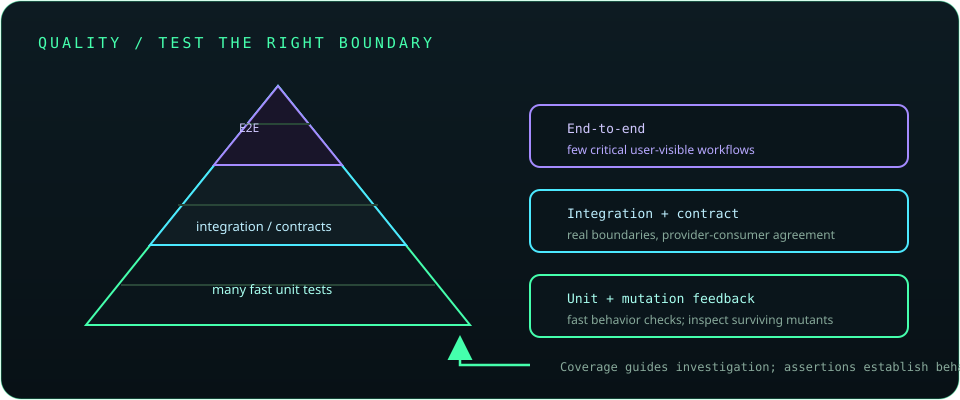

# Chapter 32: Advanced Testing and Quality Engineering

Quality engineering combines multiple test levels, automation, and feedback to reduce risk. Choose test scope based on the behavior under test: mocks are fast for isolated logic, while contracts and integration environments verify real boundaries. Coverage and mutation results are evidence, not substitutes for good assertions.

## 697. Unit, integration, and end-to-end testing

Unit tests focus on small behavior, integration tests verify cooperating components and boundaries, and end-to-end tests exercise complete user-visible flows. Broader tests tend to cost more and fail for more environmental reasons.

**Key takeaway:** Use many focused tests and a smaller set of high-value broad tests.

## 698. Test doubles and test isolation

Test doubles include stubs, fakes, spies, and mocks, each with different behavior and verification goals. Isolate tests from shared state, time, network, and file-system variability when those factors are not part of the contract.

**Key takeaway:** Choose the simplest test double that makes the scenario reliable.

## 699. Mockito advanced usage

Mockito supports argument captors, answers, spies, strict stubbing, and verification modes. Advanced mocking can create brittle tests; prefer explicit collaborators and real value objects over mocking types the code owns.

**Key takeaway:** Verify meaningful interactions and avoid overspecifying call sequences.

## 700. Contract testing

Contract tests verify that a provider and consumer agree on request, response, and message expectations. Consumer-driven contracts can catch compatibility breaks before deployment, but do not replace end-to-end or provider behavior tests.

**Key takeaway:** Test contracts at service boundaries and version them with the participating systems.

## 701. API integration testing

API integration tests start or connect to the real web layer and verify routing, serialization, validation, security, and response behavior. Use isolated test configuration and avoid relying on production credentials or shared mutable data.

**Key takeaway:** Exercise the actual HTTP boundary for behavior unit tests cannot prove.

## 702. Testcontainers

Testcontainers starts disposable services such as databases and brokers for integration tests. Pin image versions, wait for readiness, control resource use, and clean up containers; ensure CI can run the required container runtime.

**Key takeaway:** Reproducible disposable dependencies improve integration fidelity.

## 703. Database integration testing

Database integration tests validate SQL, mappings, migrations, constraints, and transaction behavior against a real engine. An in-memory substitute may behave differently from production and should not be the only evidence for vendor-specific behavior.

**Key takeaway:** Test against the database engine and migration path that production will use.

## 704. Concurrency testing

Concurrency tests exercise races, visibility, cancellation, and liveness under controlled coordination. Use barriers, latches, stress frameworks, and repeated execution rather than relying on sleeps or a single lucky run.

**Key takeaway:** Timing-based bugs need repeated, deliberate tests and clear invariants.

## 705. Performance and load testing

Performance tests measure latency, throughput, resource use, and saturation under defined workloads. Keep baselines and environment metadata, separate microbenchmarks from system load tests, and set thresholds from service objectives.

**Key takeaway:** Performance checks should be repeatable and tied to a realistic objective.

## 706. Mutation testing

Mutation testing changes code in small ways and checks whether tests detect those changes. Surviving mutants can reveal weak assertions or untested logic; equivalent mutants and tool limitations require manual interpretation.

**Key takeaway:** Mutation scores are diagnostic signals, not a goal to maximize blindly.

## 707. Code coverage interpretation

Coverage reports indicate which lines, branches, or instructions ran during tests. They do not prove assertions were meaningful or that all important scenarios were exercised.

**Key takeaway:** Use coverage to find gaps, then assess behavior quality and risk.

## 708. Continuous testing in CI/CD

Continuous testing runs suitable checks as code changes move through build and release stages. Keep fast feedback early, isolate environment-dependent suites, preserve test results, and make failures block unsafe promotion.

**Key takeaway:** Put the right test at the earliest stage that can run it reliably.

## 709. Regression testing

Regression tests preserve behavior after a defect is fixed or code is changed. A focused regression case should fail before the fix and pass afterward, with broader suites providing additional confidence.

**Key takeaway:** Turn important discovered failures into repeatable tests.

## 710. Testing microservices and distributed workflows

Distributed tests cover service contracts, asynchronous delivery, retries, idempotency, partial failures, and eventual consistency. Prefer deterministic test environments and verify recovery behavior rather than only the happy path.

**Key takeaway:** Test duplicate, delayed, and failed communication as normal workflow conditions.
