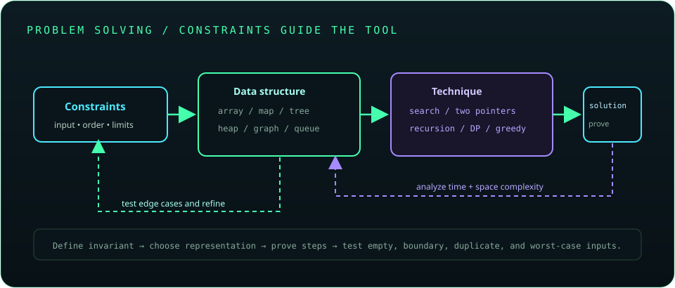

# Chapter 33: Data Structures, Algorithms, and Problem Solving

Algorithmic problem solving begins by clarifying inputs, outputs, constraints, and edge cases. Choose a data structure that supports the needed operations, estimate time and space complexity, then verify correctness with small examples and adversarial tests.



## 711. Big-O notation

Big-O describes an asymptotic upper growth bound as input size increases, ignoring constant factors and lower-order terms. It helps compare scalability but does not predict exact runtime for a specific machine or small input.

**Key takeaway:** Big-O compares growth, not absolute performance.

## 712. Time and space complexity

Time complexity estimates operation growth; space complexity estimates additional memory growth. Analyze worst-case, average-case, or amortized behavior explicitly, and include recursion stack or auxiliary structures where relevant.

**Key takeaway:** State the input dimension and complexity case you are analyzing.

## 713. Arrays and strings problem-solving

Arrays provide indexed access and contiguous storage; strings are immutable sequences with language-specific encoding considerations. Common approaches include prefix sums, frequency counts, sorting, and two-pointer scans.

**Key takeaway:** Clarify bounds, empty input, duplicate values, and character assumptions before coding.

## 714. Linked lists

Linked lists connect nodes by references and support local insertion when a node is known, but indexed lookup requires traversal. Singly and doubly linked forms trade memory for navigation and update options.

**Key takeaway:** Use a linked list when its insertion/removal behavior matters more than indexed access and locality.

## 715. Stacks and queues

A stack uses last-in-first-out order; a queue uses first-in-first-out order. They support patterns such as parsing, depth-first traversal, scheduling, and breadth-first search.

```java
var stack = new java.util.ArrayDeque<Integer>();
stack.push(10);
int value = stack.pop();
```

**Key takeaway:** Choose the ordering discipline that matches the algorithm.

## 716. Hash tables

Hash tables map keys to buckets using hash codes and equality. Expected operations can be near constant time under suitable hashing, while collisions and resizing affect costs; key equality and hash codes must remain consistent.

**Key takeaway:** Use immutable or stable keys and implement `equals()`/`hashCode()` correctly.

## 717. Trees and binary search trees

Trees model hierarchical relationships; a binary search tree orders keys so lookup can be efficient when balanced. Unbalanced trees can degrade to linear height; self-balancing variants maintain stronger performance bounds.

**Key takeaway:** Tree shape determines operation complexity.

## 718. Heaps and priority queues

A heap maintains a partial order that supports retrieving the minimum or maximum efficiently. Java's `PriorityQueue` is a min-heap by default and is useful for scheduling, top-k selection, and graph algorithms.

**Key takeaway:** A heap efficiently exposes the priority element but does not keep all elements fully sorted.

## 719. Graphs

Graphs model vertices and edges, directed or undirected, weighted or unweighted. Adjacency lists are often space-efficient for sparse graphs; adjacency matrices can be useful for dense graphs or constant-time edge checks.

**Key takeaway:** Choose graph representation based on density and required operations.

## 720. Searching and sorting algorithms

Searching includes linear scan and binary search on sorted data. Sorting algorithms trade time, space, stability, and worst-case guarantees; use Java library sorting unless learning or specialized constraints require implementing one.

**Key takeaway:** Binary search requires a correctly ordered search space and careful boundary invariants.

## 721. Recursion and backtracking

Recursion solves a problem by reducing it to smaller cases with a base condition. Backtracking explores candidate choices and undoes state when a branch fails; recursion depth and repeated work may require pruning or iteration.

**Key takeaway:** Define progress, base cases, and state restoration explicitly.

## 722. Greedy algorithms

Greedy algorithms choose a locally optimal option at each step. They are correct only when the problem has a property that makes local choices globally optimal, which should be proved or supported by a known exchange argument.

**Key takeaway:** A plausible greedy choice is not a correctness proof.

## 723. Dynamic programming

Dynamic programming stores results of overlapping subproblems with memoization or tabulation. Define state, recurrence, base cases, and evaluation order; complexity depends on the number and cost of states.

**Key takeaway:** Start from a clear recurrence before optimizing memory or implementation.

## 724. Two-pointer and sliding-window techniques

Two-pointer algorithms move indices through an ordered or structured input; sliding windows maintain a range while updating its summary. Correctness depends on the condition that permits moving one boundary without losing valid answers.

**Key takeaway:** Identify the invariant that makes pointer movement safe.

## 725. Java-specific coding interview patterns

Java problem solving benefits from standard collections, comparator contracts, primitive overflow awareness, input parsing, and clear method decomposition. Explain assumptions and complexity, test edge cases, and avoid relying on unspecified iteration order.

**Key takeaway:** Combine algorithm reasoning with precise Java API and type behavior.
