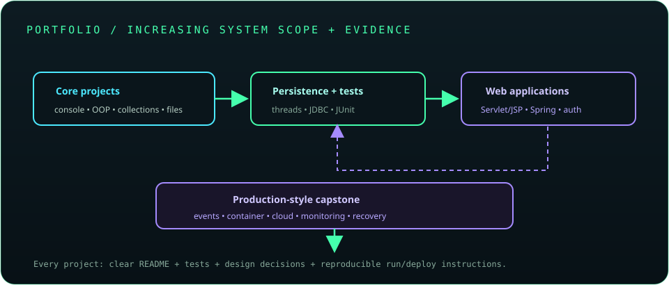

# Chapter 34: Projects and Portfolio

A portfolio demonstrates that you can build, test, explain, and operate software—not merely list technologies. Select projects with clear users and scope, keep code reviewable, document setup and design decisions, and show evidence through tests, screenshots, API examples, and deployment.

## 726. Console-based utility application

Build a focused command-line utility such as a task tracker, log analyzer, or file organizer. Include argument parsing, helpful errors, input validation, and a README with examples.

**Key takeaway:** A small finished utility is stronger than a large unfinished feature list.

## 727. Object-oriented management system

Create a domain-oriented management application, such as a library or course registry, with clear entities, services, validation, and encapsulated state. Demonstrate behavior with tests and explain important model decisions.

**Key takeaway:** Show cohesive object design and enforce domain invariants.

## 728. Collections-based inventory system

Implement inventory operations using maps, sets, and lists chosen for their access and ordering behavior. Include duplicate handling, stock constraints, reports, and tests for boundary cases.

**Key takeaway:** Explain why each collection fits its use case.

## 729. File-based record manager

Build a record manager that reads and writes a documented file format with explicit charset, safe parsing, backups or atomic replacement where appropriate, and clear handling of malformed records.

**Key takeaway:** Treat files as external data with compatibility and failure concerns.

## 730. Multithreaded processing application

Build a bounded batch processor that reads work, submits tasks to an executor, handles cancellation and failures, and writes results deterministically. Compare sequential and concurrent behavior with measurements.

**Key takeaway:** Demonstrate concurrency with bounded queues and explicit shutdown.

## 731. JDBC CRUD application

Create a small database-backed application with migrations, a `DataSource`, prepared statements or a JPA repository, validation, transaction boundaries, and integration tests against a real database.

**Key takeaway:** Show safe persistence and schema evolution, not only CRUD endpoints.

## 732. JUnit-tested Java library

Publish a small reusable library with a focused API, unit and edge-case tests, Javadoc, versioning, and a build pipeline. Include examples that demonstrate intended usage and compatibility.

**Key takeaway:** A library project should communicate and protect its public contract.

## 733. Servlet/JSP MVC application

Build a legacy-style MVC application with servlets, services, repositories, JSP EL/JSTL views, server-side validation, and secure session handling. Clearly document the container and Servlet/JSP versions used.

**Key takeaway:** Demonstrate the pattern while keeping business logic out of JSP scriptlets.

## 734. Spring Boot REST API

Create a Spring Boot API with DTOs, validation, consistent errors, persistence, OpenAPI documentation, and integration tests. Include local setup instructions and a runnable profile that does not require production secrets.

**Key takeaway:** Treat the API as a documented, testable contract.

## 735. Spring Boot application with authentication

Extend an application with secure authentication and authorization, adaptive password hashing or a vetted identity provider, role or permission checks, and protected tests. Never include real credentials or signing keys in the repository.

**Key takeaway:** Prove object-level authorization and safe credential handling in tests.

## 736. Database-backed full-stack application

Build a user-facing application with a frontend, backend API, database schema, validation, and deployment configuration. Document the data model and run the full stack locally through a reproducible environment.

**Key takeaway:** Demonstrate how client, API, and persistence contracts fit together.

## 737. Event-driven application using a message broker

Create a producer-consumer workflow with a broker, versioned event schema, idempotent processing, retry and dead-letter behavior, and observable message outcomes.

**Key takeaway:** Show safe handling of duplicate, delayed, and failed message delivery.

## 738. Containerized microservice

Package a service in a minimal non-root container with health checks, resource limits, external configuration, and a Compose or orchestration deployment. Document image build and security scanning steps.

**Key takeaway:** Demonstrate deployability and operational boundaries, not only a Dockerfile.

## 739. Cloud-deployed production-style application

Deploy an application with protected configuration, TLS, health and readiness checks, logs, metrics, backups, and a tested rollback path. Include architecture and cost assumptions without exposing provider credentials.

**Key takeaway:** A credible deployment includes security, monitoring, and recovery documentation.

## 740. Final capstone project with documentation, tests, and deployment

Choose a problem with a clear user and bounded scope. Deliver architecture notes, a reliable build, automated tests, security decisions, deployment instructions, observability, and a demo; record trade-offs and follow-up work.

**Key takeaway:** The capstone should be reproducible and understandable by someone who did not build it.
